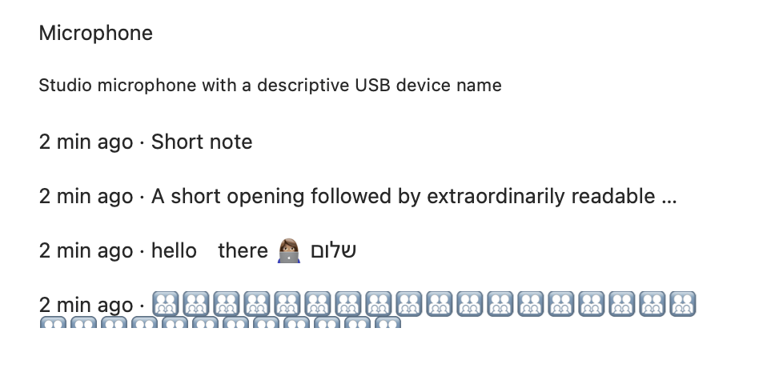
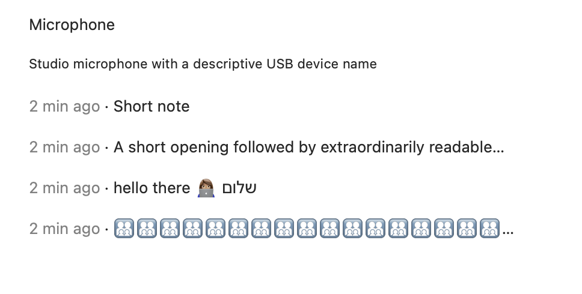
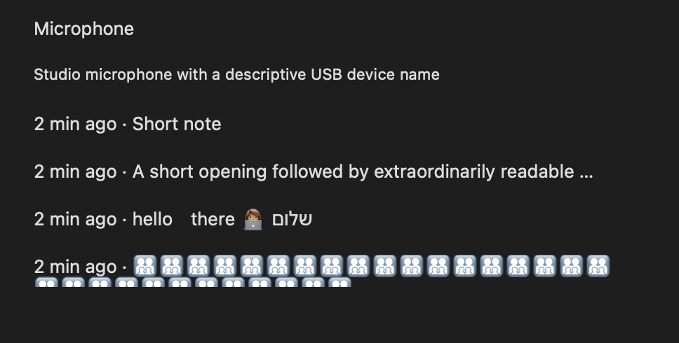
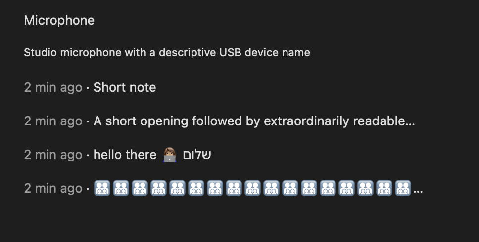

# X9 menu title proof

Synthetic data only. Base: `88eff22fb1d1e51fa882770535aad9528eb54655`.

`before/` and `after/` are offscreen AppKit typography specimens from the actual
`NSMenuItem` title, attributed-title and subtitle values in light and dark
appearance. They do **not** open or capture a native menu; native menu geometry,
highlighted rows, keyboard navigation and installed-app acceptance remain for the
captain's real-app QA. No audio, pointer, preferences or resident sockets used.

| Before | After |
| --- | --- |
|  |  |
|  |  |

Regenerate with `VOICEBAR_MENU_TITLE_SHOTS=<output directory>` and the
`ContextMenuTitleArtifactTests` Swift filter. Run heavy commands through the lane's
heavy-job guard.

Fail-first result with the new formatting tests on the base: 14 tests, 9 assertion
failures. Fixed formatting: 14 tests, zero failures. The optional artifact case is
one additional test. Tests preserve menu item order and action routing, exercise
short/long transcripts, whitespace, Hebrew, emoji and long microphone names.
