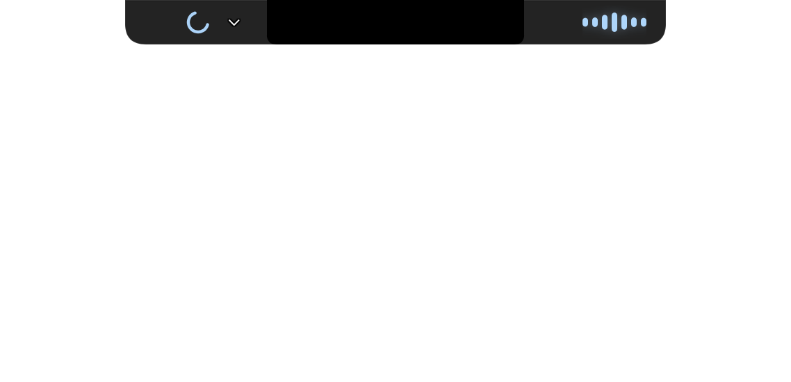

# Notch spacing proof

Synthetic, offscreen macOS AppKit renders of the production BarView. No microphone, live dictation,
installed-app replacement or daily screen capture was used. These images prove static placement;
they do not establish installed-app or native-glass readiness.

| State | Before: f5994253 | After: this commit |
| --- | --- | --- |
| Recording |  |  |
| Transcribing |  |  |

## Changes and measurements

- C7-W (`5f2ef7cf`) increased recording time-to-meter spacing from 4 to 8 pt.
  Restore the 4 pt spacing from `v2.3.0` while keeping the 80 pt row reservation, timer position and shell.
  In these 2x images, red-meter painted x bounds move from 838–929 to 830–921: exactly 4 pt inward.
- c9-P (`7cdc6414`, then `881cbe8a` for held wings) widened and retained the processing wing.
  The two-slot row places the spinner 13 pt farther from the core than the single centred spinner
  in `v2.3.0`; the microphone had been added in `780e40ac`.
  Keep the 102 pt wing and 389 pt band, put the spinner nearest the notch, and put the microphone
  one recording-control pitch outside it. The live hit target follows the microphone.
- The historical placement reconstruction measures a 36.066388 pt spinner-centre distance from the core.
  Base measures 49.066388; after measures 36.066388. This reconstructs the old placement, not its binary.
  The nominal spinner slot inset is 26.5 pt; the nominal centre distance is 36.5 pt.
  The 6 pt layout gap uses `compactControlSpacing`, the recording controls' existing constant.
  Optical bounds are distinct from slot padding and depend on the spinner's rotation.

## Verification

`TranscribingRippleTests/testNotchRegression` fails on unmodified f5994253 production:
clock-to-meter 8 vs 4 pt; spinner-core distance 49.066388 vs 36.066388 pt.
The corrected production passes both; the approved microphone-order gap check also passes.
All six existing band-width assertions remain unchanged.

The affected UI/presentation/app-configuration filter passed 307 tests with zero failures and five skips.
Three skips are unavailable native glass-text readability coverage; two are opt-in artifact writers.
The after-render test passed 1/1. Compiler warnings remain in the retained local logs.

Eleven affected formal model receipts were re-recorded through `tlc_guarded.sh`.
`python3 -B formal/verify-receipts.py` must print `PASS: all local TLC receipts match current inputs`.
Earlier resource-floor interruptions and expected-failure model configurations remain recorded locally.

GIF: none: no animation or interaction changed

Review target: `integration/2.4.2`. Push and review are owned by the lead; per-PR corpus is deferred
by the integration release workflow. Installed-app acceptance remains a release gate.
