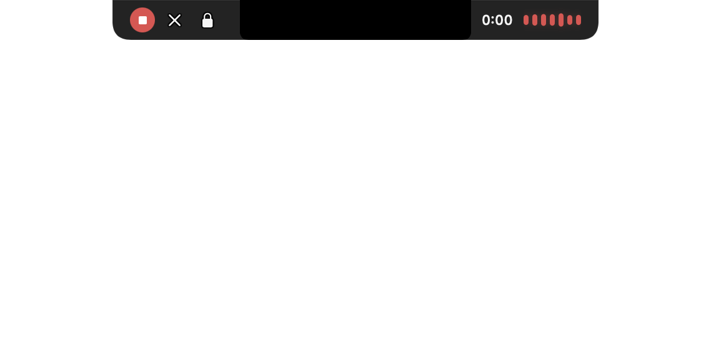
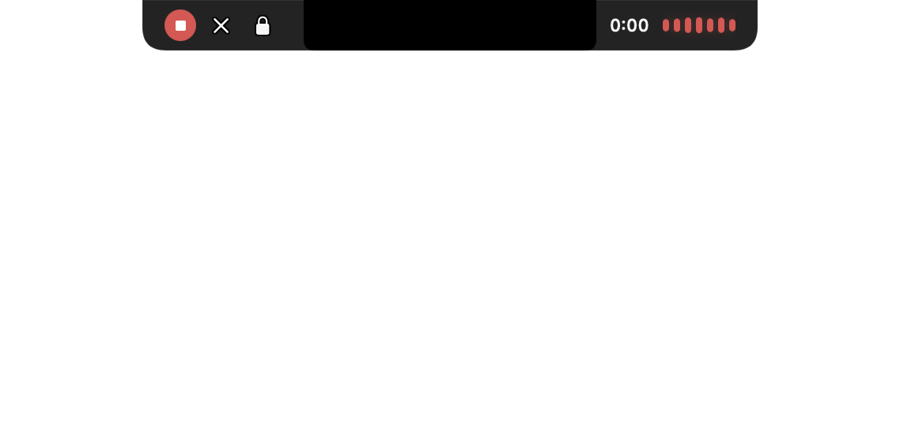

# Spinner and microphone placement proof

Synthetic, offscreen macOS AppKit renders of the production BarView. No microphone, live dictation,
installed-app replacement or daily screen capture was used. Static placement proof only;
installed-app and native-glass acceptance remain release gates.

| State | Before: f5994253 | After: this branch |
| --- | --- | --- |
| Transcribing |  |  |
| Recording, unchanged C7-W layout |  |  |

## Spinner and microphone placement fixed

c9-P (`7cdc6414`, then `881cbe8a` for held wings) widened and retained the processing wing.
The microphone had been added in `780e40ac`; the resulting two-slot row placed the spinner
13 pt farther from the core than the single centred spinner in `v2.3.0`.
Keep the 102 pt wing and 389 pt band: put the spinner nearest the notch, with the microphone
one recording-control pitch outside it. Its live hit target follows the microphone.

The historical placement reconstruction pins a 36.066388 pt painted/AX spinner-centre distance
from the core. Base measures 49.066388 pt; corrected placement measures 36.066388 pt.
This is a reconstruction of the old placement, not execution of its historical binary.
The nominal spinner slot inset is 26.5 pt and centre distance 36.5 pt.
The neighbour layout gap is 6 pt, from the recording controls' existing `compactControlSpacing`
with 20 pt control slots. Optical bounds depend on rotation and differ from slot padding.
All six existing wing/band-width assertions remain unchanged.

## Recording remains unchanged; ripple question deferred

The rejected four-point meter change and its gap assertion have been removed.
`VoiceBarWingControls.swift` is exactly the 2.4.0/C7-W (`5f2ef7cf`) implementation:
8 pt clock-to-meter layout spacing and matching 14 pt band-end insets.
Recording images document that preserved layout; no waveform-gap fix is claimed.
The transcribing ripple's distance to the notch is a separate question for Monday.

## Verification scope

The spinner position regression fails on unmodified f5994253 production (49.066388 vs 36.066388 pt)
and passes with the approved spinner/microphone placement. Focused Swift classes cover the spinner,
recording layout, band-width invariants and live microphone hit target. The current after images
are regenerated after restoring C7-W. Local logs retain test counts, compiler warnings and any skips;
unavailable native-glass readability is not counted as proven.
The follow-up focused run passed 184 tests with zero failures and seven skips: four native-glass
coverage cases and three opt-in artifact writers. The Swift cache was deleted after this step.

Only models reported stale by `python3 -B formal/verify-receipts.py` need re-recording through
`tlc_guarded.sh`; restoring the un-hashed recording-row file leaves existing model receipts current.
The verifier must print `PASS: all local TLC receipts match current inputs` at the committed head.

GIF: none: no animation or interaction changed

Review target: `integration/2.4.2`. Lead owns push/review. Per-PR corpus is deferred to the
integration-to-main release workflow. Historical rejected waveform claims are superseded by this text.
