# Native M1 notch proof, R5 with R8 close recapture

Status: **PARTIAL** native synthetic-fixture capture packet. R8 replaces only AFTER o. Sampled close alignment is verified; the timed physical-screen shutter caught the open hold. Simultaneous s comparison remains unverified. Read the observations and limitations below; capture completion is separate from acceptance of the motion.

## Capture specification

- BEFORE main: `7faf0a0e43f5afa2c135950bb15daafe473b39c6`.
- AFTER R5 surfaces: `912d899a31b1edc2fee01b1562e25b82635177e3`; R8 o only: `59f3c38380009945097e2b23b5748c784497f8ed` (position fix).
- Physical hardware-notch M1, 1512 × 982 pt, native scale 2. Stills are exact QA-app captures, cropped without resampling. System-region s shows only the 32 pt band row, with the canvas rectangle extended 40 pt left.
- Synthetic display fixtures; no microphone, speech, clipboard, real History or permission-dialog interaction. Supplied bundles retained unchanged.
- 120 s HID-idle admission; tagged tool pointer events and listen-only foreign-input monitor. R5 windows ended before18:25; R8 used one46.655s window, restored at02:22:31.682UTC on17Nov, before its06:15 local deadline.
- Recorder e runs at15fps and o at60fps; extracted with `-vsync 0`, no scaling, original presentation timestamps. **1x recorder frame, for position and visibility only, not for text**. GIF previews round timing to codec ticks.
- Recorder contacts preserve original-size band strips (o32px, e top64px); individual PNGs remain authoritative. BEFORE captures from the frozen build are reused where appropriate. AFTER o was recaptured for the position fix; other AFTER surfaces retain their R5 build attribution.

## Numbered before / after pairs

### 1. a-idle-hovered, light

| BEFORE native2x | AFTER native2x |
|---|---|
|  | 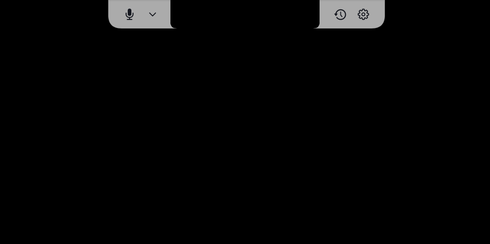 |

### 2. a-idle-hovered, dark

| BEFORE native2x | AFTER native2x |
|---|---|
|  |  |

### 3. b-recording-first-frame, light

| BEFORE native2x | AFTER native2x |
|---|---|
|  |  |

### 4. b-recording-first-frame, dark

| BEFORE native2x | AFTER native2x |
|---|---|
|  |  |

### 5. c-recording-live, light

| BEFORE native2x | AFTER native2x |
|---|---|
|  |  |

### 6. c-recording-live, dark

| BEFORE native2x | AFTER native2x |
|---|---|
|  |  |

### 7. c2-recording-lock, light

| BEFORE native2x | AFTER native2x |
|---|---|
|  |  |

### 8. c2-recording-lock, dark

| BEFORE native2x | AFTER native2x |
|---|---|
|  |  |

### 9. d-transcribing, light

| BEFORE native2x | AFTER native2x |
|---|---|
|  |  |

### 10. d-transcribing, dark

| BEFORE native2x | AFTER native2x |
|---|---|
|  |  |

### 11. g-dictionary, light

| BEFORE native2x | AFTER native2x |
|---|---|
|  |  |

### 12. g-dictionary, dark

| BEFORE native2x | AFTER native2x |
|---|---|
| 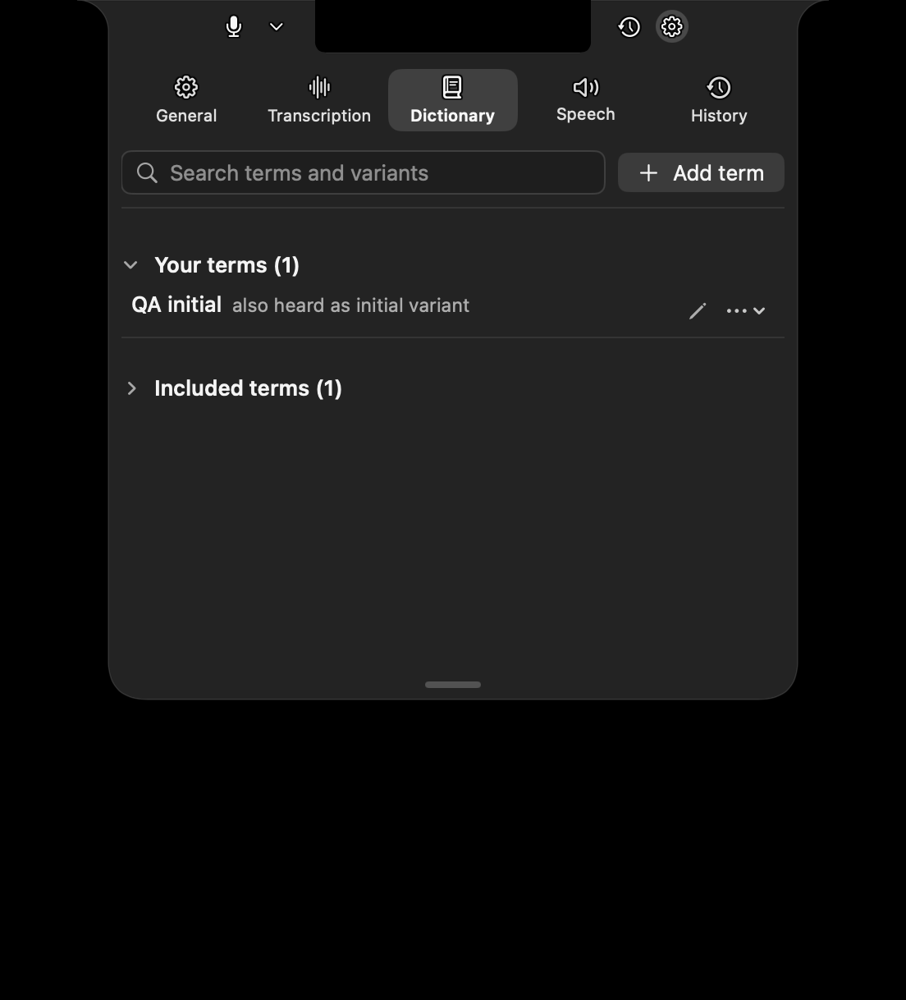 |  |

## AFTER dark measurements

Native2x pixel ink edges divided by 2. AX selects ROIs; glass threshold >15 at y32px, notch seam at y20px, neutral ink >120. Antialias uncertainty about 0.5 pt. Physical safe-area enclosure is not substituted for the visible seam.

| State | Left wing pt | Right wing pt | Left ink → notch pt | Notch → right ink pt | Outer pads L/R pt |
|---|---:|---:|---:|---:|---:|
| a | 70.5 | 74.0 | 16.5 | 16.5 | 20.0 / 18.0 |
| b | 97.5 | 111.0 | 16.5 | 17.5 | 14.5 / 14.5 |
| c | 97.5 | 111.0 | 16.5 | 17.5 | 14.5 / 14.5 |
| c2 | 97.5 | 111.0 | 17.0 | 17.5 | 14.5 / 14.5 |
| d | 70.5 | 74.0 | 16.5 | 16.5 | 18.5 / 18.0 |

Dark spinner arc RGB [101, 176, 252] against band [35, 35, 35]: relative-luminance contrast 6.862:1. See [measurements.json](measurements.json) for ROIs, ink boxes and sampling details.

## o: hover open and close, R8

The sampled close now plays over the notch: both themes retain core edges671/839pt, gap168pt, with0pt measured drift in14 resolvable closing frames each. Fully hidden edges remain UNKNOWN. The physical-screen strip places the open core at the same screen x, but does not show a part-way close; exact shutter PTS is UNKNOWN.

Native1x y2 wing seams infer screen-space core edges by adding the union-crop origin. Open reference is the maximum-width plateau; close starts after its last sample. About1pt raster uncertainty. Ink fragments at inner edges remain visible; hidden/clipped icons are UNKNOWN. Fully resolved icons stay within1pt of their outer-edge reference. No unclipped, sub-frame or uniform60fps claim.

| Theme | Frames | Closing / resolved edges | Core x pt | Gap pt | Max edge / gap drift pt | Mic / chevron / History / gear close ranges pt |
|---|---:|---:|---|---:|---|---|
| dark | 146 | 55 / 14 | 671,839 |168|0 /0|[19, 20] / [46, 46] / [43, 43] / [18, 19]|
| light | 140 | 45 / 14 | 671,839 |168|0 /0|[19, 20] / [46, 47] / [43, 44] / [18, 18]|

### System band row, AFTER dark

Request fired 2601.417ms after tagged pointer-off, 101.417ms after the source2.5s grace. The request meets the60–150ms-after-grace range. The system image shows fully open wings, matching the recorder open plateau, NOT a part-way close. Actual shutter instant and epoch-to-movie-PTS mapping UNKNOWN. This required shutter check did not pass; no substitute image is presented as mid-close.

Recorder is configured60fps; output PTS is sparse on stable states. Gaps cannot distinguish unchanged-content suppression from dropped frames. Every gap over25ms is listed below. Moving close samples dark92–113 and light96–117 have intervals16.666–25.000ms (rounding applies), including25ms intervals in both themes. No continuity claim across a gap. BEFORE R5 close still has one sampled cut; BEFORE light o was not requested.

### AFTER dark: 146 native1x frames

[1x GIF preview](images/after-dark-o.gif). Original PTS 0.000–7691.667ms.

- PTS 475.000→508.333ms: gap33.333ms.
- PTS 1325.000→2641.667ms: gap1316.667ms.
- PTS 2841.667→4175.000ms: gap1333.333ms.
- PTS 4175.000→4858.333ms: gap683.333ms.
- PTS 4858.333→5308.333ms: gap450.000ms.
- PTS 5808.333→5916.667ms: gap108.334ms.
- PTS 6158.333→6975.000ms: gap816.667ms.
- PTS 6991.667→7533.333ms: gap541.666ms.

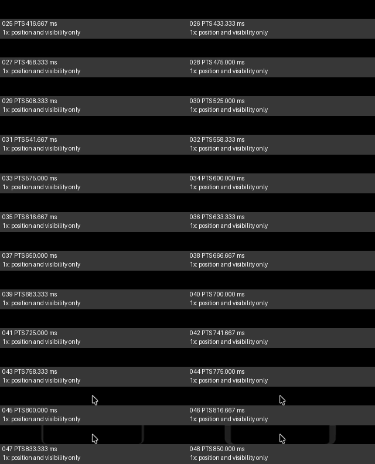

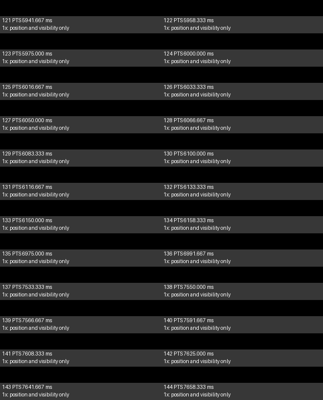

| Frame | Original PTS ms | Core edges screen pt | Gap pt |
|---|---:|---|---:|
| [001](images/after-dark-o-recorder-001.png) |0.000|UNKNOWN|UNKNOWN|
| [002](images/after-dark-o-recorder-002.png) |16.667|UNKNOWN|UNKNOWN|
| [003](images/after-dark-o-recorder-003.png) |33.333|UNKNOWN|UNKNOWN|
| [004](images/after-dark-o-recorder-004.png) |58.333|UNKNOWN|UNKNOWN|
| [005](images/after-dark-o-recorder-005.png) |75.000|UNKNOWN|UNKNOWN|
| [006](images/after-dark-o-recorder-006.png) |91.667|UNKNOWN|UNKNOWN|
| [007](images/after-dark-o-recorder-007.png) |108.333|UNKNOWN|UNKNOWN|
| [008](images/after-dark-o-recorder-008.png) |125.000|UNKNOWN|UNKNOWN|
| [009](images/after-dark-o-recorder-009.png) |141.667|UNKNOWN|UNKNOWN|
| [010](images/after-dark-o-recorder-010.png) |158.333|UNKNOWN|UNKNOWN|
| [011](images/after-dark-o-recorder-011.png) |175.000|UNKNOWN|UNKNOWN|
| [012](images/after-dark-o-recorder-012.png) |191.667|UNKNOWN|UNKNOWN|
| [013](images/after-dark-o-recorder-013.png) |208.333|UNKNOWN|UNKNOWN|
| [014](images/after-dark-o-recorder-014.png) |233.333|UNKNOWN|UNKNOWN|
| [015](images/after-dark-o-recorder-015.png) |250.000|UNKNOWN|UNKNOWN|
| [016](images/after-dark-o-recorder-016.png) |266.667|UNKNOWN|UNKNOWN|
| [017](images/after-dark-o-recorder-017.png) |283.333|UNKNOWN|UNKNOWN|
| [018](images/after-dark-o-recorder-018.png) |300.000|UNKNOWN|UNKNOWN|
| [019](images/after-dark-o-recorder-019.png) |316.667|UNKNOWN|UNKNOWN|
| [020](images/after-dark-o-recorder-020.png) |333.333|UNKNOWN|UNKNOWN|
| [021](images/after-dark-o-recorder-021.png) |350.000|UNKNOWN|UNKNOWN|
| [022](images/after-dark-o-recorder-022.png) |366.667|UNKNOWN|UNKNOWN|
| [023](images/after-dark-o-recorder-023.png) |383.333|UNKNOWN|UNKNOWN|
| [024](images/after-dark-o-recorder-024.png) |400.000|UNKNOWN|UNKNOWN|
| [025](images/after-dark-o-recorder-025.png) |416.667|UNKNOWN|UNKNOWN|
| [026](images/after-dark-o-recorder-026.png) |433.333|UNKNOWN|UNKNOWN|
| [027](images/after-dark-o-recorder-027.png) |458.333|UNKNOWN|UNKNOWN|
| [028](images/after-dark-o-recorder-028.png) |475.000|UNKNOWN|UNKNOWN|
| [029](images/after-dark-o-recorder-029.png) |508.333|UNKNOWN|UNKNOWN|
| [030](images/after-dark-o-recorder-030.png) |525.000|UNKNOWN|UNKNOWN|
| [031](images/after-dark-o-recorder-031.png) |541.667|UNKNOWN|UNKNOWN|
| [032](images/after-dark-o-recorder-032.png) |558.333|UNKNOWN|UNKNOWN|
| [033](images/after-dark-o-recorder-033.png) |575.000|UNKNOWN|UNKNOWN|
| [034](images/after-dark-o-recorder-034.png) |600.000|UNKNOWN|UNKNOWN|
| [035](images/after-dark-o-recorder-035.png) |616.667|UNKNOWN|UNKNOWN|
| [036](images/after-dark-o-recorder-036.png) |633.333|UNKNOWN|UNKNOWN|
| [037](images/after-dark-o-recorder-037.png) |650.000|UNKNOWN|UNKNOWN|
| [038](images/after-dark-o-recorder-038.png) |666.667|UNKNOWN|UNKNOWN|
| [039](images/after-dark-o-recorder-039.png) |683.333|UNKNOWN|UNKNOWN|
| [040](images/after-dark-o-recorder-040.png) |700.000|UNKNOWN|UNKNOWN|
| [041](images/after-dark-o-recorder-041.png) |725.000|UNKNOWN|UNKNOWN|
| [042](images/after-dark-o-recorder-042.png) |741.667|UNKNOWN|UNKNOWN|
| [043](images/after-dark-o-recorder-043.png) |758.333|UNKNOWN|UNKNOWN|
| [044](images/after-dark-o-recorder-044.png) |775.000|UNKNOWN|UNKNOWN|
| [045](images/after-dark-o-recorder-045.png) |800.000|UNKNOWN|UNKNOWN|
| [046](images/after-dark-o-recorder-046.png) |816.667|UNKNOWN|UNKNOWN|
| [047](images/after-dark-o-recorder-047.png) |833.333|[671, 839]|168|
| [048](images/after-dark-o-recorder-048.png) |850.000|[671, 839]|168|
| [049](images/after-dark-o-recorder-049.png) |866.667|[671, 839]|168|
| [050](images/after-dark-o-recorder-050.png) |883.333|[671, 839]|168|
| [051](images/after-dark-o-recorder-051.png) |908.333|[671, 839]|168|
| [052](images/after-dark-o-recorder-052.png) |925.000|[671, 839]|168|
| [053](images/after-dark-o-recorder-053.png) |941.667|[671, 839]|168|
| [054](images/after-dark-o-recorder-054.png) |958.333|[671, 839]|168|
| [055](images/after-dark-o-recorder-055.png) |975.000|[671, 839]|168|
| [056](images/after-dark-o-recorder-056.png) |991.667|[671, 839]|168|
| [057](images/after-dark-o-recorder-057.png) |1008.333|[671, 839]|168|
| [058](images/after-dark-o-recorder-058.png) |1025.000|[671, 839]|168|
| [059](images/after-dark-o-recorder-059.png) |1041.667|[671, 839]|168|
| [060](images/after-dark-o-recorder-060.png) |1058.333|[671, 839]|168|
| [061](images/after-dark-o-recorder-061.png) |1075.000|[671, 839]|168|
| [062](images/after-dark-o-recorder-062.png) |1100.000|[671, 839]|168|
| [063](images/after-dark-o-recorder-063.png) |1116.667|[671, 839]|168|
| [064](images/after-dark-o-recorder-064.png) |1133.333|[671, 839]|168|
| [065](images/after-dark-o-recorder-065.png) |1150.000|[671, 839]|168|
| [066](images/after-dark-o-recorder-066.png) |1166.667|[671, 839]|168|
| [067](images/after-dark-o-recorder-067.png) |1183.333|[671, 839]|168|
| [068](images/after-dark-o-recorder-068.png) |1200.000|[671, 839]|168|
| [069](images/after-dark-o-recorder-069.png) |1216.667|[671, 839]|168|
| [070](images/after-dark-o-recorder-070.png) |1233.333|[671, 839]|168|
| [071](images/after-dark-o-recorder-071.png) |1258.333|[671, 839]|168|
| [072](images/after-dark-o-recorder-072.png) |1275.000|[671, 839]|168|
| [073](images/after-dark-o-recorder-073.png) |1291.667|[671, 839]|168|
| [074](images/after-dark-o-recorder-074.png) |1308.333|[671, 839]|168|
| [075](images/after-dark-o-recorder-075.png) |1325.000|[671, 839]|168|
| [076](images/after-dark-o-recorder-076.png) |2641.667|[671, 839]|168|
| [077](images/after-dark-o-recorder-077.png) |2658.333|[671, 839]|168|
| [078](images/after-dark-o-recorder-078.png) |2675.000|[671, 839]|168|
| [079](images/after-dark-o-recorder-079.png) |2691.667|[671, 839]|168|
| [080](images/after-dark-o-recorder-080.png) |2708.333|[671, 839]|168|
| [081](images/after-dark-o-recorder-081.png) |2733.333|[671, 839]|168|
| [082](images/after-dark-o-recorder-082.png) |2750.000|[671, 839]|168|
| [083](images/after-dark-o-recorder-083.png) |2766.667|[671, 839]|168|
| [084](images/after-dark-o-recorder-084.png) |2783.333|[671, 839]|168|
| [085](images/after-dark-o-recorder-085.png) |2800.000|[671, 839]|168|
| [086](images/after-dark-o-recorder-086.png) |2816.667|[671, 839]|168|
| [087](images/after-dark-o-recorder-087.png) |2833.333|[671, 839]|168|
| [088](images/after-dark-o-recorder-088.png) |2841.667|[671, 839]|168|
| [089](images/after-dark-o-recorder-089.png) |4175.000|[671, 839]|168|
| [090](images/after-dark-o-recorder-090.png) |4858.333|[671, 839]|168|
| [091](images/after-dark-o-recorder-091.png) |5308.333|[671, 839]|168|
| [092](images/after-dark-o-recorder-092.png) |5333.333|[671, 839]|168|
| [093](images/after-dark-o-recorder-093.png) |5350.000|[671, 839]|168|
| [094](images/after-dark-o-recorder-094.png) |5366.667|[671, 839]|168|
| [095](images/after-dark-o-recorder-095.png) |5383.333|[671, 839]|168|
| [096](images/after-dark-o-recorder-096.png) |5400.000|[671, 839]|168|
| [097](images/after-dark-o-recorder-097.png) |5416.667|[671, 839]|168|
| [098](images/after-dark-o-recorder-098.png) |5433.333|[671, 839]|168|
| [099](images/after-dark-o-recorder-099.png) |5450.000|[671, 839]|168|
| [100](images/after-dark-o-recorder-100.png) |5475.000|[671, 839]|168|
| [101](images/after-dark-o-recorder-101.png) |5491.667|[671, 839]|168|
| [102](images/after-dark-o-recorder-102.png) |5508.333|[671, 839]|168|
| [103](images/after-dark-o-recorder-103.png) |5525.000|[671, 839]|168|
| [104](images/after-dark-o-recorder-104.png) |5541.667|[671, 839]|168|
| [105](images/after-dark-o-recorder-105.png) |5558.333|[671, 839]|168|
| [106](images/after-dark-o-recorder-106.png) |5575.000|UNKNOWN|UNKNOWN|
| [107](images/after-dark-o-recorder-107.png) |5591.667|UNKNOWN|UNKNOWN|
| [108](images/after-dark-o-recorder-108.png) |5608.333|UNKNOWN|UNKNOWN|
| [109](images/after-dark-o-recorder-109.png) |5625.000|UNKNOWN|UNKNOWN|
| [110](images/after-dark-o-recorder-110.png) |5641.667|UNKNOWN|UNKNOWN|
| [111](images/after-dark-o-recorder-111.png) |5658.333|UNKNOWN|UNKNOWN|
| [112](images/after-dark-o-recorder-112.png) |5683.333|UNKNOWN|UNKNOWN|
| [113](images/after-dark-o-recorder-113.png) |5700.000|UNKNOWN|UNKNOWN|
| [114](images/after-dark-o-recorder-114.png) |5716.667|UNKNOWN|UNKNOWN|
| [115](images/after-dark-o-recorder-115.png) |5733.333|UNKNOWN|UNKNOWN|
| [116](images/after-dark-o-recorder-116.png) |5750.000|UNKNOWN|UNKNOWN|
| [117](images/after-dark-o-recorder-117.png) |5766.667|UNKNOWN|UNKNOWN|
| [118](images/after-dark-o-recorder-118.png) |5783.333|UNKNOWN|UNKNOWN|
| [119](images/after-dark-o-recorder-119.png) |5808.333|UNKNOWN|UNKNOWN|
| [120](images/after-dark-o-recorder-120.png) |5916.667|UNKNOWN|UNKNOWN|
| [121](images/after-dark-o-recorder-121.png) |5941.667|UNKNOWN|UNKNOWN|
| [122](images/after-dark-o-recorder-122.png) |5958.333|UNKNOWN|UNKNOWN|
| [123](images/after-dark-o-recorder-123.png) |5975.000|UNKNOWN|UNKNOWN|
| [124](images/after-dark-o-recorder-124.png) |6000.000|UNKNOWN|UNKNOWN|
| [125](images/after-dark-o-recorder-125.png) |6016.667|UNKNOWN|UNKNOWN|
| [126](images/after-dark-o-recorder-126.png) |6033.333|UNKNOWN|UNKNOWN|
| [127](images/after-dark-o-recorder-127.png) |6050.000|UNKNOWN|UNKNOWN|
| [128](images/after-dark-o-recorder-128.png) |6066.667|UNKNOWN|UNKNOWN|
| [129](images/after-dark-o-recorder-129.png) |6083.333|UNKNOWN|UNKNOWN|
| [130](images/after-dark-o-recorder-130.png) |6100.000|UNKNOWN|UNKNOWN|
| [131](images/after-dark-o-recorder-131.png) |6116.667|UNKNOWN|UNKNOWN|
| [132](images/after-dark-o-recorder-132.png) |6133.333|UNKNOWN|UNKNOWN|
| [133](images/after-dark-o-recorder-133.png) |6150.000|UNKNOWN|UNKNOWN|
| [134](images/after-dark-o-recorder-134.png) |6158.333|UNKNOWN|UNKNOWN|
| [135](images/after-dark-o-recorder-135.png) |6975.000|UNKNOWN|UNKNOWN|
| [136](images/after-dark-o-recorder-136.png) |6991.667|UNKNOWN|UNKNOWN|
| [137](images/after-dark-o-recorder-137.png) |7533.333|UNKNOWN|UNKNOWN|
| [138](images/after-dark-o-recorder-138.png) |7550.000|UNKNOWN|UNKNOWN|
| [139](images/after-dark-o-recorder-139.png) |7566.667|UNKNOWN|UNKNOWN|
| [140](images/after-dark-o-recorder-140.png) |7591.667|UNKNOWN|UNKNOWN|
| [141](images/after-dark-o-recorder-141.png) |7608.333|UNKNOWN|UNKNOWN|
| [142](images/after-dark-o-recorder-142.png) |7625.000|UNKNOWN|UNKNOWN|
| [143](images/after-dark-o-recorder-143.png) |7641.667|UNKNOWN|UNKNOWN|
| [144](images/after-dark-o-recorder-144.png) |7658.333|UNKNOWN|UNKNOWN|
| [145](images/after-dark-o-recorder-145.png) |7675.000|UNKNOWN|UNKNOWN|
| [146](images/after-dark-o-recorder-146.png) |7691.667|UNKNOWN|UNKNOWN|

### AFTER light: 140 native1x frames

[1x GIF preview](images/after-light-o.gif). Original PTS 0.000–4616.667ms.

- PTS 875.000→1133.333ms: gap258.333ms.
- PTS 1666.667→1783.333ms: gap116.666ms.
- PTS 1783.333→3066.667ms: gap1283.334ms.
- PTS 3258.333→3758.333ms: gap500.000ms.
- PTS 4258.333→4375.000ms: gap116.667ms.

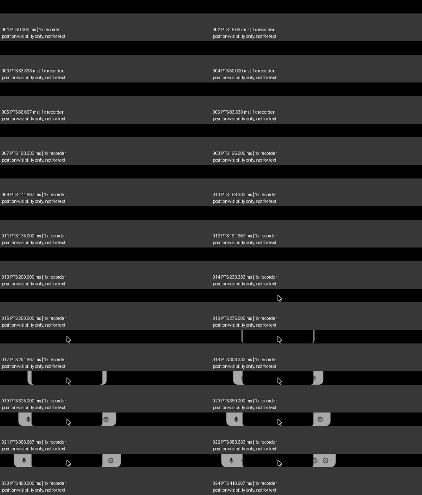

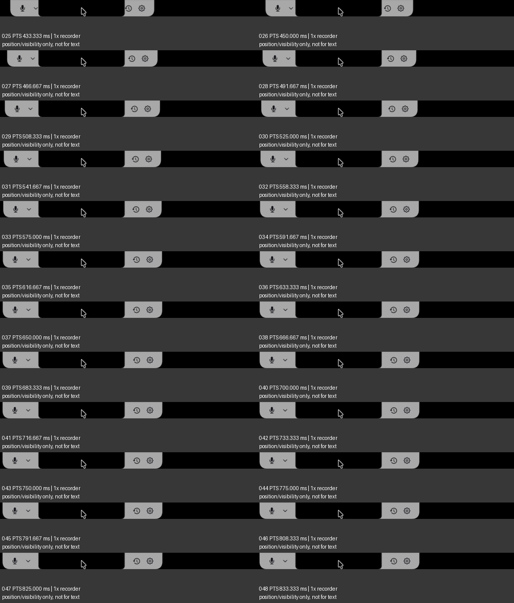

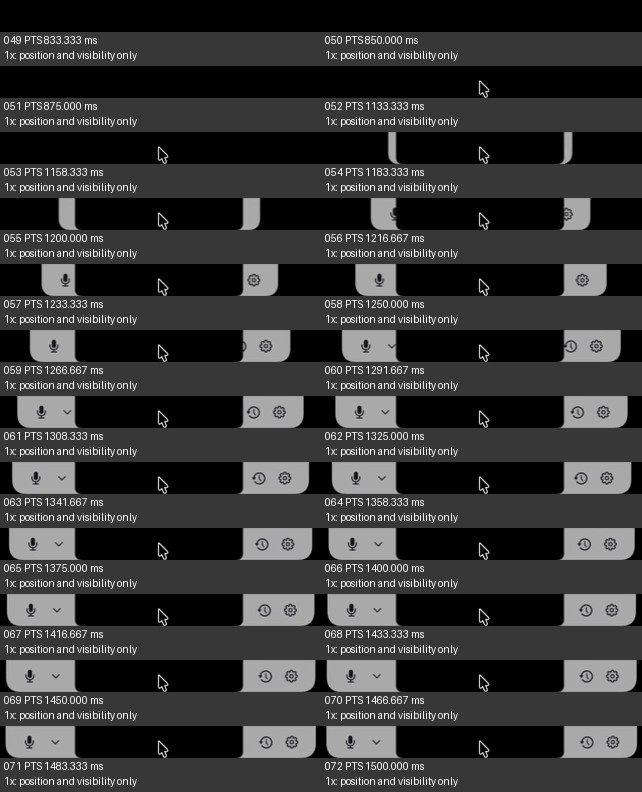

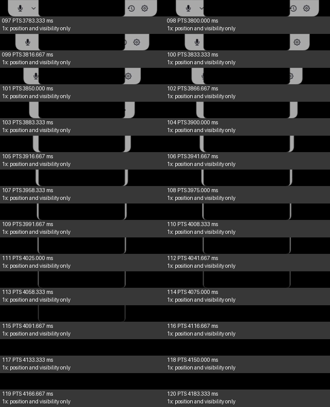

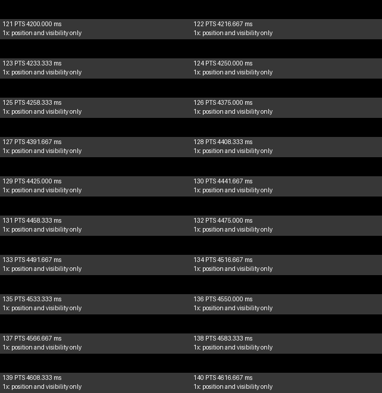

| Frame | Original PTS ms | Core edges screen pt | Gap pt |
|---|---:|---|---:|
| [001](images/after-light-o-recorder-001.png) |0.000|UNKNOWN|UNKNOWN|
| [002](images/after-light-o-recorder-002.png) |8.333|UNKNOWN|UNKNOWN|
| [003](images/after-light-o-recorder-003.png) |33.333|UNKNOWN|UNKNOWN|
| [004](images/after-light-o-recorder-004.png) |50.000|UNKNOWN|UNKNOWN|
| [005](images/after-light-o-recorder-005.png) |66.667|UNKNOWN|UNKNOWN|
| [006](images/after-light-o-recorder-006.png) |83.333|UNKNOWN|UNKNOWN|
| [007](images/after-light-o-recorder-007.png) |100.000|UNKNOWN|UNKNOWN|
| [008](images/after-light-o-recorder-008.png) |116.667|UNKNOWN|UNKNOWN|
| [009](images/after-light-o-recorder-009.png) |141.667|UNKNOWN|UNKNOWN|
| [010](images/after-light-o-recorder-010.png) |158.333|UNKNOWN|UNKNOWN|
| [011](images/after-light-o-recorder-011.png) |175.000|UNKNOWN|UNKNOWN|
| [012](images/after-light-o-recorder-012.png) |191.667|UNKNOWN|UNKNOWN|
| [013](images/after-light-o-recorder-013.png) |208.333|UNKNOWN|UNKNOWN|
| [014](images/after-light-o-recorder-014.png) |225.000|UNKNOWN|UNKNOWN|
| [015](images/after-light-o-recorder-015.png) |241.667|UNKNOWN|UNKNOWN|
| [016](images/after-light-o-recorder-016.png) |258.333|UNKNOWN|UNKNOWN|
| [017](images/after-light-o-recorder-017.png) |275.000|UNKNOWN|UNKNOWN|
| [018](images/after-light-o-recorder-018.png) |291.667|UNKNOWN|UNKNOWN|
| [019](images/after-light-o-recorder-019.png) |308.333|UNKNOWN|UNKNOWN|
| [020](images/after-light-o-recorder-020.png) |333.333|UNKNOWN|UNKNOWN|
| [021](images/after-light-o-recorder-021.png) |350.000|UNKNOWN|UNKNOWN|
| [022](images/after-light-o-recorder-022.png) |366.667|UNKNOWN|UNKNOWN|
| [023](images/after-light-o-recorder-023.png) |383.333|UNKNOWN|UNKNOWN|
| [024](images/after-light-o-recorder-024.png) |400.000|UNKNOWN|UNKNOWN|
| [025](images/after-light-o-recorder-025.png) |416.667|UNKNOWN|UNKNOWN|
| [026](images/after-light-o-recorder-026.png) |433.333|UNKNOWN|UNKNOWN|
| [027](images/after-light-o-recorder-027.png) |458.333|UNKNOWN|UNKNOWN|
| [028](images/after-light-o-recorder-028.png) |475.000|UNKNOWN|UNKNOWN|
| [029](images/after-light-o-recorder-029.png) |491.667|UNKNOWN|UNKNOWN|
| [030](images/after-light-o-recorder-030.png) |508.333|UNKNOWN|UNKNOWN|
| [031](images/after-light-o-recorder-031.png) |525.000|UNKNOWN|UNKNOWN|
| [032](images/after-light-o-recorder-032.png) |541.667|UNKNOWN|UNKNOWN|
| [033](images/after-light-o-recorder-033.png) |558.333|UNKNOWN|UNKNOWN|
| [034](images/after-light-o-recorder-034.png) |575.000|UNKNOWN|UNKNOWN|
| [035](images/after-light-o-recorder-035.png) |591.667|UNKNOWN|UNKNOWN|
| [036](images/after-light-o-recorder-036.png) |608.333|UNKNOWN|UNKNOWN|
| [037](images/after-light-o-recorder-037.png) |625.000|UNKNOWN|UNKNOWN|
| [038](images/after-light-o-recorder-038.png) |650.000|UNKNOWN|UNKNOWN|
| [039](images/after-light-o-recorder-039.png) |666.667|UNKNOWN|UNKNOWN|
| [040](images/after-light-o-recorder-040.png) |683.333|UNKNOWN|UNKNOWN|
| [041](images/after-light-o-recorder-041.png) |700.000|UNKNOWN|UNKNOWN|
| [042](images/after-light-o-recorder-042.png) |716.667|UNKNOWN|UNKNOWN|
| [043](images/after-light-o-recorder-043.png) |733.333|UNKNOWN|UNKNOWN|
| [044](images/after-light-o-recorder-044.png) |750.000|UNKNOWN|UNKNOWN|
| [045](images/after-light-o-recorder-045.png) |766.667|UNKNOWN|UNKNOWN|
| [046](images/after-light-o-recorder-046.png) |791.667|UNKNOWN|UNKNOWN|
| [047](images/after-light-o-recorder-047.png) |808.333|UNKNOWN|UNKNOWN|
| [048](images/after-light-o-recorder-048.png) |825.000|UNKNOWN|UNKNOWN|
| [049](images/after-light-o-recorder-049.png) |833.333|UNKNOWN|UNKNOWN|
| [050](images/after-light-o-recorder-050.png) |850.000|UNKNOWN|UNKNOWN|
| [051](images/after-light-o-recorder-051.png) |875.000|UNKNOWN|UNKNOWN|
| [052](images/after-light-o-recorder-052.png) |1133.333|UNKNOWN|UNKNOWN|
| [053](images/after-light-o-recorder-053.png) |1158.333|UNKNOWN|UNKNOWN|
| [054](images/after-light-o-recorder-054.png) |1183.333|[671, 839]|168|
| [055](images/after-light-o-recorder-055.png) |1200.000|[671, 839]|168|
| [056](images/after-light-o-recorder-056.png) |1216.667|[671, 839]|168|
| [057](images/after-light-o-recorder-057.png) |1233.333|[671, 839]|168|
| [058](images/after-light-o-recorder-058.png) |1250.000|[671, 839]|168|
| [059](images/after-light-o-recorder-059.png) |1266.667|[671, 839]|168|
| [060](images/after-light-o-recorder-060.png) |1291.667|[671, 839]|168|
| [061](images/after-light-o-recorder-061.png) |1308.333|[671, 839]|168|
| [062](images/after-light-o-recorder-062.png) |1325.000|[671, 839]|168|
| [063](images/after-light-o-recorder-063.png) |1341.667|[671, 839]|168|
| [064](images/after-light-o-recorder-064.png) |1358.333|[671, 839]|168|
| [065](images/after-light-o-recorder-065.png) |1375.000|[671, 839]|168|
| [066](images/after-light-o-recorder-066.png) |1400.000|[671, 839]|168|
| [067](images/after-light-o-recorder-067.png) |1416.667|[671, 839]|168|
| [068](images/after-light-o-recorder-068.png) |1433.333|[671, 839]|168|
| [069](images/after-light-o-recorder-069.png) |1450.000|[671, 839]|168|
| [070](images/after-light-o-recorder-070.png) |1466.667|[671, 839]|168|
| [071](images/after-light-o-recorder-071.png) |1483.333|[671, 839]|168|
| [072](images/after-light-o-recorder-072.png) |1500.000|[671, 839]|168|
| [073](images/after-light-o-recorder-073.png) |1516.667|[671, 839]|168|
| [074](images/after-light-o-recorder-074.png) |1533.333|[671, 839]|168|
| [075](images/after-light-o-recorder-075.png) |1550.000|[671, 839]|168|
| [076](images/after-light-o-recorder-076.png) |1566.667|[671, 839]|168|
| [077](images/after-light-o-recorder-077.png) |1591.667|[671, 839]|168|
| [078](images/after-light-o-recorder-078.png) |1608.333|[671, 839]|168|
| [079](images/after-light-o-recorder-079.png) |1625.000|[671, 839]|168|
| [080](images/after-light-o-recorder-080.png) |1641.667|[671, 839]|168|
| [081](images/after-light-o-recorder-081.png) |1658.333|[671, 839]|168|
| [082](images/after-light-o-recorder-082.png) |1666.667|[671, 839]|168|
| [083](images/after-light-o-recorder-083.png) |1783.333|[671, 839]|168|
| [084](images/after-light-o-recorder-084.png) |3066.667|[671, 839]|168|
| [085](images/after-light-o-recorder-085.png) |3091.667|[671, 839]|168|
| [086](images/after-light-o-recorder-086.png) |3108.333|[671, 839]|168|
| [087](images/after-light-o-recorder-087.png) |3125.000|[671, 839]|168|
| [088](images/after-light-o-recorder-088.png) |3141.667|[671, 839]|168|
| [089](images/after-light-o-recorder-089.png) |3158.333|[671, 839]|168|
| [090](images/after-light-o-recorder-090.png) |3175.000|[671, 839]|168|
| [091](images/after-light-o-recorder-091.png) |3191.667|[671, 839]|168|
| [092](images/after-light-o-recorder-092.png) |3208.333|[671, 839]|168|
| [093](images/after-light-o-recorder-093.png) |3225.000|[671, 839]|168|
| [094](images/after-light-o-recorder-094.png) |3241.667|[671, 839]|168|
| [095](images/after-light-o-recorder-095.png) |3258.333|[671, 839]|168|
| [096](images/after-light-o-recorder-096.png) |3758.333|[671, 839]|168|
| [097](images/after-light-o-recorder-097.png) |3783.333|[671, 839]|168|
| [098](images/after-light-o-recorder-098.png) |3800.000|[671, 839]|168|
| [099](images/after-light-o-recorder-099.png) |3816.667|[671, 839]|168|
| [100](images/after-light-o-recorder-100.png) |3833.333|[671, 839]|168|
| [101](images/after-light-o-recorder-101.png) |3850.000|[671, 839]|168|
| [102](images/after-light-o-recorder-102.png) |3866.667|[671, 839]|168|
| [103](images/after-light-o-recorder-103.png) |3883.333|[671, 839]|168|
| [104](images/after-light-o-recorder-104.png) |3900.000|[671, 839]|168|
| [105](images/after-light-o-recorder-105.png) |3916.667|[671, 839]|168|
| [106](images/after-light-o-recorder-106.png) |3941.667|[671, 839]|168|
| [107](images/after-light-o-recorder-107.png) |3958.333|[671, 839]|168|
| [108](images/after-light-o-recorder-108.png) |3975.000|[671, 839]|168|
| [109](images/after-light-o-recorder-109.png) |3991.667|[671, 839]|168|
| [110](images/after-light-o-recorder-110.png) |4008.333|UNKNOWN|UNKNOWN|
| [111](images/after-light-o-recorder-111.png) |4025.000|UNKNOWN|UNKNOWN|
| [112](images/after-light-o-recorder-112.png) |4041.667|UNKNOWN|UNKNOWN|
| [113](images/after-light-o-recorder-113.png) |4058.333|UNKNOWN|UNKNOWN|
| [114](images/after-light-o-recorder-114.png) |4075.000|UNKNOWN|UNKNOWN|
| [115](images/after-light-o-recorder-115.png) |4091.667|UNKNOWN|UNKNOWN|
| [116](images/after-light-o-recorder-116.png) |4116.667|UNKNOWN|UNKNOWN|
| [117](images/after-light-o-recorder-117.png) |4133.333|UNKNOWN|UNKNOWN|
| [118](images/after-light-o-recorder-118.png) |4150.000|UNKNOWN|UNKNOWN|
| [119](images/after-light-o-recorder-119.png) |4166.667|UNKNOWN|UNKNOWN|
| [120](images/after-light-o-recorder-120.png) |4183.333|UNKNOWN|UNKNOWN|
| [121](images/after-light-o-recorder-121.png) |4200.000|UNKNOWN|UNKNOWN|
| [122](images/after-light-o-recorder-122.png) |4216.667|UNKNOWN|UNKNOWN|
| [123](images/after-light-o-recorder-123.png) |4233.333|UNKNOWN|UNKNOWN|
| [124](images/after-light-o-recorder-124.png) |4250.000|UNKNOWN|UNKNOWN|
| [125](images/after-light-o-recorder-125.png) |4258.333|UNKNOWN|UNKNOWN|
| [126](images/after-light-o-recorder-126.png) |4375.000|UNKNOWN|UNKNOWN|
| [127](images/after-light-o-recorder-127.png) |4391.667|UNKNOWN|UNKNOWN|
| [128](images/after-light-o-recorder-128.png) |4408.333|UNKNOWN|UNKNOWN|
| [129](images/after-light-o-recorder-129.png) |4425.000|UNKNOWN|UNKNOWN|
| [130](images/after-light-o-recorder-130.png) |4441.667|UNKNOWN|UNKNOWN|
| [131](images/after-light-o-recorder-131.png) |4458.333|UNKNOWN|UNKNOWN|
| [132](images/after-light-o-recorder-132.png) |4475.000|UNKNOWN|UNKNOWN|
| [133](images/after-light-o-recorder-133.png) |4491.667|UNKNOWN|UNKNOWN|
| [134](images/after-light-o-recorder-134.png) |4516.667|UNKNOWN|UNKNOWN|
| [135](images/after-light-o-recorder-135.png) |4533.333|UNKNOWN|UNKNOWN|
| [136](images/after-light-o-recorder-136.png) |4550.000|UNKNOWN|UNKNOWN|
| [137](images/after-light-o-recorder-137.png) |4566.667|UNKNOWN|UNKNOWN|
| [138](images/after-light-o-recorder-138.png) |4583.333|UNKNOWN|UNKNOWN|
| [139](images/after-light-o-recorder-139.png) |4608.333|UNKNOWN|UNKNOWN|
| [140](images/after-light-o-recorder-140.png) |4616.667|UNKNOWN|UNKNOWN|

## e: recording → transcribing

AFTER recording controls transition to the spinner/navigation while the wings contract. The 15fps samples do not establish sub-frame continuity; the first dark transition sample is already substantially contracted. BEFORE e is reused from the same frozen baseline.

### AFTER dark: 23 native1x frames

PTS 0.000–1466.667 ms. [1x GIF preview](images/after-dark-e.gif).

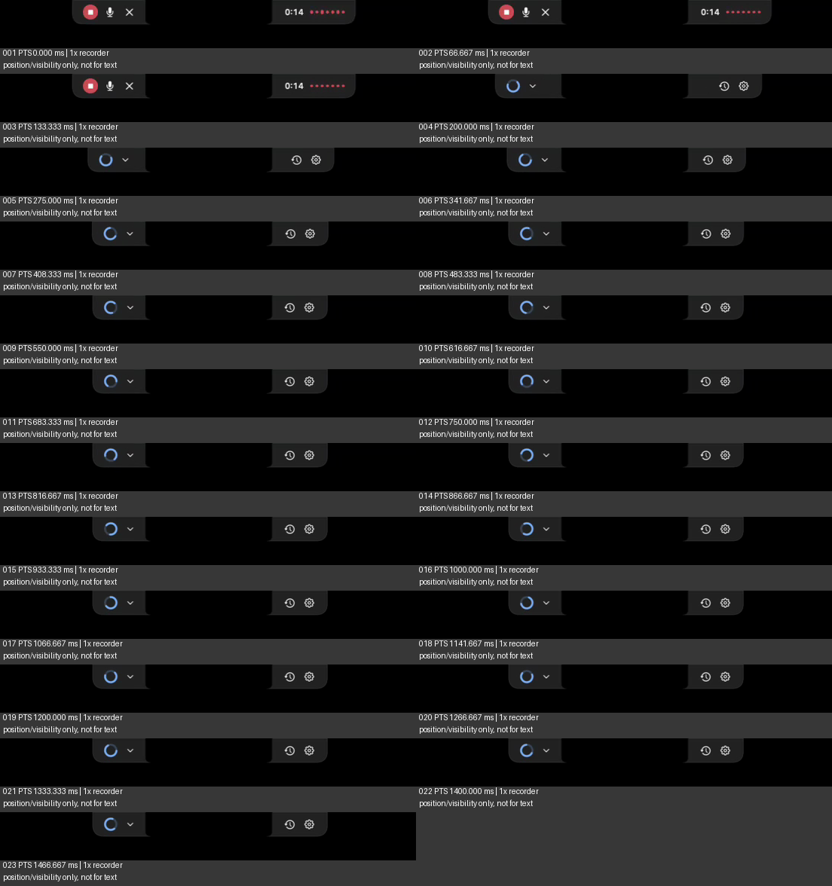

| Frame | Original PTS ms | Band edges at y16px |
|---|---:|---|
| [001](images/after-dark-e-recorder-001.png) | 0.000 | [96, 472] |
| [002](images/after-dark-e-recorder-002.png) | 66.667 | [96, 472] |
| [003](images/after-dark-e-recorder-003.png) | 133.333 | [96, 472] |
| [004](images/after-dark-e-recorder-004.png) | 200.000 | [105, 459] |
| [005](images/after-dark-e-recorder-005.png) | 275.000 | [116, 444] |
| [006](images/after-dark-e-recorder-006.png) | 341.667 | [120, 438] |
| [007](images/after-dark-e-recorder-007.png) | 408.333 | [122, 436] |
| [008](images/after-dark-e-recorder-008.png) | 483.333 | [122, 435] |
| [009](images/after-dark-e-recorder-009.png) | 550.000 | [123, 435] |
| [010](images/after-dark-e-recorder-010.png) | 616.667 | [123, 435] |
| [011](images/after-dark-e-recorder-011.png) | 683.333 | [123, 435] |
| [012](images/after-dark-e-recorder-012.png) | 750.000 | [123, 435] |
| [013](images/after-dark-e-recorder-013.png) | 816.667 | [123, 435] |
| [014](images/after-dark-e-recorder-014.png) | 866.667 | [123, 435] |
| [015](images/after-dark-e-recorder-015.png) | 933.333 | [123, 435] |
| [016](images/after-dark-e-recorder-016.png) | 1000.000 | [123, 435] |
| [017](images/after-dark-e-recorder-017.png) | 1066.667 | [123, 435] |
| [018](images/after-dark-e-recorder-018.png) | 1141.667 | [123, 435] |
| [019](images/after-dark-e-recorder-019.png) | 1200.000 | [123, 435] |
| [020](images/after-dark-e-recorder-020.png) | 1266.667 | [123, 435] |
| [021](images/after-dark-e-recorder-021.png) | 1333.333 | [123, 435] |
| [022](images/after-dark-e-recorder-022.png) | 1400.000 | [123, 435] |
| [023](images/after-dark-e-recorder-023.png) | 1466.667 | [123, 435] |

### AFTER light: 37 native1x frames

PTS 0.000–2416.667 ms. [1x GIF preview](images/after-light-e.gif).

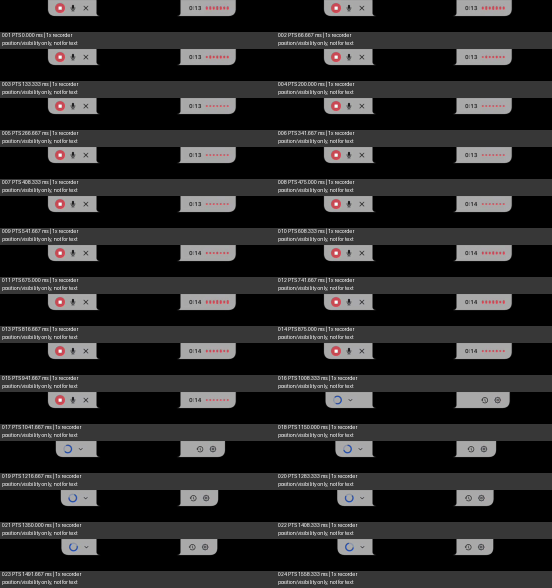

| Frame | Original PTS ms | Band edges at y16px |
|---|---:|---|
| [001](images/after-light-e-recorder-001.png) | 0.000 | [96, 472] |
| [002](images/after-light-e-recorder-002.png) | 66.667 | [96, 472] |
| [003](images/after-light-e-recorder-003.png) | 133.333 | [96, 472] |
| [004](images/after-light-e-recorder-004.png) | 200.000 | [96, 472] |
| [005](images/after-light-e-recorder-005.png) | 266.667 | [96, 472] |
| [006](images/after-light-e-recorder-006.png) | 341.667 | [96, 472] |
| [007](images/after-light-e-recorder-007.png) | 408.333 | [96, 472] |
| [008](images/after-light-e-recorder-008.png) | 475.000 | [96, 472] |
| [009](images/after-light-e-recorder-009.png) | 541.667 | [96, 472] |
| [010](images/after-light-e-recorder-010.png) | 608.333 | [96, 472] |
| [011](images/after-light-e-recorder-011.png) | 675.000 | [96, 472] |
| [012](images/after-light-e-recorder-012.png) | 741.667 | [96, 472] |
| [013](images/after-light-e-recorder-013.png) | 816.667 | [96, 472] |
| [014](images/after-light-e-recorder-014.png) | 875.000 | [96, 472] |
| [015](images/after-light-e-recorder-015.png) | 941.667 | [96, 472] |
| [016](images/after-light-e-recorder-016.png) | 1008.333 | [96, 472] |
| [017](images/after-light-e-recorder-017.png) | 1041.667 | [96, 472] |
| [018](images/after-light-e-recorder-018.png) | 1150.000 | [99, 467] |
| [019](images/after-light-e-recorder-019.png) | 1216.667 | [112, 450] |
| [020](images/after-light-e-recorder-020.png) | 1283.333 | [119, 440] |
| [021](images/after-light-e-recorder-021.png) | 1350.000 | [122, 436] |
| [022](images/after-light-e-recorder-022.png) | 1408.333 | [122, 435] |
| [023](images/after-light-e-recorder-023.png) | 1491.667 | [123, 435] |
| [024](images/after-light-e-recorder-024.png) | 1558.333 | [123, 435] |
| [025](images/after-light-e-recorder-025.png) | 1625.000 | [123, 435] |
| [026](images/after-light-e-recorder-026.png) | 1683.333 | [123, 435] |
| [027](images/after-light-e-recorder-027.png) | 1750.000 | [123, 435] |
| [028](images/after-light-e-recorder-028.png) | 1816.667 | [123, 435] |
| [029](images/after-light-e-recorder-029.png) | 1883.333 | [123, 435] |
| [030](images/after-light-e-recorder-030.png) | 1950.000 | [123, 435] |
| [031](images/after-light-e-recorder-031.png) | 2016.667 | [123, 435] |
| [032](images/after-light-e-recorder-032.png) | 2083.333 | [123, 435] |
| [033](images/after-light-e-recorder-033.png) | 2150.000 | [123, 435] |
| [034](images/after-light-e-recorder-034.png) | 2216.667 | [123, 435] |
| [035](images/after-light-e-recorder-035.png) | 2283.333 | [123, 435] |
| [036](images/after-light-e-recorder-036.png) | 2350.000 | [123, 435] |
| [037](images/after-light-e-recorder-037.png) | 2416.667 | [123, 435] |

### BEFORE light: 32 native1x frames

PTS 0.000–2158.333 ms. [1x GIF preview](images/before-light-e.gif).

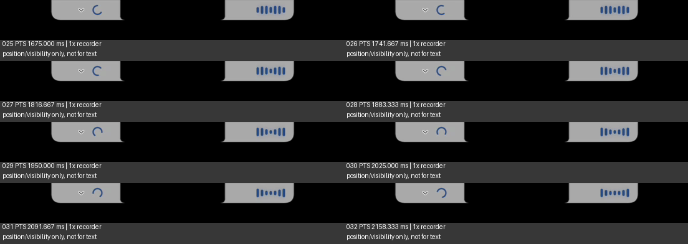

| Frame | Original PTS ms | Band edges at y16px |
|---|---:|---|
| [001](images/before-light-e-recorder-001.png) | 0.000 | [82, 472] |
| [002](images/before-light-e-recorder-002.png) | 91.667 | [82, 472] |
| [003](images/before-light-e-recorder-003.png) | 158.333 | [82, 472] |
| [004](images/before-light-e-recorder-004.png) | 225.000 | [82, 472] |
| [005](images/before-light-e-recorder-005.png) | 295.000 | [82, 472] |
| [006](images/before-light-e-recorder-006.png) | 358.333 | [82, 472] |
| [007](images/before-light-e-recorder-007.png) | 433.333 | [82, 472] |
| [008](images/before-light-e-recorder-008.png) | 500.000 | [82, 472] |
| [009](images/before-light-e-recorder-009.png) | 575.000 | [82, 472] |
| [010](images/before-light-e-recorder-010.png) | 650.000 | [82, 472] |
| [011](images/before-light-e-recorder-011.png) | 716.667 | [82, 472] |
| [012](images/before-light-e-recorder-012.png) | 791.667 | [82, 472] |
| [013](images/before-light-e-recorder-013.png) | 858.333 | [82, 472] |
| [014](images/before-light-e-recorder-014.png) | 925.000 | [82, 472] |
| [015](images/before-light-e-recorder-015.png) | 1000.000 | [82, 472] |
| [016](images/before-light-e-recorder-016.png) | 1066.667 | [82, 472] |
| [017](images/before-light-e-recorder-017.png) | 1133.333 | [82, 472] |
| [018](images/before-light-e-recorder-018.png) | 1200.000 | [82, 472] |
| [019](images/before-light-e-recorder-019.png) | 1275.000 | [82, 472] |
| [020](images/before-light-e-recorder-020.png) | 1341.667 | [82, 472] |
| [021](images/before-light-e-recorder-021.png) | 1408.333 | [82, 472] |
| [022](images/before-light-e-recorder-022.png) | 1475.000 | [82, 472] |
| [023](images/before-light-e-recorder-023.png) | 1541.667 | [82, 472] |
| [024](images/before-light-e-recorder-024.png) | 1608.333 | [82, 472] |
| [025](images/before-light-e-recorder-025.png) | 1675.000 | [82, 472] |
| [026](images/before-light-e-recorder-026.png) | 1741.667 | [82, 472] |
| [027](images/before-light-e-recorder-027.png) | 1816.667 | [82, 472] |
| [028](images/before-light-e-recorder-028.png) | 1883.333 | [82, 472] |
| [029](images/before-light-e-recorder-029.png) | 1950.000 | [82, 472] |
| [030](images/before-light-e-recorder-030.png) | 2025.000 | [82, 472] |
| [031](images/before-light-e-recorder-031.png) | 2091.667 | [82, 472] |
| [032](images/before-light-e-recorder-032.png) | 2158.333 | [82, 472] |

### BEFORE dark: 33 native1x frames

PTS 0.000–2200.000 ms. [1x GIF preview](images/before-dark-e.gif).

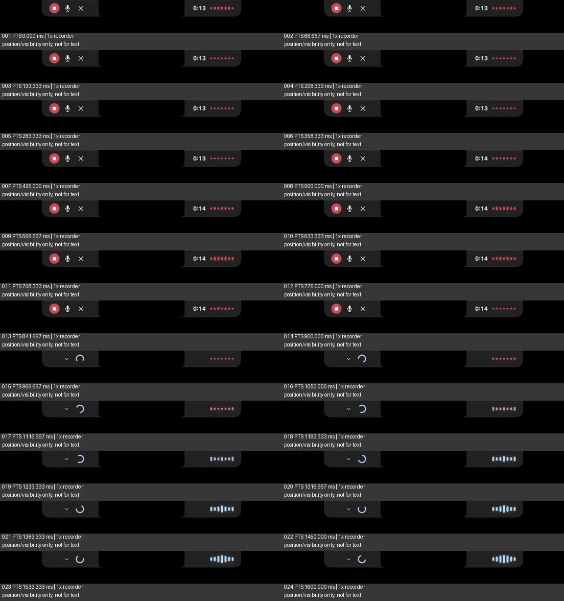

| Frame | Original PTS ms | Band edges at y16px |
|---|---:|---|
| [001](images/before-dark-e-recorder-001.png) | 0.000 | [82, 472] |
| [002](images/before-dark-e-recorder-002.png) | 66.667 | [82, 472] |
| [003](images/before-dark-e-recorder-003.png) | 133.333 | [82, 472] |
| [004](images/before-dark-e-recorder-004.png) | 208.333 | [82, 472] |
| [005](images/before-dark-e-recorder-005.png) | 283.333 | [82, 472] |
| [006](images/before-dark-e-recorder-006.png) | 358.333 | [82, 472] |
| [007](images/before-dark-e-recorder-007.png) | 425.000 | [82, 472] |
| [008](images/before-dark-e-recorder-008.png) | 500.000 | [82, 472] |
| [009](images/before-dark-e-recorder-009.png) | 566.667 | [82, 472] |
| [010](images/before-dark-e-recorder-010.png) | 633.333 | [82, 472] |
| [011](images/before-dark-e-recorder-011.png) | 708.333 | [82, 472] |
| [012](images/before-dark-e-recorder-012.png) | 775.000 | [82, 472] |
| [013](images/before-dark-e-recorder-013.png) | 841.667 | [82, 472] |
| [014](images/before-dark-e-recorder-014.png) | 900.000 | [82, 472] |
| [015](images/before-dark-e-recorder-015.png) | 966.667 | [82, 472] |
| [016](images/before-dark-e-recorder-016.png) | 1050.000 | [82, 472] |
| [017](images/before-dark-e-recorder-017.png) | 1116.667 | [82, 472] |
| [018](images/before-dark-e-recorder-018.png) | 1183.333 | [82, 472] |
| [019](images/before-dark-e-recorder-019.png) | 1233.333 | [82, 472] |
| [020](images/before-dark-e-recorder-020.png) | 1316.667 | [82, 472] |
| [021](images/before-dark-e-recorder-021.png) | 1383.333 | [82, 472] |
| [022](images/before-dark-e-recorder-022.png) | 1450.000 | [82, 472] |
| [023](images/before-dark-e-recorder-023.png) | 1533.333 | [82, 472] |
| [024](images/before-dark-e-recorder-024.png) | 1600.000 | [82, 472] |
| [025](images/before-dark-e-recorder-025.png) | 1666.667 | [82, 472] |
| [026](images/before-dark-e-recorder-026.png) | 1733.333 | [82, 472] |
| [027](images/before-dark-e-recorder-027.png) | 1800.000 | [82, 472] |
| [028](images/before-dark-e-recorder-028.png) | 1866.667 | [82, 472] |
| [029](images/before-dark-e-recorder-029.png) | 1933.333 | [82, 472] |
| [030](images/before-dark-e-recorder-030.png) | 2000.000 | [82, 472] |
| [031](images/before-dark-e-recorder-031.png) | 2066.667 | [82, 472] |
| [032](images/before-dark-e-recorder-032.png) | 2133.333 | [82, 472] |
| [033](images/before-dark-e-recorder-033.png) | 2200.000 | [82, 472] |

Per-frame icon/wing-edge measurements and unresolvable frames are in [motion-assessment.json](motion-assessment.json). Original PTS and neutral-ink component boxes are in [motion.json](motion.json).

## s: recording left-wing surroundings

The system native2x recording strip shows plain blue screen background immediately behind and to the left of the left wing’s rounded outer end; no separate stray shape is visible there. Tool capture composites the isolated QA window over black, while the system strip shows the real background through/around the glass. These are sequential captures of the same stable recording scene, not simultaneous: the tool timer is0:13 and the system timer is0:14. Exact simultaneous comparison is NOT VERIFIED.

## f: held History over-pull, AFTER dark

Eight native stages, pointer held between stages. Percentages refer to commanded travel toward the source arming boundary, not calibrated hint opacity. Native hint pixels/identifier and release outcome determine the result.

### f0-rest

Capture request monotonic 26668644.993ms (not movie PTS).

### f1-50

Capture request monotonic 26670993.813ms (not movie PTS).

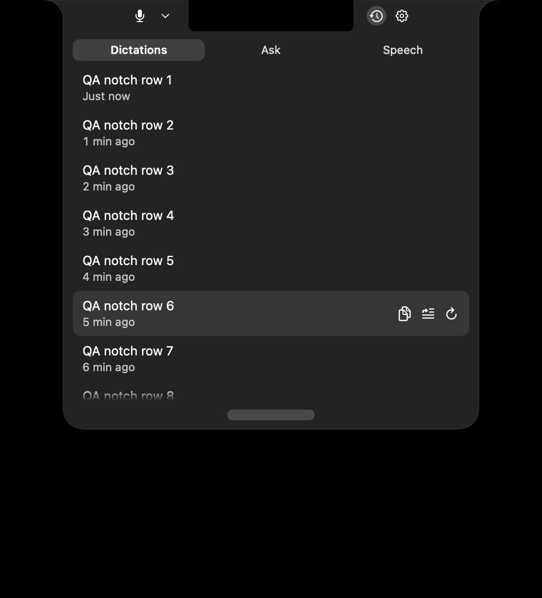

### f2-100

Capture request monotonic 26672911.976ms (not movie PTS).

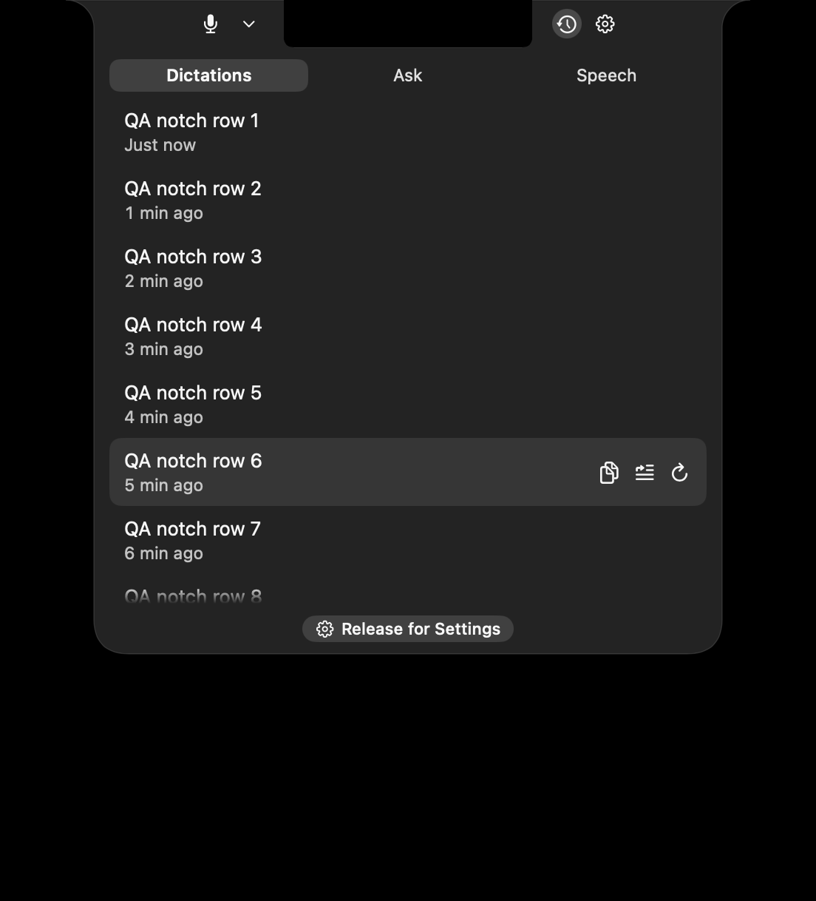

### f3-armed

Capture request monotonic 26674838.289ms (not movie PTS).

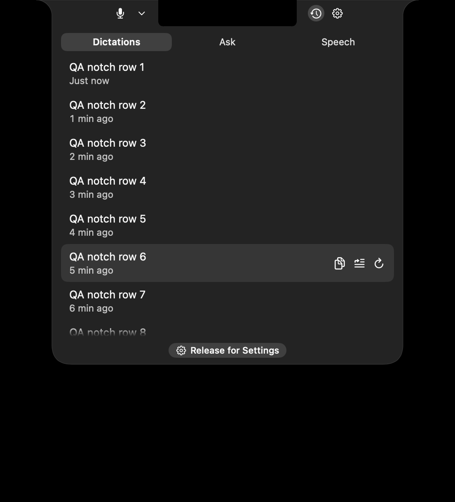

### f4-back-below-threshold

Capture request monotonic 26677745.85ms (not movie PTS).

### f5-released-history

Capture request monotonic 26679456.749ms (not movie PTS).

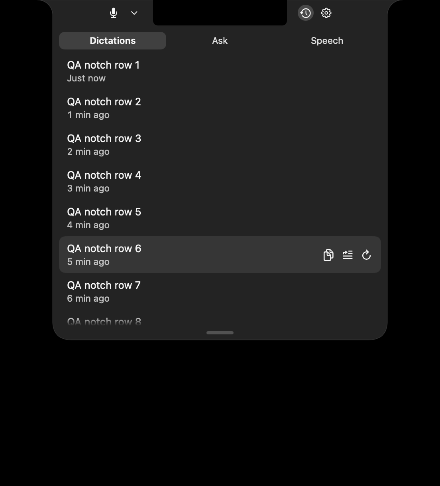

### f6-armed-release-variant

Capture request monotonic 26683288.478ms (not movie PTS).

### f7-release-opens-settings

Capture request monotonic 26685168.527ms (not movie PTS).

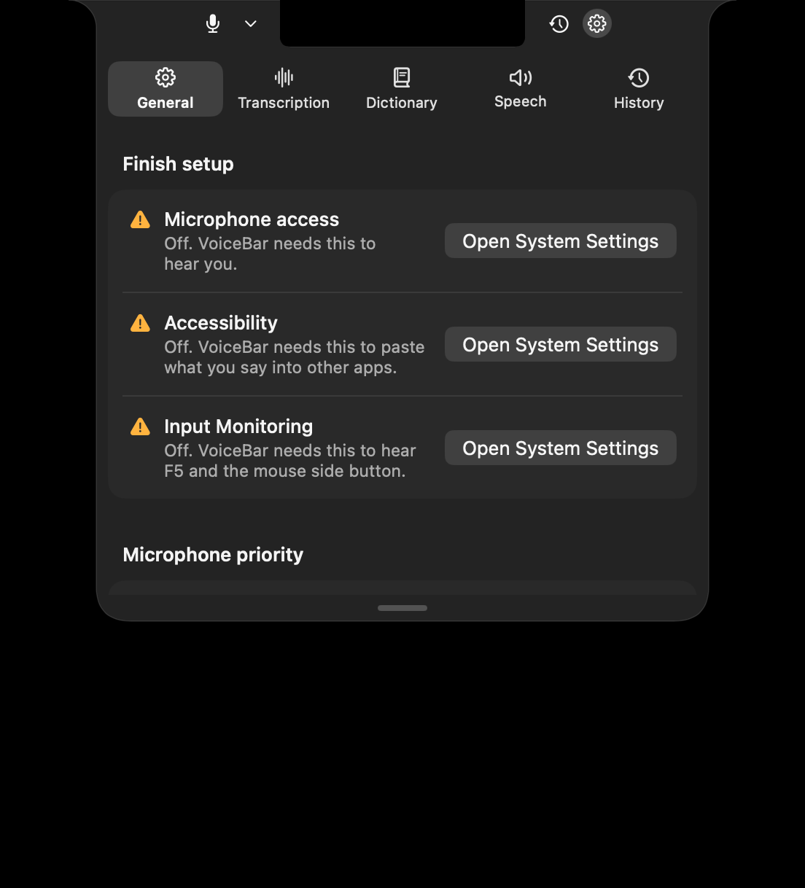

## Not shown / not verified

- R8 timed system shutter did NOT show part-way close (open hold instead); exact shutter-to-movie PTS UNKNOWN. Sampled close shift is gone at the recorded seam edges. BEFORE close retains one sampled cut, not eight distinct moving states.
- Hidden/near-transparent icon positions are UNKNOWN where raster ink cannot resolve them; no sub-frame continuity or flicker-free claim.
- BEFORE light o: NOT SHOWN (not requested). Recorder cannot establish 2x text quality.
- f light: NOT SHOWN. h version footer and i queued-read interruption: NOT SHOWN.
- Microphone, STT, live dictation, paste, real-agent voice acceptance and real History: NOT RUN.
- Candidate installation/release, another display/background, human-return interruption and forced deadline restoration: NOT VERIFIED. Resident restore probes prove only their recorded transport/identity/audio/appearance checks.
- Failed extraction attempt is retained in private receipts, with its clean restoration; it is not a successful frame-extraction run.

[inventory.json](inventory.json) binds delivered PNG bytes, build, theme and native scale. Private raw permission, ownership and restoration receipts are excluded. No home-folder paths or private utterances are published.
