# Native M1 notch proof, R5

Status: **PARTIAL** native synthetic-fixture capture packet. All requested item/theme captures were acquired; close-motion origin and simultaneous s comparison remain unverified. Read the observations and limitations below; capture completion is separate from acceptance of the motion.

## Capture specification

- BEFORE main: `7faf0a0e43f5afa2c135950bb15daafe473b39c6`.
- AFTER candidate: `912d899a31b1edc2fee01b1562e25b82635177e3`.
- Physical hardware-notch M1, 1512 × 982 pt, native scale 2. Stills are exact QA-app captures, cropped without resampling. System-region s shows only the 32 pt band row, with the canvas rectangle extended 40 pt left.
- Synthetic display fixtures; no microphone, speech, clipboard, real History or permission-dialog interaction. Supplied bundles retained unchanged.
- 120 s HID-idle admission. Tagged tool pointer events; listen-only foreign-input monitor. No new window at or after 18:20 local; restoration reserve before 18:25.
- Recorder e runs at15fps and o at60fps; extracted with `-vsync 0`, no scaling, original presentation timestamps. **1x recorder frame, for position and visibility only, not for text**. GIF previews round timing to codec ticks.
- Recorder contacts preserve original-size band strips (o32px, e top64px); individual PNGs remain authoritative. BEFORE captures from the frozen build are reused where appropriate. All AFTER images are newly captured for this candidate.

## Numbered before / after pairs

### 1. a-idle-hovered, light

| BEFORE native2x | AFTER native2x |
|---|---|
|  |  |

### 2. a-idle-hovered, dark

| BEFORE native2x | AFTER native2x |
|---|---|
|  |  |

### 3. b-recording-first-frame, light

| BEFORE native2x | AFTER native2x |
|---|---|
|  |  |

### 4. b-recording-first-frame, dark

| BEFORE native2x | AFTER native2x |
|---|---|
|  |  |

### 5. c-recording-live, light

| BEFORE native2x | AFTER native2x |
|---|---|
|  |  |

### 6. c-recording-live, dark

| BEFORE native2x | AFTER native2x |
|---|---|
|  |  |

### 7. c2-recording-lock, light

| BEFORE native2x | AFTER native2x |
|---|---|
|  |  |

### 8. c2-recording-lock, dark

| BEFORE native2x | AFTER native2x |
|---|---|
|  |  |

### 9. d-transcribing, light

| BEFORE native2x | AFTER native2x |
|---|---|
|  |  |

### 10. d-transcribing, dark

| BEFORE native2x | AFTER native2x |
|---|---|
|  |  |

### 11. g-dictionary, light

| BEFORE native2x | AFTER native2x |
|---|---|
|  | 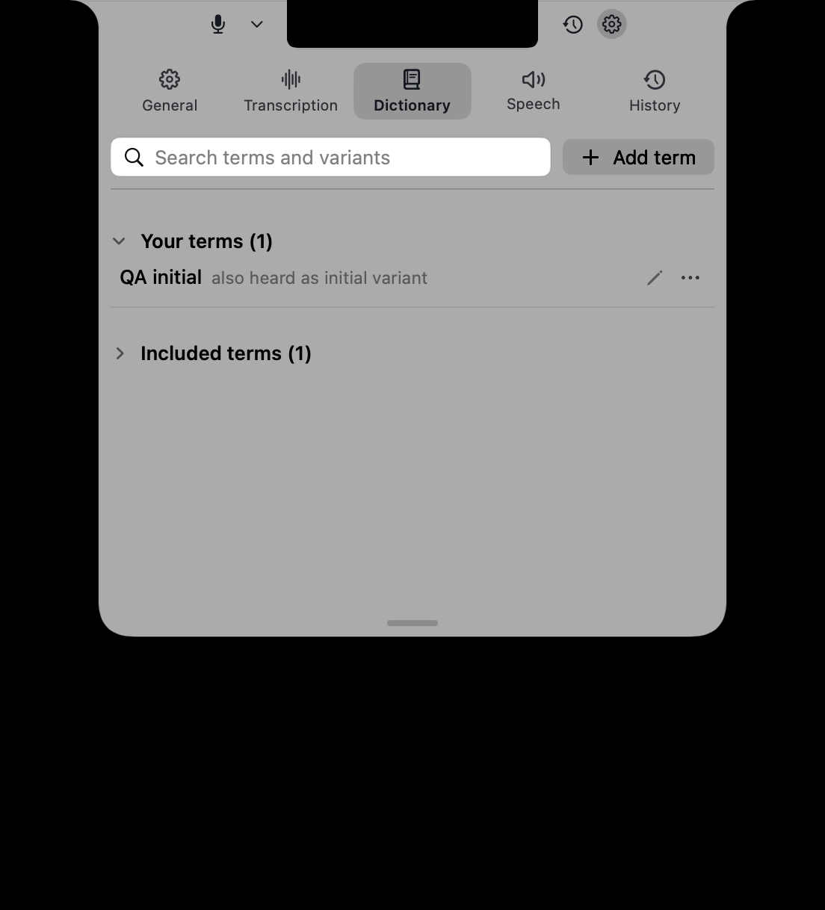 |

### 12. g-dictionary, dark

| BEFORE native2x | AFTER native2x |
|---|---|
|  |  |

## AFTER dark measurements

Native2x pixel ink edges divided by 2. AX selects ROIs; glass threshold >15 at y32px, notch seam at y20px, neutral ink >120. Antialias uncertainty about 0.5 pt. Physical safe-area enclosure is not substituted for the visible seam.

| State | Left wing pt | Right wing pt | Left ink → notch pt | Notch → right ink pt | Outer pads L/R pt |
|---|---:|---:|---:|---:|---:|
| a | 70.5 | 74.0 | 16.5 | 16.5 | 20.0 / 18.0 |
| b | 97.5 | 111.0 | 16.5 | 17.5 | 14.5 / 14.5 |
| c | 97.5 | 111.0 | 16.5 | 17.5 | 14.5 / 14.5 |
| c2 | 97.5 | 111.0 | 17.0 | 17.5 | 14.5 / 14.5 |
| d | 70.5 | 74.0 | 16.5 | 16.5 | 18.5 / 18.0 |

Dark spinner arc RGB [101, 176, 252] against band [35, 35, 35]: relative-luminance contrast 6.862:1. See [measurements.json](measurements.json) for ROIs, ink boxes and sampling details.

## o: hover open and close

AFTER icons ride with the outer wing edges: fully resolved dark ranges mic19–20pt, chevron46–47pt, History43–44pt, gear18–19pt; light mic19–20pt, chevron46–47pt, History43–44pt, gear17–18pt. Every range spans1pt. Partial icon fragments ARE visible at the inner notch-facing wing edge during emergence/retraction (dark frame017 mic/gear; frame020 History; light frame020 mic/gear and frame024 chevron). No resolved fragment touches the outer wing edge. Thus no blanket unclipped-icon claim. AFTER closing also shifts the recorded band right before shrinking: dark frame060→061 changes notch-gap pixels75–243 to263–416 in the union crop; light frame060→061 changes75–243 to262–416. The raw movie contains the shift. Product versus recorder-compositing cause is NOT VERIFIED. The original endpoint crop cut the shifted right wing; offline union crops include all visible band pixels without scaling. BEFORE opens with icons exposed by the expanding edge, then closes in one sampled cut (frame096→097), so eight distinct moving closing geometries do not exist in that baseline sequence. At least eight source frames bracket each transition; AFTER contains more than eight changing geometries in each direction.

### AFTER dark: 108 native1x frames

PTS 0.000–5145.000 ms. [1x GIF preview](images/after-dark-o.gif).

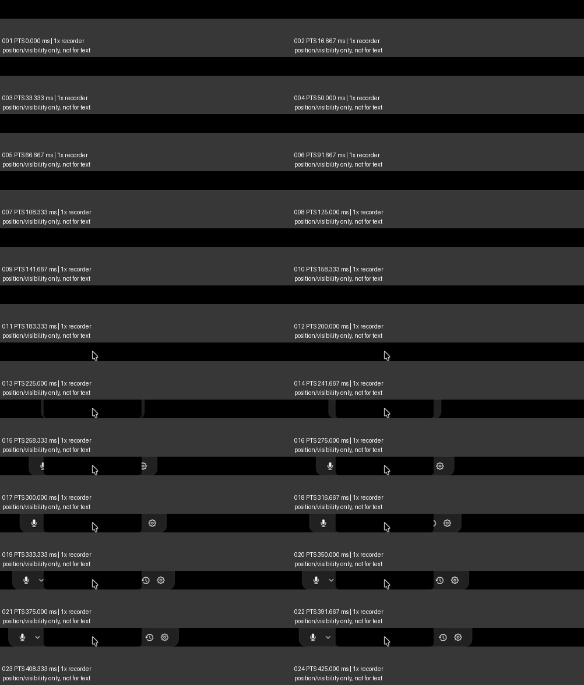

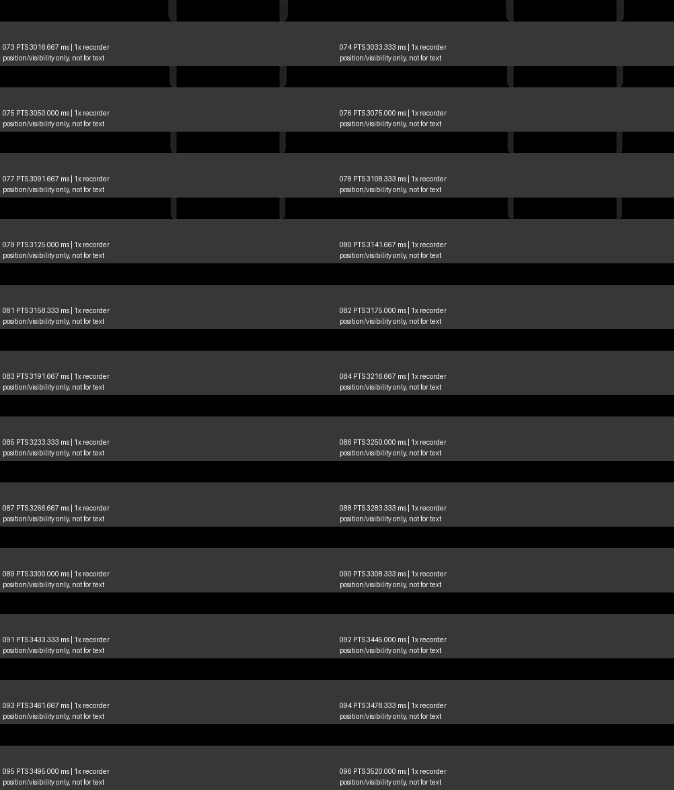

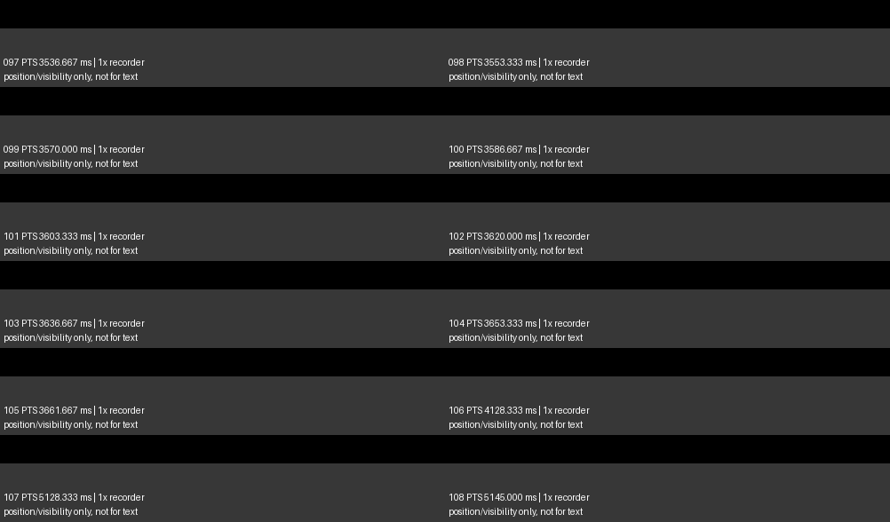

| Frame | Original PTS ms | Band edges at y16px |
|---|---:|---|
| [001](images/after-dark-o-recorder-001.png) | 0.000 | None |
| [002](images/after-dark-o-recorder-002.png) | 16.667 | None |
| [003](images/after-dark-o-recorder-003.png) | 33.333 | None |
| [004](images/after-dark-o-recorder-004.png) | 50.000 | None |
| [005](images/after-dark-o-recorder-005.png) | 66.667 | None |
| [006](images/after-dark-o-recorder-006.png) | 91.667 | None |
| [007](images/after-dark-o-recorder-007.png) | 108.333 | None |
| [008](images/after-dark-o-recorder-008.png) | 125.000 | None |
| [009](images/after-dark-o-recorder-009.png) | 141.667 | None |
| [010](images/after-dark-o-recorder-010.png) | 158.333 | None |
| [011](images/after-dark-o-recorder-011.png) | 183.333 | None |
| [012](images/after-dark-o-recorder-012.png) | 200.000 | None |
| [013](images/after-dark-o-recorder-013.png) | 225.000 | [157, 162] |
| [014](images/after-dark-o-recorder-014.png) | 241.667 | [157, 162] |
| [015](images/after-dark-o-recorder-015.png) | 258.333 | [70, 248] |
| [016](images/after-dark-o-recorder-016.png) | 275.000 | [62, 256] |
| [017](images/after-dark-o-recorder-017.png) | 300.000 | [49, 270] |
| [018](images/after-dark-o-recorder-018.png) | 316.667 | [41, 279] |
| [019](images/after-dark-o-recorder-019.png) | 333.333 | [34, 286] |
| [020](images/after-dark-o-recorder-020.png) | 350.000 | [29, 291] |
| [021](images/after-dark-o-recorder-021.png) | 375.000 | [20, 300] |
| [022](images/after-dark-o-recorder-022.png) | 391.667 | [17, 304] |
| [023](images/after-dark-o-recorder-023.png) | 408.333 | [14, 307] |
| [024](images/after-dark-o-recorder-024.png) | 425.000 | [12, 310] |
| [025](images/after-dark-o-recorder-025.png) | 450.000 | [9, 312] |
| [026](images/after-dark-o-recorder-026.png) | 466.667 | [8, 313] |
| [027](images/after-dark-o-recorder-027.png) | 483.333 | [7, 314] |
| [028](images/after-dark-o-recorder-028.png) | 500.000 | [7, 315] |
| [029](images/after-dark-o-recorder-029.png) | 516.667 | [6, 315] |
| [030](images/after-dark-o-recorder-030.png) | 533.333 | [6, 316] |
| [031](images/after-dark-o-recorder-031.png) | 550.000 | [5, 316] |
| [032](images/after-dark-o-recorder-032.png) | 566.667 | [5, 316] |
| [033](images/after-dark-o-recorder-033.png) | 591.667 | [5, 317] |
| [034](images/after-dark-o-recorder-034.png) | 608.333 | [5, 317] |
| [035](images/after-dark-o-recorder-035.png) | 625.000 | [5, 317] |
| [036](images/after-dark-o-recorder-036.png) | 641.667 | [5, 317] |
| [037](images/after-dark-o-recorder-037.png) | 658.333 | [5, 317] |
| [038](images/after-dark-o-recorder-038.png) | 683.333 | [5, 317] |
| [039](images/after-dark-o-recorder-039.png) | 700.000 | [5, 317] |
| [040](images/after-dark-o-recorder-040.png) | 716.667 | [5, 317] |
| [041](images/after-dark-o-recorder-041.png) | 733.333 | [5, 317] |
| [042](images/after-dark-o-recorder-042.png) | 750.000 | [5, 317] |
| [043](images/after-dark-o-recorder-043.png) | 766.667 | [5, 317] |
| [044](images/after-dark-o-recorder-044.png) | 791.667 | [5, 317] |
| [045](images/after-dark-o-recorder-045.png) | 808.333 | [5, 317] |
| [046](images/after-dark-o-recorder-046.png) | 825.000 | [5, 317] |
| [047](images/after-dark-o-recorder-047.png) | 841.667 | [5, 317] |
| [048](images/after-dark-o-recorder-048.png) | 1116.667 | [5, 317] |
| [049](images/after-dark-o-recorder-049.png) | 2066.667 | [5, 317] |
| [050](images/after-dark-o-recorder-050.png) | 2091.667 | [5, 317] |
| [051](images/after-dark-o-recorder-051.png) | 2108.333 | [5, 317] |
| [052](images/after-dark-o-recorder-052.png) | 2125.000 | [5, 317] |
| [053](images/after-dark-o-recorder-053.png) | 2141.667 | [5, 317] |
| [054](images/after-dark-o-recorder-054.png) | 2158.333 | [5, 317] |
| [055](images/after-dark-o-recorder-055.png) | 2175.000 | [5, 317] |
| [056](images/after-dark-o-recorder-056.png) | 2191.667 | [5, 317] |
| [057](images/after-dark-o-recorder-057.png) | 2208.333 | [5, 317] |
| [058](images/after-dark-o-recorder-058.png) | 2233.333 | [5, 317] |
| [059](images/after-dark-o-recorder-059.png) | 2250.000 | [5, 317] |
| [060](images/after-dark-o-recorder-060.png) | 2266.667 | [5, 317] |
| [061](images/after-dark-o-recorder-061.png) | 2800.000 | [184, 497] |
| [062](images/after-dark-o-recorder-062.png) | 2825.000 | [193, 487] |
| [063](images/after-dark-o-recorder-063.png) | 2841.667 | [202, 478] |
| [064](images/after-dark-o-recorder-064.png) | 2858.333 | [211, 469] |
| [065](images/after-dark-o-recorder-065.png) | 2875.000 | [216, 463] |
| [066](images/after-dark-o-recorder-066.png) | 2891.667 | [224, 456] |
| [067](images/after-dark-o-recorder-067.png) | 2908.333 | [227, 452] |
| [068](images/after-dark-o-recorder-068.png) | 2933.333 | [238, 441] |
| [069](images/after-dark-o-recorder-069.png) | 2950.000 | [241, 437] |
| [070](images/after-dark-o-recorder-070.png) | 2966.667 | [245, 434] |
| [071](images/after-dark-o-recorder-071.png) | 2983.333 | [247, 432] |
| [072](images/after-dark-o-recorder-072.png) | 3000.000 | [249, 430] |
| [073](images/after-dark-o-recorder-073.png) | 3016.667 | [250, 428] |
| [074](images/after-dark-o-recorder-074.png) | 3033.333 | [251, 427] |
| [075](images/after-dark-o-recorder-075.png) | 3050.000 | [252, 426] |
| [076](images/after-dark-o-recorder-076.png) | 3075.000 | [253, 425] |
| [077](images/after-dark-o-recorder-077.png) | 3091.667 | [253, 425] |
| [078](images/after-dark-o-recorder-078.png) | 3108.333 | [254, 424] |
| [079](images/after-dark-o-recorder-079.png) | 3125.000 | [254, 424] |
| [080](images/after-dark-o-recorder-080.png) | 3141.667 | [254, 424] |
| [081](images/after-dark-o-recorder-081.png) | 3158.333 | None |
| [082](images/after-dark-o-recorder-082.png) | 3175.000 | None |
| [083](images/after-dark-o-recorder-083.png) | 3191.667 | None |
| [084](images/after-dark-o-recorder-084.png) | 3216.667 | None |
| [085](images/after-dark-o-recorder-085.png) | 3233.333 | None |
| [086](images/after-dark-o-recorder-086.png) | 3250.000 | None |
| [087](images/after-dark-o-recorder-087.png) | 3266.667 | None |
| [088](images/after-dark-o-recorder-088.png) | 3283.333 | None |
| [089](images/after-dark-o-recorder-089.png) | 3300.000 | None |
| [090](images/after-dark-o-recorder-090.png) | 3308.333 | None |
| [091](images/after-dark-o-recorder-091.png) | 3433.333 | None |
| [092](images/after-dark-o-recorder-092.png) | 3445.000 | None |
| [093](images/after-dark-o-recorder-093.png) | 3461.667 | None |
| [094](images/after-dark-o-recorder-094.png) | 3478.333 | None |
| [095](images/after-dark-o-recorder-095.png) | 3495.000 | None |
| [096](images/after-dark-o-recorder-096.png) | 3520.000 | None |
| [097](images/after-dark-o-recorder-097.png) | 3536.667 | None |
| [098](images/after-dark-o-recorder-098.png) | 3553.333 | None |
| [099](images/after-dark-o-recorder-099.png) | 3570.000 | None |
| [100](images/after-dark-o-recorder-100.png) | 3586.667 | None |
| [101](images/after-dark-o-recorder-101.png) | 3603.333 | None |
| [102](images/after-dark-o-recorder-102.png) | 3620.000 | None |
| [103](images/after-dark-o-recorder-103.png) | 3636.667 | None |
| [104](images/after-dark-o-recorder-104.png) | 3653.333 | None |
| [105](images/after-dark-o-recorder-105.png) | 3661.667 | None |
| [106](images/after-dark-o-recorder-106.png) | 4128.333 | None |
| [107](images/after-dark-o-recorder-107.png) | 5128.333 | None |
| [108](images/after-dark-o-recorder-108.png) | 5145.000 | None |

### BEFORE dark: 128 native1x frames

PTS 0.000–5716.667 ms. [1x GIF preview](images/before-dark-o.gif).

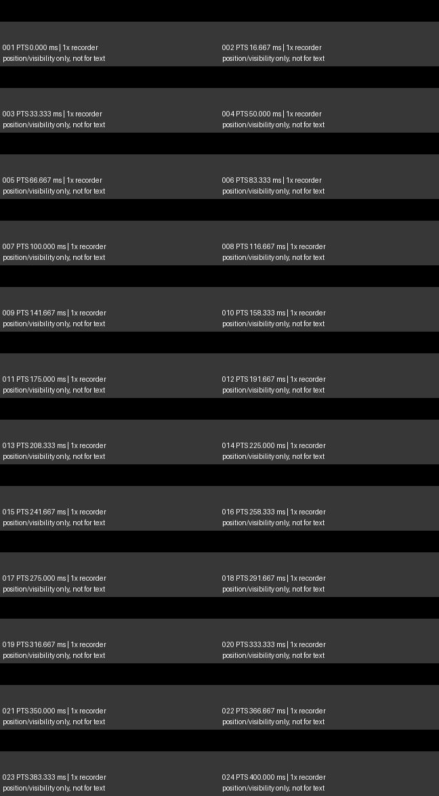

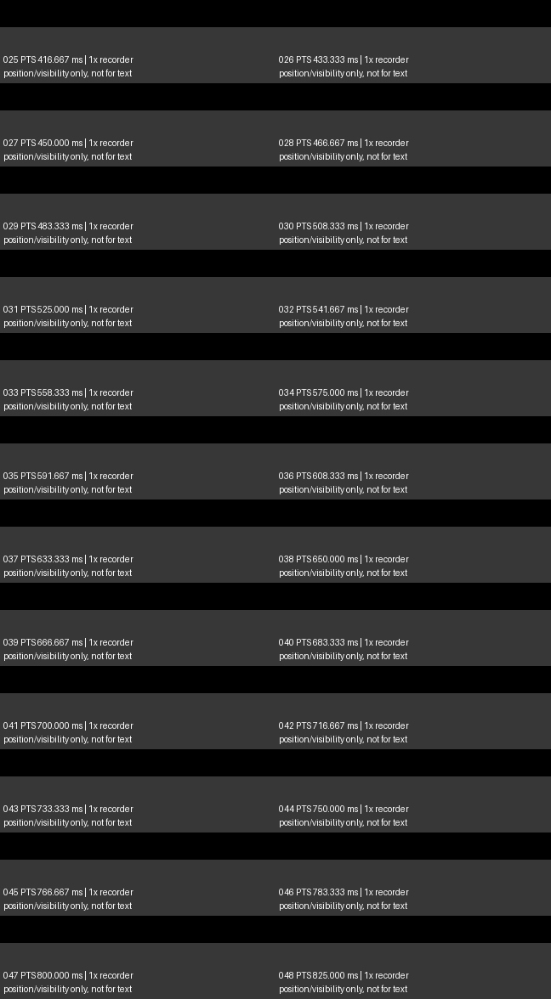

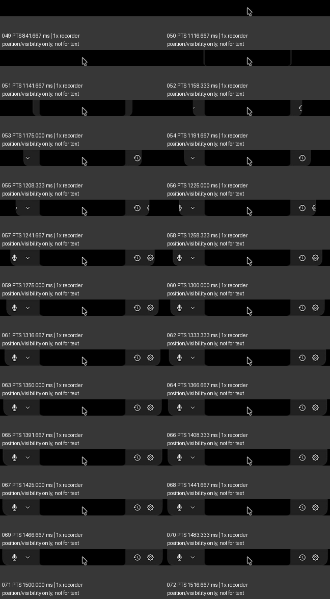

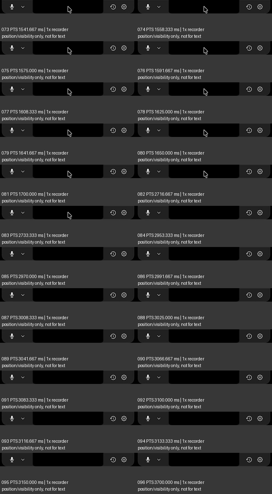

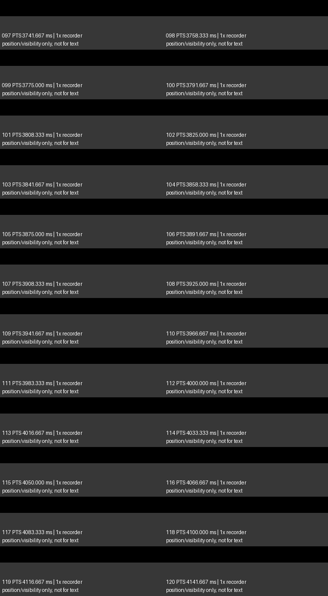

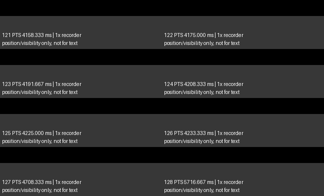

| Frame | Original PTS ms | Band edges at y16px |
|---|---:|---|
| [001](images/before-dark-o-recorder-001.png) | 0.000 | None |
| [002](images/before-dark-o-recorder-002.png) | 16.667 | None |
| [003](images/before-dark-o-recorder-003.png) | 33.333 | None |
| [004](images/before-dark-o-recorder-004.png) | 50.000 | None |
| [005](images/before-dark-o-recorder-005.png) | 66.667 | None |
| [006](images/before-dark-o-recorder-006.png) | 83.333 | None |
| [007](images/before-dark-o-recorder-007.png) | 100.000 | None |
| [008](images/before-dark-o-recorder-008.png) | 116.667 | None |
| [009](images/before-dark-o-recorder-009.png) | 141.667 | None |
| [010](images/before-dark-o-recorder-010.png) | 158.333 | None |
| [011](images/before-dark-o-recorder-011.png) | 175.000 | None |
| [012](images/before-dark-o-recorder-012.png) | 191.667 | None |
| [013](images/before-dark-o-recorder-013.png) | 208.333 | None |
| [014](images/before-dark-o-recorder-014.png) | 225.000 | None |
| [015](images/before-dark-o-recorder-015.png) | 241.667 | None |
| [016](images/before-dark-o-recorder-016.png) | 258.333 | None |
| [017](images/before-dark-o-recorder-017.png) | 275.000 | None |
| [018](images/before-dark-o-recorder-018.png) | 291.667 | None |
| [019](images/before-dark-o-recorder-019.png) | 316.667 | None |
| [020](images/before-dark-o-recorder-020.png) | 333.333 | None |
| [021](images/before-dark-o-recorder-021.png) | 350.000 | None |
| [022](images/before-dark-o-recorder-022.png) | 366.667 | None |
| [023](images/before-dark-o-recorder-023.png) | 383.333 | None |
| [024](images/before-dark-o-recorder-024.png) | 400.000 | None |
| [025](images/before-dark-o-recorder-025.png) | 416.667 | None |
| [026](images/before-dark-o-recorder-026.png) | 433.333 | None |
| [027](images/before-dark-o-recorder-027.png) | 450.000 | None |
| [028](images/before-dark-o-recorder-028.png) | 466.667 | None |
| [029](images/before-dark-o-recorder-029.png) | 483.333 | None |
| [030](images/before-dark-o-recorder-030.png) | 508.333 | None |
| [031](images/before-dark-o-recorder-031.png) | 525.000 | None |
| [032](images/before-dark-o-recorder-032.png) | 541.667 | None |
| [033](images/before-dark-o-recorder-033.png) | 558.333 | None |
| [034](images/before-dark-o-recorder-034.png) | 575.000 | None |
| [035](images/before-dark-o-recorder-035.png) | 591.667 | None |
| [036](images/before-dark-o-recorder-036.png) | 608.333 | None |
| [037](images/before-dark-o-recorder-037.png) | 633.333 | None |
| [038](images/before-dark-o-recorder-038.png) | 650.000 | None |
| [039](images/before-dark-o-recorder-039.png) | 666.667 | None |
| [040](images/before-dark-o-recorder-040.png) | 683.333 | None |
| [041](images/before-dark-o-recorder-041.png) | 700.000 | None |
| [042](images/before-dark-o-recorder-042.png) | 716.667 | None |
| [043](images/before-dark-o-recorder-043.png) | 733.333 | None |
| [044](images/before-dark-o-recorder-044.png) | 750.000 | None |
| [045](images/before-dark-o-recorder-045.png) | 766.667 | None |
| [046](images/before-dark-o-recorder-046.png) | 783.333 | None |
| [047](images/before-dark-o-recorder-047.png) | 800.000 | None |
| [048](images/before-dark-o-recorder-048.png) | 825.000 | None |
| [049](images/before-dark-o-recorder-049.png) | 841.667 | None |
| [050](images/before-dark-o-recorder-050.png) | 1116.667 | [160, 165] |
| [051](images/before-dark-o-recorder-051.png) | 1141.667 | [160, 165] |
| [052](images/before-dark-o-recorder-052.png) | 1158.333 | [75, 249] |
| [053](images/before-dark-o-recorder-053.png) | 1175.000 | [64, 260] |
| [054](images/before-dark-o-recorder-054.png) | 1191.667 | [55, 269] |
| [055](images/before-dark-o-recorder-055.png) | 1208.333 | [46, 278] |
| [056](images/before-dark-o-recorder-056.png) | 1225.000 | [38, 287] |
| [057](images/before-dark-o-recorder-057.png) | 1241.667 | [31, 291] |
| [058](images/before-dark-o-recorder-058.png) | 1258.333 | [27, 295] |
| [059](images/before-dark-o-recorder-059.png) | 1275.000 | [20, 304] |
| [060](images/before-dark-o-recorder-060.png) | 1300.000 | [15, 309] |
| [061](images/before-dark-o-recorder-061.png) | 1316.667 | [12, 312] |
| [062](images/before-dark-o-recorder-062.png) | 1333.333 | [10, 314] |
| [063](images/before-dark-o-recorder-063.png) | 1350.000 | [9, 315] |
| [064](images/before-dark-o-recorder-064.png) | 1366.667 | [8, 316] |
| [065](images/before-dark-o-recorder-065.png) | 1391.667 | [6, 318] |
| [066](images/before-dark-o-recorder-066.png) | 1408.333 | [6, 318] |
| [067](images/before-dark-o-recorder-067.png) | 1425.000 | [5, 319] |
| [068](images/before-dark-o-recorder-068.png) | 1441.667 | [5, 319] |
| [069](images/before-dark-o-recorder-069.png) | 1466.667 | [5, 319] |
| [070](images/before-dark-o-recorder-070.png) | 1483.333 | [5, 319] |
| [071](images/before-dark-o-recorder-071.png) | 1500.000 | [4, 320] |
| [072](images/before-dark-o-recorder-072.png) | 1516.667 | [4, 320] |
| [073](images/before-dark-o-recorder-073.png) | 1541.667 | [4, 320] |
| [074](images/before-dark-o-recorder-074.png) | 1558.333 | [4, 320] |
| [075](images/before-dark-o-recorder-075.png) | 1575.000 | [4, 320] |
| [076](images/before-dark-o-recorder-076.png) | 1591.667 | [4, 320] |
| [077](images/before-dark-o-recorder-077.png) | 1608.333 | [4, 320] |
| [078](images/before-dark-o-recorder-078.png) | 1625.000 | [4, 320] |
| [079](images/before-dark-o-recorder-079.png) | 1641.667 | [4, 320] |
| [080](images/before-dark-o-recorder-080.png) | 1650.000 | [4, 320] |
| [081](images/before-dark-o-recorder-081.png) | 1700.000 | [4, 320] |
| [082](images/before-dark-o-recorder-082.png) | 2716.667 | [4, 320] |
| [083](images/before-dark-o-recorder-083.png) | 2733.333 | [4, 320] |
| [084](images/before-dark-o-recorder-084.png) | 2953.333 | [4, 320] |
| [085](images/before-dark-o-recorder-085.png) | 2970.000 | [4, 320] |
| [086](images/before-dark-o-recorder-086.png) | 2991.667 | [4, 320] |
| [087](images/before-dark-o-recorder-087.png) | 3008.333 | [4, 320] |
| [088](images/before-dark-o-recorder-088.png) | 3025.000 | [4, 320] |
| [089](images/before-dark-o-recorder-089.png) | 3041.667 | [4, 320] |
| [090](images/before-dark-o-recorder-090.png) | 3066.667 | [4, 320] |
| [091](images/before-dark-o-recorder-091.png) | 3083.333 | [4, 320] |
| [092](images/before-dark-o-recorder-092.png) | 3100.000 | [4, 320] |
| [093](images/before-dark-o-recorder-093.png) | 3116.667 | [4, 320] |
| [094](images/before-dark-o-recorder-094.png) | 3133.333 | [4, 320] |
| [095](images/before-dark-o-recorder-095.png) | 3150.000 | [4, 320] |
| [096](images/before-dark-o-recorder-096.png) | 3700.000 | [4, 320] |
| [097](images/before-dark-o-recorder-097.png) | 3741.667 | None |
| [098](images/before-dark-o-recorder-098.png) | 3758.333 | None |
| [099](images/before-dark-o-recorder-099.png) | 3775.000 | None |
| [100](images/before-dark-o-recorder-100.png) | 3791.667 | None |
| [101](images/before-dark-o-recorder-101.png) | 3808.333 | None |
| [102](images/before-dark-o-recorder-102.png) | 3825.000 | None |
| [103](images/before-dark-o-recorder-103.png) | 3841.667 | None |
| [104](images/before-dark-o-recorder-104.png) | 3858.333 | None |
| [105](images/before-dark-o-recorder-105.png) | 3875.000 | None |
| [106](images/before-dark-o-recorder-106.png) | 3891.667 | None |
| [107](images/before-dark-o-recorder-107.png) | 3908.333 | None |
| [108](images/before-dark-o-recorder-108.png) | 3925.000 | None |
| [109](images/before-dark-o-recorder-109.png) | 3941.667 | None |
| [110](images/before-dark-o-recorder-110.png) | 3966.667 | None |
| [111](images/before-dark-o-recorder-111.png) | 3983.333 | None |
| [112](images/before-dark-o-recorder-112.png) | 4000.000 | None |
| [113](images/before-dark-o-recorder-113.png) | 4016.667 | None |
| [114](images/before-dark-o-recorder-114.png) | 4033.333 | None |
| [115](images/before-dark-o-recorder-115.png) | 4050.000 | None |
| [116](images/before-dark-o-recorder-116.png) | 4066.667 | None |
| [117](images/before-dark-o-recorder-117.png) | 4083.333 | None |
| [118](images/before-dark-o-recorder-118.png) | 4100.000 | None |
| [119](images/before-dark-o-recorder-119.png) | 4116.667 | None |
| [120](images/before-dark-o-recorder-120.png) | 4141.667 | None |
| [121](images/before-dark-o-recorder-121.png) | 4158.333 | None |
| [122](images/before-dark-o-recorder-122.png) | 4175.000 | None |
| [123](images/before-dark-o-recorder-123.png) | 4191.667 | None |
| [124](images/before-dark-o-recorder-124.png) | 4208.333 | None |
| [125](images/before-dark-o-recorder-125.png) | 4225.000 | None |
| [126](images/before-dark-o-recorder-126.png) | 4233.333 | None |
| [127](images/before-dark-o-recorder-127.png) | 4708.333 | None |
| [128](images/before-dark-o-recorder-128.png) | 5716.667 | None |

### AFTER light: 104 native1x frames

PTS 0.000–5483.333 ms. [1x GIF preview](images/after-light-o.gif).

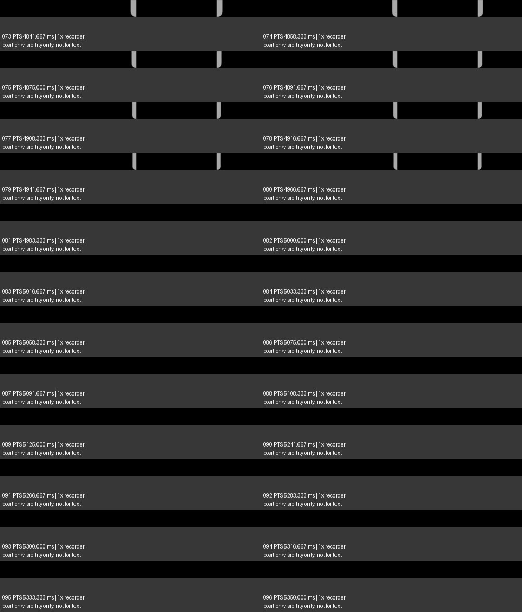

| Frame | Original PTS ms | Band edges at y16px |
|---|---:|---|
| [001](images/after-light-o-recorder-001.png) | 0.000 | None |
| [002](images/after-light-o-recorder-002.png) | 16.667 | None |
| [003](images/after-light-o-recorder-003.png) | 33.333 | None |
| [004](images/after-light-o-recorder-004.png) | 50.000 | None |
| [005](images/after-light-o-recorder-005.png) | 66.667 | None |
| [006](images/after-light-o-recorder-006.png) | 83.333 | None |
| [007](images/after-light-o-recorder-007.png) | 108.333 | None |
| [008](images/after-light-o-recorder-008.png) | 125.000 | None |
| [009](images/after-light-o-recorder-009.png) | 141.667 | None |
| [010](images/after-light-o-recorder-010.png) | 158.333 | None |
| [011](images/after-light-o-recorder-011.png) | 175.000 | None |
| [012](images/after-light-o-recorder-012.png) | 191.667 | None |
| [013](images/after-light-o-recorder-013.png) | 200.000 | None |
| [014](images/after-light-o-recorder-014.png) | 233.333 | None |
| [015](images/after-light-o-recorder-015.png) | 250.000 | None |
| [016](images/after-light-o-recorder-016.png) | 275.000 | [158, 161] |
| [017](images/after-light-o-recorder-017.png) | 291.667 | [158, 161] |
| [018](images/after-light-o-recorder-018.png) | 308.333 | [72, 246] |
| [019](images/after-light-o-recorder-019.png) | 325.000 | [65, 253] |
| [020](images/after-light-o-recorder-020.png) | 350.000 | [52, 267] |
| [021](images/after-light-o-recorder-021.png) | 366.667 | [44, 276] |
| [022](images/after-light-o-recorder-022.png) | 383.333 | [36, 284] |
| [023](images/after-light-o-recorder-023.png) | 400.000 | [33, 287] |
| [024](images/after-light-o-recorder-024.png) | 416.667 | [24, 296] |
| [025](images/after-light-o-recorder-025.png) | 433.333 | [20, 301] |
| [026](images/after-light-o-recorder-026.png) | 450.000 | [17, 304] |
| [027](images/after-light-o-recorder-027.png) | 466.667 | [14, 307] |
| [028](images/after-light-o-recorder-028.png) | 491.667 | [11, 310] |
| [029](images/after-light-o-recorder-029.png) | 508.333 | [9, 312] |
| [030](images/after-light-o-recorder-030.png) | 525.000 | [8, 313] |
| [031](images/after-light-o-recorder-031.png) | 541.667 | [7, 314] |
| [032](images/after-light-o-recorder-032.png) | 558.333 | [7, 315] |
| [033](images/after-light-o-recorder-033.png) | 575.000 | [6, 315] |
| [034](images/after-light-o-recorder-034.png) | 591.667 | [6, 315] |
| [035](images/after-light-o-recorder-035.png) | 616.667 | [6, 316] |
| [036](images/after-light-o-recorder-036.png) | 633.333 | [5, 316] |
| [037](images/after-light-o-recorder-037.png) | 650.000 | [5, 316] |
| [038](images/after-light-o-recorder-038.png) | 666.667 | [5, 316] |
| [039](images/after-light-o-recorder-039.png) | 683.333 | [5, 316] |
| [040](images/after-light-o-recorder-040.png) | 700.000 | [5, 316] |
| [041](images/after-light-o-recorder-041.png) | 716.667 | [5, 316] |
| [042](images/after-light-o-recorder-042.png) | 733.333 | [5, 316] |
| [043](images/after-light-o-recorder-043.png) | 750.000 | [5, 316] |
| [044](images/after-light-o-recorder-044.png) | 775.000 | [5, 317] |
| [045](images/after-light-o-recorder-045.png) | 791.667 | [5, 317] |
| [046](images/after-light-o-recorder-046.png) | 808.333 | [5, 317] |
| [047](images/after-light-o-recorder-047.png) | 825.000 | [5, 317] |
| [048](images/after-light-o-recorder-048.png) | 833.333 | [5, 317] |
| [049](images/after-light-o-recorder-049.png) | 2075.000 | [5, 317] |
| [050](images/after-light-o-recorder-050.png) | 2091.667 | [5, 317] |
| [051](images/after-light-o-recorder-051.png) | 2108.333 | [5, 317] |
| [052](images/after-light-o-recorder-052.png) | 2133.333 | [5, 317] |
| [053](images/after-light-o-recorder-053.png) | 2150.000 | [5, 317] |
| [054](images/after-light-o-recorder-054.png) | 2166.667 | [5, 317] |
| [055](images/after-light-o-recorder-055.png) | 2183.333 | [5, 317] |
| [056](images/after-light-o-recorder-056.png) | 2200.000 | [5, 317] |
| [057](images/after-light-o-recorder-057.png) | 2216.667 | [5, 317] |
| [058](images/after-light-o-recorder-058.png) | 2233.333 | [5, 317] |
| [059](images/after-light-o-recorder-059.png) | 2250.000 | [5, 317] |
| [060](images/after-light-o-recorder-060.png) | 2266.667 | [5, 317] |
| [061](images/after-light-o-recorder-061.png) | 4633.333 | [185, 497] |
| [062](images/after-light-o-recorder-062.png) | 4650.000 | [189, 492] |
| [063](images/after-light-o-recorder-063.png) | 4666.667 | [201, 480] |
| [064](images/after-light-o-recorder-064.png) | 4683.333 | [210, 470] |
| [065](images/after-light-o-recorder-065.png) | 4700.000 | [218, 462] |
| [066](images/after-light-o-recorder-066.png) | 4716.667 | [225, 454] |
| [067](images/after-light-o-recorder-067.png) | 4733.333 | [228, 451] |
| [068](images/after-light-o-recorder-068.png) | 4750.000 | [237, 442] |
| [069](images/after-light-o-recorder-069.png) | 4766.667 | [241, 438] |
| [070](images/after-light-o-recorder-070.png) | 4783.333 | [244, 435] |
| [071](images/after-light-o-recorder-071.png) | 4808.333 | [248, 431] |
| [072](images/after-light-o-recorder-072.png) | 4825.000 | [249, 429] |
| [073](images/after-light-o-recorder-073.png) | 4841.667 | [251, 428] |
| [074](images/after-light-o-recorder-074.png) | 4858.333 | [252, 427] |
| [075](images/after-light-o-recorder-075.png) | 4875.000 | [253, 426] |
| [076](images/after-light-o-recorder-076.png) | 4891.667 | [253, 425] |
| [077](images/after-light-o-recorder-077.png) | 4908.333 | [254, 424] |
| [078](images/after-light-o-recorder-078.png) | 4916.667 | [254, 424] |
| [079](images/after-light-o-recorder-079.png) | 4941.667 | [254, 424] |
| [080](images/after-light-o-recorder-080.png) | 4966.667 | [255, 424] |
| [081](images/after-light-o-recorder-081.png) | 4983.333 | None |
| [082](images/after-light-o-recorder-082.png) | 5000.000 | None |
| [083](images/after-light-o-recorder-083.png) | 5016.667 | None |
| [084](images/after-light-o-recorder-084.png) | 5033.333 | None |
| [085](images/after-light-o-recorder-085.png) | 5058.333 | None |
| [086](images/after-light-o-recorder-086.png) | 5075.000 | None |
| [087](images/after-light-o-recorder-087.png) | 5091.667 | None |
| [088](images/after-light-o-recorder-088.png) | 5108.333 | None |
| [089](images/after-light-o-recorder-089.png) | 5125.000 | None |
| [090](images/after-light-o-recorder-090.png) | 5241.667 | None |
| [091](images/after-light-o-recorder-091.png) | 5266.667 | None |
| [092](images/after-light-o-recorder-092.png) | 5283.333 | None |
| [093](images/after-light-o-recorder-093.png) | 5300.000 | None |
| [094](images/after-light-o-recorder-094.png) | 5316.667 | None |
| [095](images/after-light-o-recorder-095.png) | 5333.333 | None |
| [096](images/after-light-o-recorder-096.png) | 5350.000 | None |
| [097](images/after-light-o-recorder-097.png) | 5366.667 | None |
| [098](images/after-light-o-recorder-098.png) | 5383.333 | None |
| [099](images/after-light-o-recorder-099.png) | 5400.000 | None |
| [100](images/after-light-o-recorder-100.png) | 5425.000 | None |
| [101](images/after-light-o-recorder-101.png) | 5441.667 | None |
| [102](images/after-light-o-recorder-102.png) | 5458.333 | None |
| [103](images/after-light-o-recorder-103.png) | 5475.000 | None |
| [104](images/after-light-o-recorder-104.png) | 5483.333 | None |

## e: recording → transcribing

AFTER recording controls transition to the spinner/navigation while the wings contract. The 15fps samples do not establish sub-frame continuity; the first dark transition sample is already substantially contracted. BEFORE e is reused from the same frozen baseline.

### AFTER dark: 23 native1x frames

PTS 0.000–1466.667 ms. [1x GIF preview](images/after-dark-e.gif).

| Frame | Original PTS ms | Band edges at y16px |
|---|---:|---|
| [001](images/after-dark-e-recorder-001.png) | 0.000 | [96, 472] |
| [002](images/after-dark-e-recorder-002.png) | 66.667 | [96, 472] |
| [003](images/after-dark-e-recorder-003.png) | 133.333 | [96, 472] |
| [004](images/after-dark-e-recorder-004.png) | 200.000 | [105, 459] |
| [005](images/after-dark-e-recorder-005.png) | 275.000 | [116, 444] |
| [006](images/after-dark-e-recorder-006.png) | 341.667 | [120, 438] |
| [007](images/after-dark-e-recorder-007.png) | 408.333 | [122, 436] |
| [008](images/after-dark-e-recorder-008.png) | 483.333 | [122, 435] |
| [009](images/after-dark-e-recorder-009.png) | 550.000 | [123, 435] |
| [010](images/after-dark-e-recorder-010.png) | 616.667 | [123, 435] |
| [011](images/after-dark-e-recorder-011.png) | 683.333 | [123, 435] |
| [012](images/after-dark-e-recorder-012.png) | 750.000 | [123, 435] |
| [013](images/after-dark-e-recorder-013.png) | 816.667 | [123, 435] |
| [014](images/after-dark-e-recorder-014.png) | 866.667 | [123, 435] |
| [015](images/after-dark-e-recorder-015.png) | 933.333 | [123, 435] |
| [016](images/after-dark-e-recorder-016.png) | 1000.000 | [123, 435] |
| [017](images/after-dark-e-recorder-017.png) | 1066.667 | [123, 435] |
| [018](images/after-dark-e-recorder-018.png) | 1141.667 | [123, 435] |
| [019](images/after-dark-e-recorder-019.png) | 1200.000 | [123, 435] |
| [020](images/after-dark-e-recorder-020.png) | 1266.667 | [123, 435] |
| [021](images/after-dark-e-recorder-021.png) | 1333.333 | [123, 435] |
| [022](images/after-dark-e-recorder-022.png) | 1400.000 | [123, 435] |
| [023](images/after-dark-e-recorder-023.png) | 1466.667 | [123, 435] |

### AFTER light: 37 native1x frames

PTS 0.000–2416.667 ms. [1x GIF preview](images/after-light-e.gif).

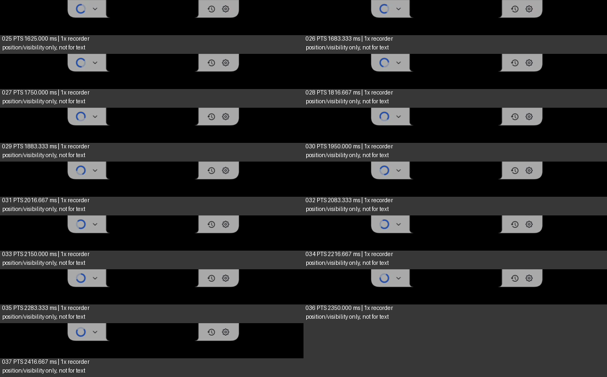

| Frame | Original PTS ms | Band edges at y16px |
|---|---:|---|
| [001](images/after-light-e-recorder-001.png) | 0.000 | [96, 472] |
| [002](images/after-light-e-recorder-002.png) | 66.667 | [96, 472] |
| [003](images/after-light-e-recorder-003.png) | 133.333 | [96, 472] |
| [004](images/after-light-e-recorder-004.png) | 200.000 | [96, 472] |
| [005](images/after-light-e-recorder-005.png) | 266.667 | [96, 472] |
| [006](images/after-light-e-recorder-006.png) | 341.667 | [96, 472] |
| [007](images/after-light-e-recorder-007.png) | 408.333 | [96, 472] |
| [008](images/after-light-e-recorder-008.png) | 475.000 | [96, 472] |
| [009](images/after-light-e-recorder-009.png) | 541.667 | [96, 472] |
| [010](images/after-light-e-recorder-010.png) | 608.333 | [96, 472] |
| [011](images/after-light-e-recorder-011.png) | 675.000 | [96, 472] |
| [012](images/after-light-e-recorder-012.png) | 741.667 | [96, 472] |
| [013](images/after-light-e-recorder-013.png) | 816.667 | [96, 472] |
| [014](images/after-light-e-recorder-014.png) | 875.000 | [96, 472] |
| [015](images/after-light-e-recorder-015.png) | 941.667 | [96, 472] |
| [016](images/after-light-e-recorder-016.png) | 1008.333 | [96, 472] |
| [017](images/after-light-e-recorder-017.png) | 1041.667 | [96, 472] |
| [018](images/after-light-e-recorder-018.png) | 1150.000 | [99, 467] |
| [019](images/after-light-e-recorder-019.png) | 1216.667 | [112, 450] |
| [020](images/after-light-e-recorder-020.png) | 1283.333 | [119, 440] |
| [021](images/after-light-e-recorder-021.png) | 1350.000 | [122, 436] |
| [022](images/after-light-e-recorder-022.png) | 1408.333 | [122, 435] |
| [023](images/after-light-e-recorder-023.png) | 1491.667 | [123, 435] |
| [024](images/after-light-e-recorder-024.png) | 1558.333 | [123, 435] |
| [025](images/after-light-e-recorder-025.png) | 1625.000 | [123, 435] |
| [026](images/after-light-e-recorder-026.png) | 1683.333 | [123, 435] |
| [027](images/after-light-e-recorder-027.png) | 1750.000 | [123, 435] |
| [028](images/after-light-e-recorder-028.png) | 1816.667 | [123, 435] |
| [029](images/after-light-e-recorder-029.png) | 1883.333 | [123, 435] |
| [030](images/after-light-e-recorder-030.png) | 1950.000 | [123, 435] |
| [031](images/after-light-e-recorder-031.png) | 2016.667 | [123, 435] |
| [032](images/after-light-e-recorder-032.png) | 2083.333 | [123, 435] |
| [033](images/after-light-e-recorder-033.png) | 2150.000 | [123, 435] |
| [034](images/after-light-e-recorder-034.png) | 2216.667 | [123, 435] |
| [035](images/after-light-e-recorder-035.png) | 2283.333 | [123, 435] |
| [036](images/after-light-e-recorder-036.png) | 2350.000 | [123, 435] |
| [037](images/after-light-e-recorder-037.png) | 2416.667 | [123, 435] |

### BEFORE light: 32 native1x frames

PTS 0.000–2158.333 ms. [1x GIF preview](images/before-light-e.gif).

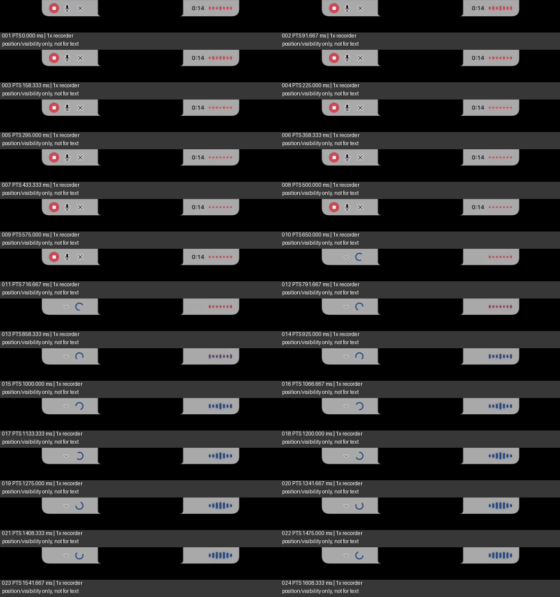

| Frame | Original PTS ms | Band edges at y16px |
|---|---:|---|
| [001](images/before-light-e-recorder-001.png) | 0.000 | [82, 472] |
| [002](images/before-light-e-recorder-002.png) | 91.667 | [82, 472] |
| [003](images/before-light-e-recorder-003.png) | 158.333 | [82, 472] |
| [004](images/before-light-e-recorder-004.png) | 225.000 | [82, 472] |
| [005](images/before-light-e-recorder-005.png) | 295.000 | [82, 472] |
| [006](images/before-light-e-recorder-006.png) | 358.333 | [82, 472] |
| [007](images/before-light-e-recorder-007.png) | 433.333 | [82, 472] |
| [008](images/before-light-e-recorder-008.png) | 500.000 | [82, 472] |
| [009](images/before-light-e-recorder-009.png) | 575.000 | [82, 472] |
| [010](images/before-light-e-recorder-010.png) | 650.000 | [82, 472] |
| [011](images/before-light-e-recorder-011.png) | 716.667 | [82, 472] |
| [012](images/before-light-e-recorder-012.png) | 791.667 | [82, 472] |
| [013](images/before-light-e-recorder-013.png) | 858.333 | [82, 472] |
| [014](images/before-light-e-recorder-014.png) | 925.000 | [82, 472] |
| [015](images/before-light-e-recorder-015.png) | 1000.000 | [82, 472] |
| [016](images/before-light-e-recorder-016.png) | 1066.667 | [82, 472] |
| [017](images/before-light-e-recorder-017.png) | 1133.333 | [82, 472] |
| [018](images/before-light-e-recorder-018.png) | 1200.000 | [82, 472] |
| [019](images/before-light-e-recorder-019.png) | 1275.000 | [82, 472] |
| [020](images/before-light-e-recorder-020.png) | 1341.667 | [82, 472] |
| [021](images/before-light-e-recorder-021.png) | 1408.333 | [82, 472] |
| [022](images/before-light-e-recorder-022.png) | 1475.000 | [82, 472] |
| [023](images/before-light-e-recorder-023.png) | 1541.667 | [82, 472] |
| [024](images/before-light-e-recorder-024.png) | 1608.333 | [82, 472] |
| [025](images/before-light-e-recorder-025.png) | 1675.000 | [82, 472] |
| [026](images/before-light-e-recorder-026.png) | 1741.667 | [82, 472] |
| [027](images/before-light-e-recorder-027.png) | 1816.667 | [82, 472] |
| [028](images/before-light-e-recorder-028.png) | 1883.333 | [82, 472] |
| [029](images/before-light-e-recorder-029.png) | 1950.000 | [82, 472] |
| [030](images/before-light-e-recorder-030.png) | 2025.000 | [82, 472] |
| [031](images/before-light-e-recorder-031.png) | 2091.667 | [82, 472] |
| [032](images/before-light-e-recorder-032.png) | 2158.333 | [82, 472] |

### BEFORE dark: 33 native1x frames

PTS 0.000–2200.000 ms. [1x GIF preview](images/before-dark-e.gif).

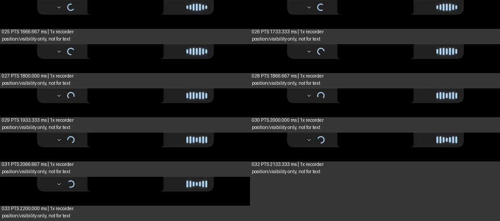

| Frame | Original PTS ms | Band edges at y16px |
|---|---:|---|
| [001](images/before-dark-e-recorder-001.png) | 0.000 | [82, 472] |
| [002](images/before-dark-e-recorder-002.png) | 66.667 | [82, 472] |
| [003](images/before-dark-e-recorder-003.png) | 133.333 | [82, 472] |
| [004](images/before-dark-e-recorder-004.png) | 208.333 | [82, 472] |
| [005](images/before-dark-e-recorder-005.png) | 283.333 | [82, 472] |
| [006](images/before-dark-e-recorder-006.png) | 358.333 | [82, 472] |
| [007](images/before-dark-e-recorder-007.png) | 425.000 | [82, 472] |
| [008](images/before-dark-e-recorder-008.png) | 500.000 | [82, 472] |
| [009](images/before-dark-e-recorder-009.png) | 566.667 | [82, 472] |
| [010](images/before-dark-e-recorder-010.png) | 633.333 | [82, 472] |
| [011](images/before-dark-e-recorder-011.png) | 708.333 | [82, 472] |
| [012](images/before-dark-e-recorder-012.png) | 775.000 | [82, 472] |
| [013](images/before-dark-e-recorder-013.png) | 841.667 | [82, 472] |
| [014](images/before-dark-e-recorder-014.png) | 900.000 | [82, 472] |
| [015](images/before-dark-e-recorder-015.png) | 966.667 | [82, 472] |
| [016](images/before-dark-e-recorder-016.png) | 1050.000 | [82, 472] |
| [017](images/before-dark-e-recorder-017.png) | 1116.667 | [82, 472] |
| [018](images/before-dark-e-recorder-018.png) | 1183.333 | [82, 472] |
| [019](images/before-dark-e-recorder-019.png) | 1233.333 | [82, 472] |
| [020](images/before-dark-e-recorder-020.png) | 1316.667 | [82, 472] |
| [021](images/before-dark-e-recorder-021.png) | 1383.333 | [82, 472] |
| [022](images/before-dark-e-recorder-022.png) | 1450.000 | [82, 472] |
| [023](images/before-dark-e-recorder-023.png) | 1533.333 | [82, 472] |
| [024](images/before-dark-e-recorder-024.png) | 1600.000 | [82, 472] |
| [025](images/before-dark-e-recorder-025.png) | 1666.667 | [82, 472] |
| [026](images/before-dark-e-recorder-026.png) | 1733.333 | [82, 472] |
| [027](images/before-dark-e-recorder-027.png) | 1800.000 | [82, 472] |
| [028](images/before-dark-e-recorder-028.png) | 1866.667 | [82, 472] |
| [029](images/before-dark-e-recorder-029.png) | 1933.333 | [82, 472] |
| [030](images/before-dark-e-recorder-030.png) | 2000.000 | [82, 472] |
| [031](images/before-dark-e-recorder-031.png) | 2066.667 | [82, 472] |
| [032](images/before-dark-e-recorder-032.png) | 2133.333 | [82, 472] |
| [033](images/before-dark-e-recorder-033.png) | 2200.000 | [82, 472] |

Per-frame icon/wing-edge measurements and unresolvable frames are in [motion-assessment.json](motion-assessment.json). Original PTS and neutral-ink component boxes are in [motion.json](motion.json).

## s: recording left-wing surroundings

The system native2x recording strip shows plain blue screen background immediately behind and to the left of the left wing’s rounded outer end; no separate stray shape is visible there. Tool capture composites the isolated QA window over black, while the system strip shows the real background through/around the glass. These are sequential captures of the same stable recording scene, not simultaneous: the tool timer is0:13 and the system timer is0:14. Exact simultaneous comparison is NOT VERIFIED.

## f: held History over-pull, AFTER dark

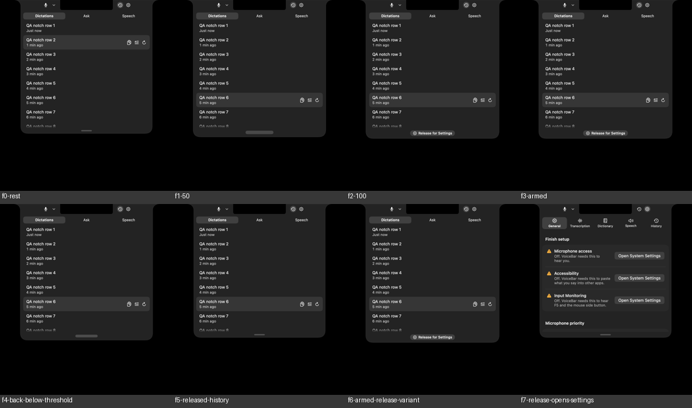

Eight native stages, pointer held between stages. Percentages refer to commanded travel toward the source arming boundary, not calibrated hint opacity. Native hint pixels/identifier and release outcome determine the result.

### f0-rest

Capture request monotonic 26668644.993ms (not movie PTS).

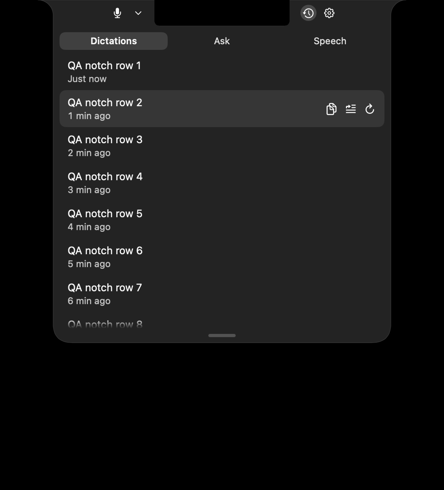

### f1-50

Capture request monotonic 26670993.813ms (not movie PTS).

### f2-100

Capture request monotonic 26672911.976ms (not movie PTS).

### f3-armed

Capture request monotonic 26674838.289ms (not movie PTS).

### f4-back-below-threshold

Capture request monotonic 26677745.85ms (not movie PTS).

### f5-released-history

Capture request monotonic 26679456.749ms (not movie PTS).

### f6-armed-release-variant

Capture request monotonic 26683288.478ms (not movie PTS).

### f7-release-opens-settings

Capture request monotonic 26685168.527ms (not movie PTS).

## Not shown / not verified

- Close-motion global shift: cause NOT VERIFIED; exact simultaneous system/tool stills NOT SHOWN. BEFORE close has one sampled cut, not eight distinct moving states.
- Hidden/near-transparent icon positions are UNKNOWN where raster ink cannot resolve them; no sub-frame continuity or flicker-free claim.
- BEFORE light o: NOT SHOWN (not requested). Recorder cannot establish 2x text quality.
- f light: NOT SHOWN. h version footer and i queued-read interruption: NOT SHOWN.
- Microphone, STT, live dictation, paste, real-agent voice acceptance and real History: NOT RUN.
- Candidate installation/release, another display/background, human-return interruption and forced deadline restoration: NOT VERIFIED. Resident restore probes prove only their recorded transport/identity/audio/appearance checks.
- Failed extraction attempt is retained in private receipts, with its clean restoration; it is not a successful frame-extraction run.

[inventory.json](inventory.json) binds delivered PNG bytes, build, theme and native scale. Private raw permission, ownership and restoration receipts are excluded. No home-folder paths or private utterances are published.
