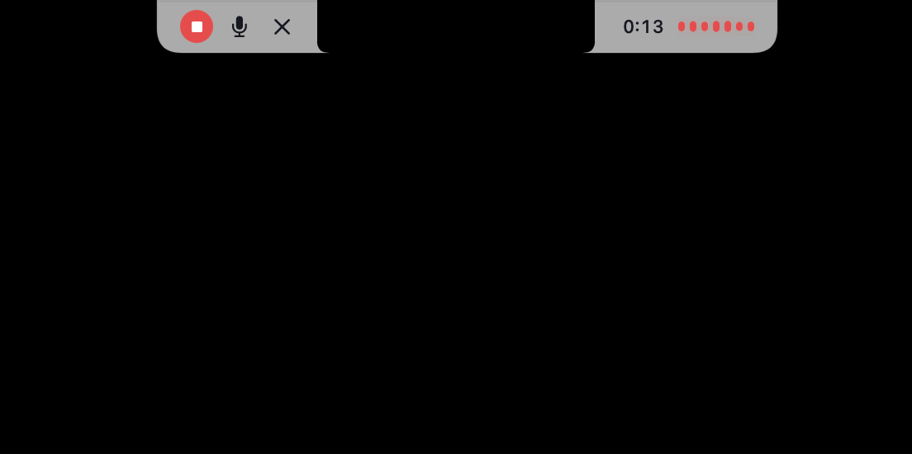
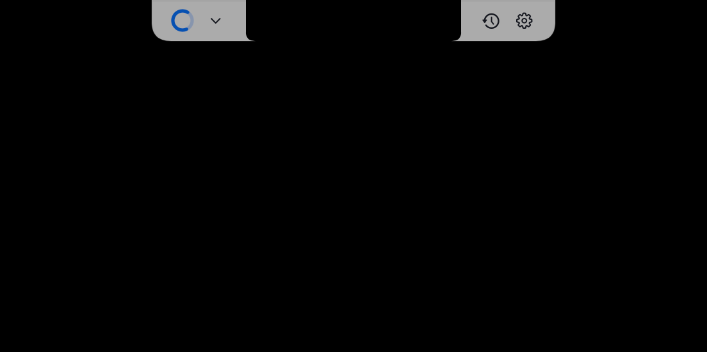
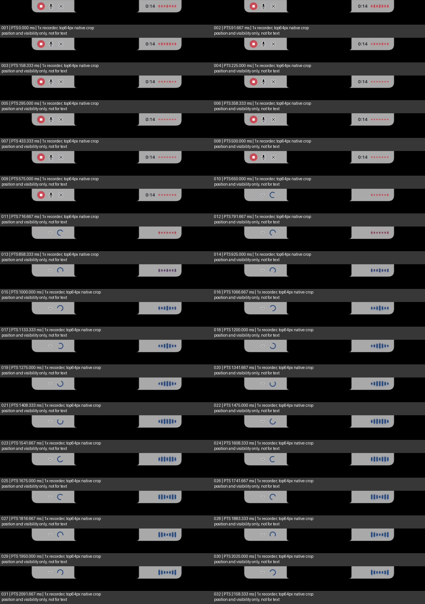
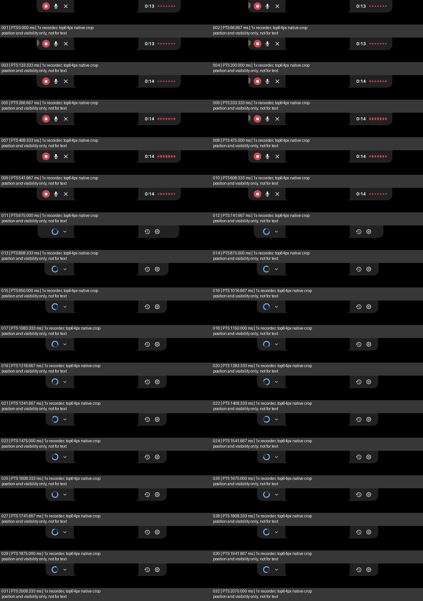
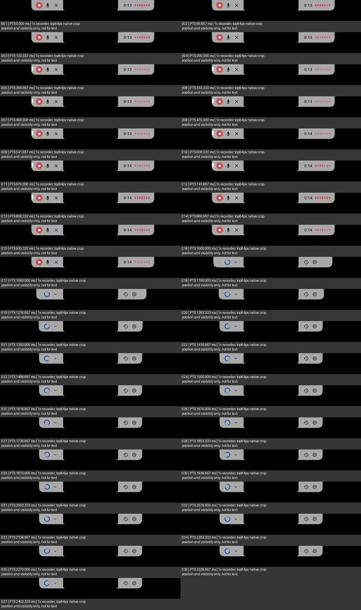
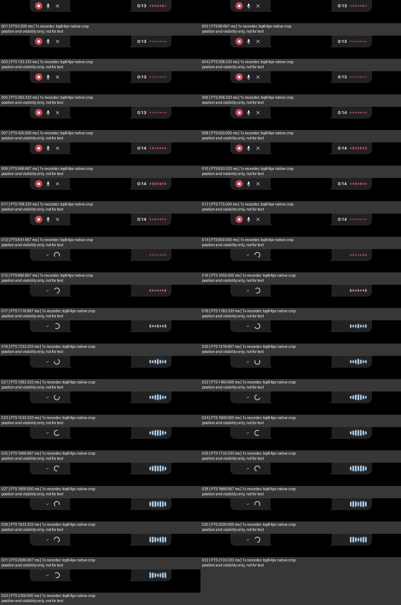
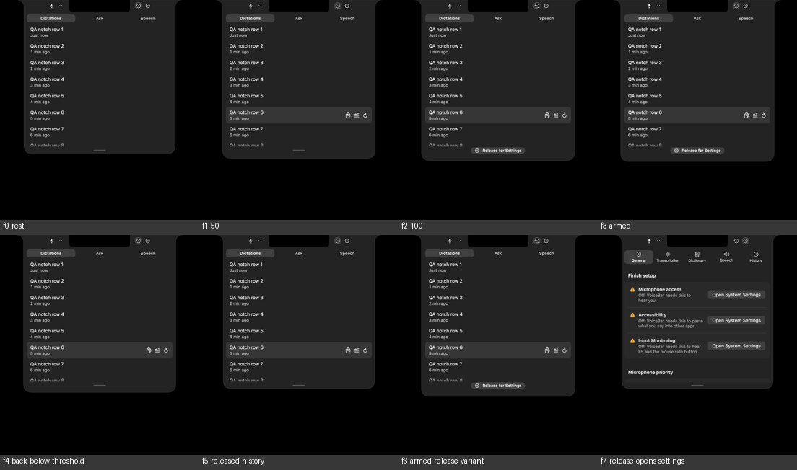
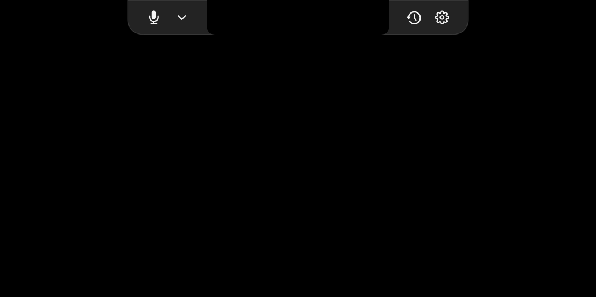

# Native M1 notch proof, R4

Status: requested R4 captures complete. Five native windows opened no earlier than 13:00:00 local; the last closed at 13:06:06.173, before the 13:20:00 deadline. The original first History trial failed its cancel-release check; its adverse outcome is retained below. No product or supplied-bundle edits were made for capture.

## Capture specification

- BEFORE: main `7faf0a0e43f5afa2c135950bb15daafe473b39c6`.
- AFTER: look candidate `1ed722648420f395abb077d9ca8c4fd2e20899ac`.
- Native hardware-notch M1 display, 1512 × 982 points, scale 2. Stills are native 2x pixels from the exact QA app, cropped without resampling. Black notch and transparent canvas regions are retained.
- Display-only synthetic fixtures; no microphone, live speech, clipboard or real History data. The General pane in the fixture shows setup controls, not a system permission dialog.
- Recorder frames are native 1x, never upscaled: **1x recorder frame, for position and visibility only, not for text**. Original movie presentation timestamps are preserved. GIFs are 1x previews with codec-rounded timing; PNGs plus recorded PTS are authoritative.
- Recorder contact sheets show original-size top64px band crops, labelled per frame. History contact sheets are downsampled overviews; inspect each linked native2x stage for text.
- Existing BEFORE a/b/c/c2/d/g stills and the 32-frame BEFORE/light e sequence were reused from the same pinned build. Every AFTER image in this packet is newly captured from 1ed72264.
- Capture admission was explicitly 60 seconds for this granted run, while the tool default remains 600. Prewindow input restarts admission; foreign input during a window still stops and restores. Windows used the existing ownership/permission broker and resident restore path.

## Numbered before / after pairs

### 1. a-idle-hovered, light

| BEFORE, native2x | AFTER, native2x |
|---|---|
|  |  |

The opposite-tone edges around the mic, chevron, History and gear are gone; launcher geometry is retained.

### 2. a-idle-hovered, dark

| BEFORE, native2x | AFTER, native2x |
|---|---|
|  |  |

The opposite-tone edges around the mic, chevron, History and gear are gone; launcher geometry is retained.

### 3. b-recording-first-frame, light

| BEFORE, native2x | AFTER, native2x |
|---|---|
|  |  |

The left recording wing is narrower, the X is closer to the notch, the timer is present at 0:00, and light pre-capture dots are darker. Glyph edges are removed.

### 4. b-recording-first-frame, dark

| BEFORE, native2x | AFTER, native2x |
|---|---|
|  |  |

The left recording wing is narrower, the X is closer to the notch, the timer is present at 0:00, and light pre-capture dots are darker. Glyph edges are removed.

### 5. c-recording-live, light

| BEFORE, native2x | AFTER, native2x |
|---|---|
|  |  |

The live controls move toward the notch inside the narrower left wing; right timer/waveform geometry is retained.

### 6. c-recording-live, dark

| BEFORE, native2x | AFTER, native2x |
|---|---|
|  |  |

The live controls move toward the notch inside the narrower left wing; right timer/waveform geometry is retained.

### 7. c2-recording-lock, light

| BEFORE, native2x | AFTER, native2x |
|---|---|
|  |  |

The locked recording layout uses the narrower left wing; glyph edges are removed.

### 8. c2-recording-lock, dark

| BEFORE, native2x | AFTER, native2x |
|---|---|
|  |  |

The locked recording layout uses the narrower left wing; glyph edges are removed.

### 9. d-transcribing, light

| BEFORE, native2x | AFTER, native2x |
|---|---|
|  |  |

Transcribing uses the compact launcher geometry with History and gear at the same pixel positions as idle; the dark spinner arc is lighter.

### 10. d-transcribing, dark

| BEFORE, native2x | AFTER, native2x |
|---|---|
|  |  |

Transcribing uses the compact launcher geometry with History and gear at the same pixel positions as idle; the dark spinner arc is lighter.

### 11. g-dictionary, light

| BEFORE, native2x | AFTER, native2x |
|---|---|
|  |  |

Pencil and ellipsis sit on the title line; the row retains its synthetic seed. Drawer and band glyph edges are removed.

### 12. g-dictionary, dark

| BEFORE, native2x | AFTER, native2x |
|---|---|
|  |  |

Pencil and ellipsis sit on the title line; the row retains its synthetic seed. Drawer and band glyph edges are removed.

## AFTER dark screenshot measurements

Points, 2px = 1pt. AX frames select ROIs; measurements use actual ink/glass pixels, not layout slots. The visible rendered notch seam is x384–720px in the 1104px crop (global x671–839pt). The preflight physical safe-area enclosure is x663–848pt; substituting it would shift gaps by 8–9pt. Glass edges use a >15 threshold at y32px; neutral ink uses >120 per channel within the actual control region. Threshold and antialias uncertainty is about 0.5pt. Colored stop-circle, meter and spinner ink are included in outer padding.

| State | Left wing | Right wing | Inner left ink → notch | Notch → first right ink | Outer pad L / R |
|---|---:|---:|---:|---:|---:|
| a | 74.0 | 74.0 | 20.0 | 16.5 | 20.0 / 18.0 |
| b | 97.5 | 111.0 | 16.5 | 17.5 | 14.5 / 14.5 |
| c | 97.5 | 111.0 | 16.5 | 17.5 | 14.5 / 14.5 |
| c2 | 97.5 | 111.0 | 17.0 | 17.5 | 14.5 / 14.5 |
| d | 74.0 | 74.0 | 20.0 | 16.5 | 15.5 / 18.0 |

In c2 the innermost left glyph is Lock; in a/d it is the chevron. In b/c it is X. a and d have identical measured History and gear ink boxes: History x753–780px, gear x806–832px. Thus History begins 16.5pt from the notch and the gear has an 18.0pt outer pad in both states.

### Color, glyph edges and Dictionary alignment

- Light pre-capture dot: RGB (106, 106, 112) against (171, 171, 171); relative-luminance contrast 2.340:1.
- Dark spinner arc: RGB (101, 176, 252) against (35, 35, 35); contrast 6.862:1.
- Mic, X and gear: two-pixel bands immediately outside core ink were sampled in both appearances. All six samples contain zero opposite-polarity outline pixels (5-level tolerance beyond the band); modal outside colors match the band, RGB171 in light and RGB35 in dark. Visual inspection agrees: no contrasting ring remains in these samples. This does not assert every glyph on every possible background.
- Dictionary title capital-A ink centre y370.5px; pencil y372.0px and ellipsis y371.5px, in both themes. The actions are 0.75pt and 0.50pt below the cap-height centre, respectively; these are pixel observations, not an assertion of exact mathematical centring.
- [measurements.json](measurements.json) retains coordinates, thresholds, sampled RGB values and individual edge-ring counts.

## e: recording → transcribing

The AFTER frames show the band contracting to the compact launcher and replacing recording controls with a spinner and navigation. BEFORE retains wide wings and changes its waveform from recording red toward processing blue. These sequences contain real captured transition samples, not only two endpoints. They do not establish sub-frame continuity.

### BEFORE light: 32 native1x frames

PTS 0.000–2158.333ms. [1x motion preview](images/before-light-e.gif).

| Frame | Original PTS (ms) | Band edges at y16px | Scale / meaning |
|---|---:|---|---|
| [001](images/before-light-e-recorder-001.png) | 0.000 | [82, 472] | 1x recorder frame, for position and visibility only, not for text |
| [002](images/before-light-e-recorder-002.png) | 91.667 | [82, 472] | 1x recorder frame, for position and visibility only, not for text |
| [003](images/before-light-e-recorder-003.png) | 158.333 | [82, 472] | 1x recorder frame, for position and visibility only, not for text |
| [004](images/before-light-e-recorder-004.png) | 225.000 | [82, 472] | 1x recorder frame, for position and visibility only, not for text |
| [005](images/before-light-e-recorder-005.png) | 295.000 | [82, 472] | 1x recorder frame, for position and visibility only, not for text |
| [006](images/before-light-e-recorder-006.png) | 358.333 | [82, 472] | 1x recorder frame, for position and visibility only, not for text |
| [007](images/before-light-e-recorder-007.png) | 433.333 | [82, 472] | 1x recorder frame, for position and visibility only, not for text |
| [008](images/before-light-e-recorder-008.png) | 500.000 | [82, 472] | 1x recorder frame, for position and visibility only, not for text |
| [009](images/before-light-e-recorder-009.png) | 575.000 | [82, 472] | 1x recorder frame, for position and visibility only, not for text |
| [010](images/before-light-e-recorder-010.png) | 650.000 | [82, 472] | 1x recorder frame, for position and visibility only, not for text |
| [011](images/before-light-e-recorder-011.png) | 716.667 | [82, 472] | 1x recorder frame, for position and visibility only, not for text |
| [012](images/before-light-e-recorder-012.png) | 791.667 | [82, 472] | 1x recorder frame, for position and visibility only, not for text |
| [013](images/before-light-e-recorder-013.png) | 858.333 | [82, 472] | 1x recorder frame, for position and visibility only, not for text |
| [014](images/before-light-e-recorder-014.png) | 925.000 | [82, 472] | 1x recorder frame, for position and visibility only, not for text |
| [015](images/before-light-e-recorder-015.png) | 1000.000 | [82, 472] | 1x recorder frame, for position and visibility only, not for text |
| [016](images/before-light-e-recorder-016.png) | 1066.667 | [82, 472] | 1x recorder frame, for position and visibility only, not for text |
| [017](images/before-light-e-recorder-017.png) | 1133.333 | [82, 472] | 1x recorder frame, for position and visibility only, not for text |
| [018](images/before-light-e-recorder-018.png) | 1200.000 | [82, 472] | 1x recorder frame, for position and visibility only, not for text |
| [019](images/before-light-e-recorder-019.png) | 1275.000 | [82, 472] | 1x recorder frame, for position and visibility only, not for text |
| [020](images/before-light-e-recorder-020.png) | 1341.667 | [82, 472] | 1x recorder frame, for position and visibility only, not for text |
| [021](images/before-light-e-recorder-021.png) | 1408.333 | [82, 472] | 1x recorder frame, for position and visibility only, not for text |
| [022](images/before-light-e-recorder-022.png) | 1475.000 | [82, 472] | 1x recorder frame, for position and visibility only, not for text |
| [023](images/before-light-e-recorder-023.png) | 1541.667 | [82, 472] | 1x recorder frame, for position and visibility only, not for text |
| [024](images/before-light-e-recorder-024.png) | 1608.333 | [82, 472] | 1x recorder frame, for position and visibility only, not for text |
| [025](images/before-light-e-recorder-025.png) | 1675.000 | [82, 472] | 1x recorder frame, for position and visibility only, not for text |
| [026](images/before-light-e-recorder-026.png) | 1741.667 | [82, 472] | 1x recorder frame, for position and visibility only, not for text |
| [027](images/before-light-e-recorder-027.png) | 1816.667 | [82, 472] | 1x recorder frame, for position and visibility only, not for text |
| [028](images/before-light-e-recorder-028.png) | 1883.333 | [82, 472] | 1x recorder frame, for position and visibility only, not for text |
| [029](images/before-light-e-recorder-029.png) | 1950.000 | [82, 472] | 1x recorder frame, for position and visibility only, not for text |
| [030](images/before-light-e-recorder-030.png) | 2025.000 | [82, 472] | 1x recorder frame, for position and visibility only, not for text |
| [031](images/before-light-e-recorder-031.png) | 2091.667 | [82, 472] | 1x recorder frame, for position and visibility only, not for text |
| [032](images/before-light-e-recorder-032.png) | 2158.333 | [82, 472] | 1x recorder frame, for position and visibility only, not for text |

### AFTER dark: 32 native1x frames

PTS 0.000–2075.000ms. [1x motion preview](images/after-dark-e.gif).

| Frame | Original PTS (ms) | Band edges at y16px | Scale / meaning |
|---|---:|---|---|
| [001](images/after-dark-e-recorder-001.png) | 0.000 | [96, 472] | 1x recorder frame, for position and visibility only, not for text |
| [002](images/after-dark-e-recorder-002.png) | 66.667 | [95, 472] | 1x recorder frame, for position and visibility only, not for text |
| [003](images/after-dark-e-recorder-003.png) | 133.333 | [95, 472] | 1x recorder frame, for position and visibility only, not for text |
| [004](images/after-dark-e-recorder-004.png) | 200.000 | [95, 472] | 1x recorder frame, for position and visibility only, not for text |
| [005](images/after-dark-e-recorder-005.png) | 266.667 | [96, 472] | 1x recorder frame, for position and visibility only, not for text |
| [006](images/after-dark-e-recorder-006.png) | 333.333 | [95, 472] | 1x recorder frame, for position and visibility only, not for text |
| [007](images/after-dark-e-recorder-007.png) | 408.333 | [96, 472] | 1x recorder frame, for position and visibility only, not for text |
| [008](images/after-dark-e-recorder-008.png) | 475.000 | [95, 472] | 1x recorder frame, for position and visibility only, not for text |
| [009](images/after-dark-e-recorder-009.png) | 541.667 | [96, 472] | 1x recorder frame, for position and visibility only, not for text |
| [010](images/after-dark-e-recorder-010.png) | 608.333 | [96, 472] | 1x recorder frame, for position and visibility only, not for text |
| [011](images/after-dark-e-recorder-011.png) | 675.000 | [96, 472] | 1x recorder frame, for position and visibility only, not for text |
| [012](images/after-dark-e-recorder-012.png) | 741.667 | [96, 472] | 1x recorder frame, for position and visibility only, not for text |
| [013](images/after-dark-e-recorder-013.png) | 808.333 | [98, 468] | 1x recorder frame, for position and visibility only, not for text |
| [014](images/after-dark-e-recorder-014.png) | 875.000 | [110, 449] | 1x recorder frame, for position and visibility only, not for text |
| [015](images/after-dark-e-recorder-015.png) | 950.000 | [116, 440] | 1x recorder frame, for position and visibility only, not for text |
| [016](images/after-dark-e-recorder-016.png) | 1016.667 | [118, 436] | 1x recorder frame, for position and visibility only, not for text |
| [017](images/after-dark-e-recorder-017.png) | 1083.333 | [119, 435] | 1x recorder frame, for position and visibility only, not for text |
| [018](images/after-dark-e-recorder-018.png) | 1150.000 | [119, 435] | 1x recorder frame, for position and visibility only, not for text |
| [019](images/after-dark-e-recorder-019.png) | 1216.667 | [119, 435] | 1x recorder frame, for position and visibility only, not for text |
| [020](images/after-dark-e-recorder-020.png) | 1283.333 | [119, 435] | 1x recorder frame, for position and visibility only, not for text |
| [021](images/after-dark-e-recorder-021.png) | 1341.667 | [119, 435] | 1x recorder frame, for position and visibility only, not for text |
| [022](images/after-dark-e-recorder-022.png) | 1408.333 | [119, 435] | 1x recorder frame, for position and visibility only, not for text |
| [023](images/after-dark-e-recorder-023.png) | 1475.000 | [119, 435] | 1x recorder frame, for position and visibility only, not for text |
| [024](images/after-dark-e-recorder-024.png) | 1541.667 | [119, 435] | 1x recorder frame, for position and visibility only, not for text |
| [025](images/after-dark-e-recorder-025.png) | 1608.333 | [119, 435] | 1x recorder frame, for position and visibility only, not for text |
| [026](images/after-dark-e-recorder-026.png) | 1675.000 | [119, 435] | 1x recorder frame, for position and visibility only, not for text |
| [027](images/after-dark-e-recorder-027.png) | 1741.667 | [119, 435] | 1x recorder frame, for position and visibility only, not for text |
| [028](images/after-dark-e-recorder-028.png) | 1808.333 | [119, 435] | 1x recorder frame, for position and visibility only, not for text |
| [029](images/after-dark-e-recorder-029.png) | 1875.000 | [119, 435] | 1x recorder frame, for position and visibility only, not for text |
| [030](images/after-dark-e-recorder-030.png) | 1941.667 | [119, 435] | 1x recorder frame, for position and visibility only, not for text |
| [031](images/after-dark-e-recorder-031.png) | 2008.333 | [119, 435] | 1x recorder frame, for position and visibility only, not for text |
| [032](images/after-dark-e-recorder-032.png) | 2075.000 | [119, 435] | 1x recorder frame, for position and visibility only, not for text |

### AFTER light: 37 native1x frames

PTS 0.000–2403.333ms. [1x motion preview](images/after-light-e.gif).

| Frame | Original PTS (ms) | Band edges at y16px | Scale / meaning |
|---|---:|---|---|
| [001](images/after-light-e-recorder-001.png) | 0.000 | [96, 472] | 1x recorder frame, for position and visibility only, not for text |
| [002](images/after-light-e-recorder-002.png) | 66.667 | [96, 472] | 1x recorder frame, for position and visibility only, not for text |
| [003](images/after-light-e-recorder-003.png) | 133.333 | [96, 472] | 1x recorder frame, for position and visibility only, not for text |
| [004](images/after-light-e-recorder-004.png) | 200.000 | [96, 472] | 1x recorder frame, for position and visibility only, not for text |
| [005](images/after-light-e-recorder-005.png) | 266.667 | [96, 472] | 1x recorder frame, for position and visibility only, not for text |
| [006](images/after-light-e-recorder-006.png) | 333.333 | [96, 472] | 1x recorder frame, for position and visibility only, not for text |
| [007](images/after-light-e-recorder-007.png) | 400.000 | [96, 472] | 1x recorder frame, for position and visibility only, not for text |
| [008](images/after-light-e-recorder-008.png) | 475.000 | [96, 472] | 1x recorder frame, for position and visibility only, not for text |
| [009](images/after-light-e-recorder-009.png) | 541.667 | [96, 472] | 1x recorder frame, for position and visibility only, not for text |
| [010](images/after-light-e-recorder-010.png) | 608.333 | [96, 472] | 1x recorder frame, for position and visibility only, not for text |
| [011](images/after-light-e-recorder-011.png) | 675.000 | [96, 472] | 1x recorder frame, for position and visibility only, not for text |
| [012](images/after-light-e-recorder-012.png) | 741.667 | [96, 472] | 1x recorder frame, for position and visibility only, not for text |
| [013](images/after-light-e-recorder-013.png) | 808.333 | [96, 472] | 1x recorder frame, for position and visibility only, not for text |
| [014](images/after-light-e-recorder-014.png) | 866.667 | [96, 472] | 1x recorder frame, for position and visibility only, not for text |
| [015](images/after-light-e-recorder-015.png) | 933.333 | [96, 472] | 1x recorder frame, for position and visibility only, not for text |
| [016](images/after-light-e-recorder-016.png) | 1000.000 | [96, 472] | 1x recorder frame, for position and visibility only, not for text |
| [017](images/after-light-e-recorder-017.png) | 1050.000 | [96, 472] | 1x recorder frame, for position and visibility only, not for text |
| [018](images/after-light-e-recorder-018.png) | 1150.000 | [101, 464] | 1x recorder frame, for position and visibility only, not for text |
| [019](images/after-light-e-recorder-019.png) | 1216.667 | [111, 448] | 1x recorder frame, for position and visibility only, not for text |
| [020](images/after-light-e-recorder-020.png) | 1283.333 | [117, 439] | 1x recorder frame, for position and visibility only, not for text |
| [021](images/after-light-e-recorder-021.png) | 1350.000 | [118, 436] | 1x recorder frame, for position and visibility only, not for text |
| [022](images/after-light-e-recorder-022.png) | 1416.667 | [119, 435] | 1x recorder frame, for position and visibility only, not for text |
| [023](images/after-light-e-recorder-023.png) | 1486.667 | [119, 435] | 1x recorder frame, for position and visibility only, not for text |
| [024](images/after-light-e-recorder-024.png) | 1550.000 | [119, 435] | 1x recorder frame, for position and visibility only, not for text |
| [025](images/after-light-e-recorder-025.png) | 1616.667 | [119, 435] | 1x recorder frame, for position and visibility only, not for text |
| [026](images/after-light-e-recorder-026.png) | 1670.000 | [119, 435] | 1x recorder frame, for position and visibility only, not for text |
| [027](images/after-light-e-recorder-027.png) | 1736.667 | [119, 435] | 1x recorder frame, for position and visibility only, not for text |
| [028](images/after-light-e-recorder-028.png) | 1803.333 | [119, 435] | 1x recorder frame, for position and visibility only, not for text |
| [029](images/after-light-e-recorder-029.png) | 1870.000 | [119, 435] | 1x recorder frame, for position and visibility only, not for text |
| [030](images/after-light-e-recorder-030.png) | 1936.667 | [119, 435] | 1x recorder frame, for position and visibility only, not for text |
| [031](images/after-light-e-recorder-031.png) | 2003.333 | [119, 435] | 1x recorder frame, for position and visibility only, not for text |
| [032](images/after-light-e-recorder-032.png) | 2070.000 | [119, 435] | 1x recorder frame, for position and visibility only, not for text |
| [033](images/after-light-e-recorder-033.png) | 2136.667 | [119, 435] | 1x recorder frame, for position and visibility only, not for text |
| [034](images/after-light-e-recorder-034.png) | 2203.333 | [119, 435] | 1x recorder frame, for position and visibility only, not for text |
| [035](images/after-light-e-recorder-035.png) | 2270.000 | [119, 435] | 1x recorder frame, for position and visibility only, not for text |
| [036](images/after-light-e-recorder-036.png) | 2336.667 | [119, 435] | 1x recorder frame, for position and visibility only, not for text |
| [037](images/after-light-e-recorder-037.png) | 2403.333 | [119, 435] | 1x recorder frame, for position and visibility only, not for text |

### BEFORE dark: 33 native1x frames

PTS 0.000–2200.000ms. [1x motion preview](images/before-dark-e.gif).

| Frame | Original PTS (ms) | Band edges at y16px | Scale / meaning |
|---|---:|---|---|
| [001](images/before-dark-e-recorder-001.png) | 0.000 | [82, 472] | 1x recorder frame, for position and visibility only, not for text |
| [002](images/before-dark-e-recorder-002.png) | 66.667 | [82, 472] | 1x recorder frame, for position and visibility only, not for text |
| [003](images/before-dark-e-recorder-003.png) | 133.333 | [82, 472] | 1x recorder frame, for position and visibility only, not for text |
| [004](images/before-dark-e-recorder-004.png) | 208.333 | [82, 472] | 1x recorder frame, for position and visibility only, not for text |
| [005](images/before-dark-e-recorder-005.png) | 283.333 | [82, 472] | 1x recorder frame, for position and visibility only, not for text |
| [006](images/before-dark-e-recorder-006.png) | 358.333 | [82, 472] | 1x recorder frame, for position and visibility only, not for text |
| [007](images/before-dark-e-recorder-007.png) | 425.000 | [82, 472] | 1x recorder frame, for position and visibility only, not for text |
| [008](images/before-dark-e-recorder-008.png) | 500.000 | [82, 472] | 1x recorder frame, for position and visibility only, not for text |
| [009](images/before-dark-e-recorder-009.png) | 566.667 | [82, 472] | 1x recorder frame, for position and visibility only, not for text |
| [010](images/before-dark-e-recorder-010.png) | 633.333 | [82, 472] | 1x recorder frame, for position and visibility only, not for text |
| [011](images/before-dark-e-recorder-011.png) | 708.333 | [82, 472] | 1x recorder frame, for position and visibility only, not for text |
| [012](images/before-dark-e-recorder-012.png) | 775.000 | [82, 472] | 1x recorder frame, for position and visibility only, not for text |
| [013](images/before-dark-e-recorder-013.png) | 841.667 | [82, 472] | 1x recorder frame, for position and visibility only, not for text |
| [014](images/before-dark-e-recorder-014.png) | 900.000 | [82, 472] | 1x recorder frame, for position and visibility only, not for text |
| [015](images/before-dark-e-recorder-015.png) | 966.667 | [82, 472] | 1x recorder frame, for position and visibility only, not for text |
| [016](images/before-dark-e-recorder-016.png) | 1050.000 | [82, 472] | 1x recorder frame, for position and visibility only, not for text |
| [017](images/before-dark-e-recorder-017.png) | 1116.667 | [82, 472] | 1x recorder frame, for position and visibility only, not for text |
| [018](images/before-dark-e-recorder-018.png) | 1183.333 | [82, 472] | 1x recorder frame, for position and visibility only, not for text |
| [019](images/before-dark-e-recorder-019.png) | 1233.333 | [82, 472] | 1x recorder frame, for position and visibility only, not for text |
| [020](images/before-dark-e-recorder-020.png) | 1316.667 | [82, 472] | 1x recorder frame, for position and visibility only, not for text |
| [021](images/before-dark-e-recorder-021.png) | 1383.333 | [82, 472] | 1x recorder frame, for position and visibility only, not for text |
| [022](images/before-dark-e-recorder-022.png) | 1450.000 | [82, 472] | 1x recorder frame, for position and visibility only, not for text |
| [023](images/before-dark-e-recorder-023.png) | 1533.333 | [82, 472] | 1x recorder frame, for position and visibility only, not for text |
| [024](images/before-dark-e-recorder-024.png) | 1600.000 | [82, 472] | 1x recorder frame, for position and visibility only, not for text |
| [025](images/before-dark-e-recorder-025.png) | 1666.667 | [82, 472] | 1x recorder frame, for position and visibility only, not for text |
| [026](images/before-dark-e-recorder-026.png) | 1733.333 | [82, 472] | 1x recorder frame, for position and visibility only, not for text |
| [027](images/before-dark-e-recorder-027.png) | 1800.000 | [82, 472] | 1x recorder frame, for position and visibility only, not for text |
| [028](images/before-dark-e-recorder-028.png) | 1866.667 | [82, 472] | 1x recorder frame, for position and visibility only, not for text |
| [029](images/before-dark-e-recorder-029.png) | 1933.333 | [82, 472] | 1x recorder frame, for position and visibility only, not for text |
| [030](images/before-dark-e-recorder-030.png) | 2000.000 | [82, 472] | 1x recorder frame, for position and visibility only, not for text |
| [031](images/before-dark-e-recorder-031.png) | 2066.667 | [82, 472] | 1x recorder frame, for position and visibility only, not for text |
| [032](images/before-dark-e-recorder-032.png) | 2133.333 | [82, 472] | 1x recorder frame, for position and visibility only, not for text |
| [033](images/before-dark-e-recorder-033.png) | 2200.000 | [82, 472] | 1x recorder frame, for position and visibility only, not for text |

[motion.json](motion.json) records every original frame PTS and a per-frame horizontal band-edge measurement. AFTER/dark starts at half-open x96–472px and settles at x119–435px; BEFORE/dark remains x82–472px. The measurements are recorder pixels (1px = 1pt), not native2x text evidence.

## f: held History over-pull, dark

The final native run captured rest, about50%, about100%, armed, backoff with hint gone, unarmed release retaining History, a second armed pull, and armed release opening General/Settings in both builds. Percentages name commanded travel toward the raw1.3 threshold, not calibrated hint opacity; the about100% checkpoint already shows the hint. Armed is supported by both the `notch-settings-pull-hint` identifier and visible hint pixels. The pointer stayed down between held stages.

### AFTER dark held stages

| Stage | Native2x image |
|---|---|
| f0-rest | [after-dark-f0-rest.png](images/after-dark-f0-rest.png) |
| f1-50 | [after-dark-f1-50.png](images/after-dark-f1-50.png) |
| f2-100 | [after-dark-f2-100.png](images/after-dark-f2-100.png) |
| f3-armed | [after-dark-f3-armed.png](images/after-dark-f3-armed.png) |
| f4-back-below-threshold | [after-dark-f4-back-below-threshold.png](images/after-dark-f4-back-below-threshold.png) |
| f5-released-history | [after-dark-f5-released-history.png](images/after-dark-f5-released-history.png) |
| f6-armed-release-variant | [after-dark-f6-armed-release-variant.png](images/after-dark-f6-armed-release-variant.png) |
| f7-release-opens-settings | [after-dark-f7-release-opens-settings.png](images/after-dark-f7-release-opens-settings.png) |

### BEFORE dark held stages

| Stage | Native2x image |
|---|---|
| f0-rest | [before-dark-f0-rest.png](images/before-dark-f0-rest.png) |
| f1-50 | [before-dark-f1-50.png](images/before-dark-f1-50.png) |
| f2-100 | [before-dark-f2-100.png](images/before-dark-f2-100.png) |
| f3-armed | [before-dark-f3-armed.png](images/before-dark-f3-armed.png) |
| f4-back-below-threshold | [before-dark-f4-back-below-threshold.png](images/before-dark-f4-back-below-threshold.png) |
| f5-released-history | [before-dark-f5-released-history.png](images/before-dark-f5-released-history.png) |
| f6-armed-release-variant | [before-dark-f6-armed-release-variant.png](images/before-dark-f6-armed-release-variant.png) |
| f7-release-opens-settings | [before-dark-f7-release-opens-settings.png](images/before-dark-f7-release-opens-settings.png) |

### Original adverse trial retained

The first trial armed in both builds, but the fast upward backoff closed History on release. The helper sent the return in twelve40ms samples, consistent with an upward closing flick beyond the source0.5progress/s rule; a later hold does not erase the last sampled velocity. The capture helper alone changed upward samples to100ms. The final trial then retained History on unarmed release and reached Settings on armed release, with the original checks unchanged. No product code or QA bundle changed.

| First-trial AFTER collapse | First-trial BEFORE collapse |
|---|---|
|  |  |

## Not shown / not verified

- h General version footer: NOT_SHOWN; the frozen fixture host omits it. General-top images from the armed release do not stand in for the footer.
- i F5 during a read with queued Next: NOT_SHOWN; the fixture host cannot stage it.
- f in light: NOT_RUN in R4; only the requested dark comparison is shown.
- Microphone, live STT, live dictation, paste, actual user History and real-agent voice acceptance: NOT_RUN.
- Installed candidate release, another Mac/display background, native human-return interruption and production readiness: NOT_VERIFIED. The restored installed app remains2.4.2; the QA candidate was never installed.
- Exact hint-opacity percentages and sub-frame flicker absence: NOT_VERIFIED.

All delivered PNG metadata, scale labels and byte hashes are in [inventory.json](inventory.json). Raw ownership, permission, admission, failed-trial and restoration receipts remain private. No home-folder paths or private utterances are published.
