# Native notch states look proof

Status: PARTIAL. Only the artifacts inventoried here are proved.

BEFORE `7faf0a0e43f5afa2c135950bb15daafe473b39c6`. AFTER `afacf26aa7ae206dca1acc27ab7174cc92a6fcbb`.

Real built-in hardware-notch screen, 1512 x 982 points, native 2x stills, light and dark. Existing UIE2E display-only app with synthetic setup/permission rows, the seeded QA initial dictionary row, common bundled TypeScript term, and invented QA history rows and device-free meter. Crops contain the notch band/drawer on the broker's black backdrop; no full-desktop captures.

Run method: a capture adapter imports the harness ownership/permission APIs under its supervisor lock. This is **not the stock suite**. `NativeHost.permissions` creates the ownership snapshot; `NativeHost.remember` checks kernel birth and canonical executable path; the unchanged runner `Boundary` starts the broker. Every action/still is gated.

## 1. a-idle-hovered, light

The captured idle launcher is unchanged.

## 1. a-idle-hovered, dark

The captured idle launcher is unchanged.

## 2. b-recording-first-frame, light

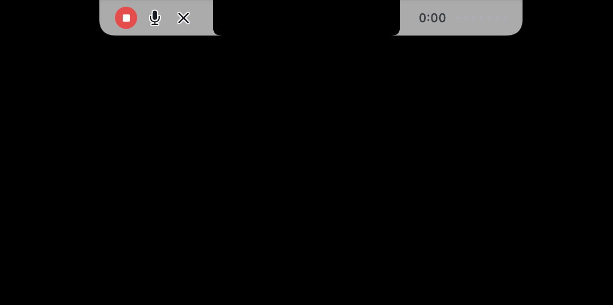

AFTER shows 0:00 before capture becomes live.

## 2. b-recording-first-frame, dark

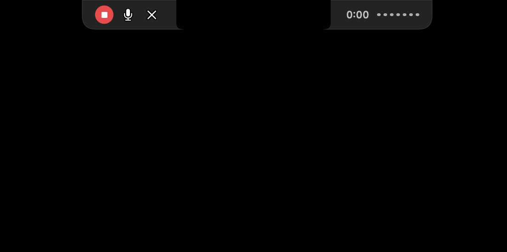

AFTER shows 0:00 before capture becomes live.

## 3. c-recording-live, light

AFTER moves the left recording controls closer to the physical notch; the right timer stays in place.

## 3. c-recording-live, dark

AFTER moves the left recording controls closer to the physical notch; the right timer stays in place.

## 4. c2-recording-lock, light

AFTER reduces the left gap with Lock present; Lock remains mounted.

## 4. c2-recording-lock, dark

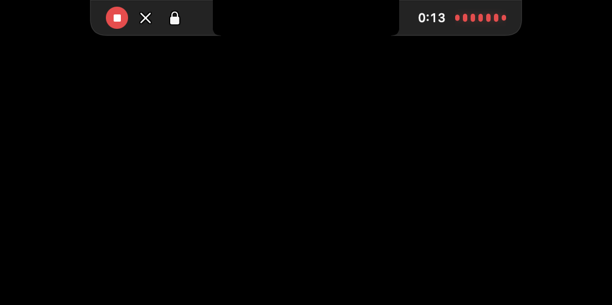

AFTER reduces the left gap with Lock present; Lock remains mounted.

## 5. d-transcribing, light

AFTER removes the waveform, compacts the wings and places History/Settings on the right.

## 5. d-transcribing, dark

AFTER removes the waveform, compacts the wings and places History/Settings on the right.

## 6. g-dictionary, light

AFTER removes the extra chevron beside the row ellipsis.

## 6. g-dictionary, dark

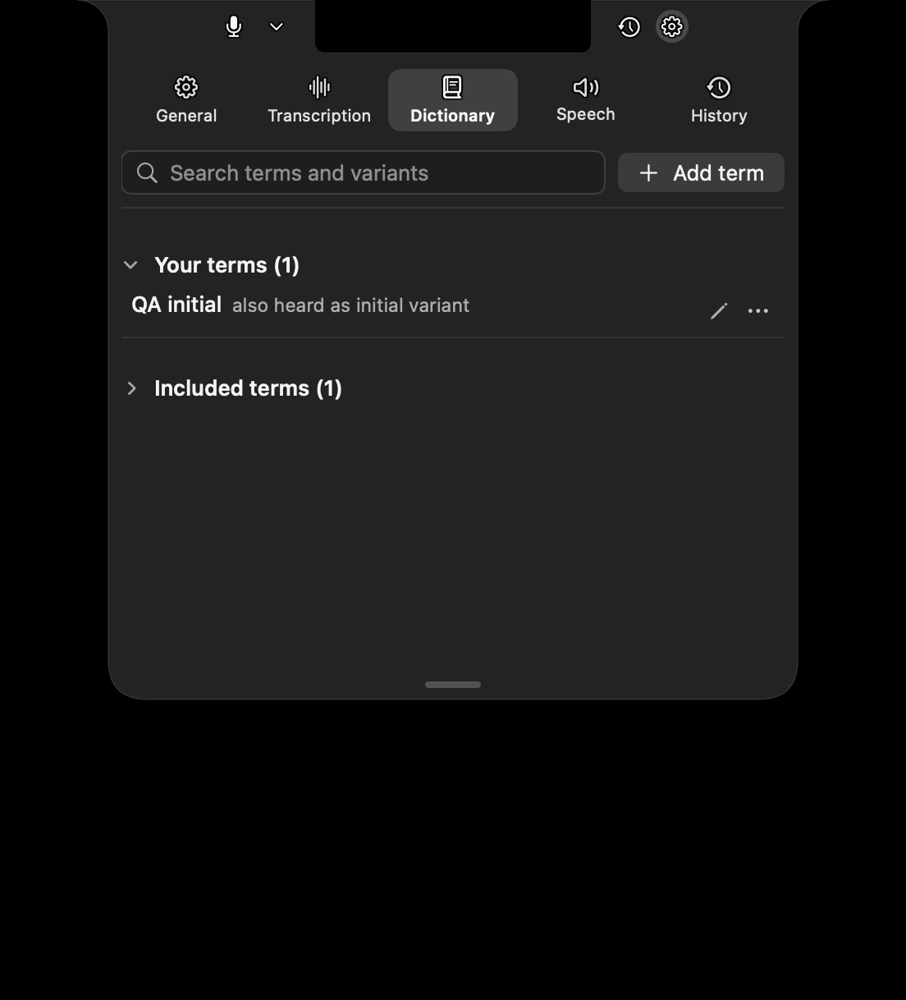

AFTER removes the extra chevron beside the row ellipsis.

## 7. h-general-top-observed, light

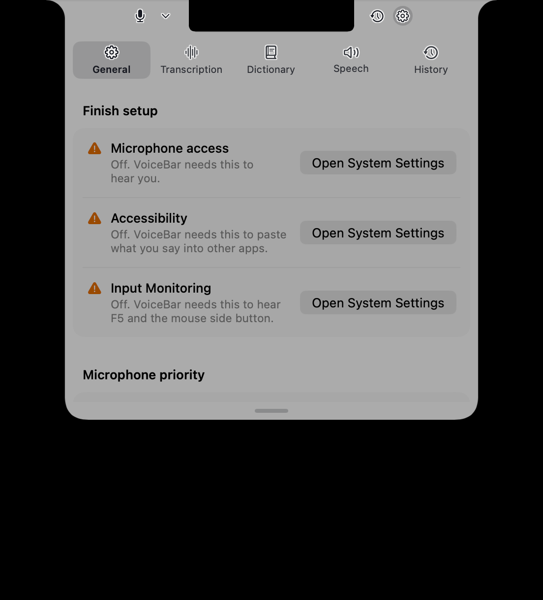

Observed General pane top only; footer NOT_RUN.

## 7. h-general-top-observed, dark

Observed General pane top only; footer NOT_RUN.

## e. Recording to transcribing sparse samples, light

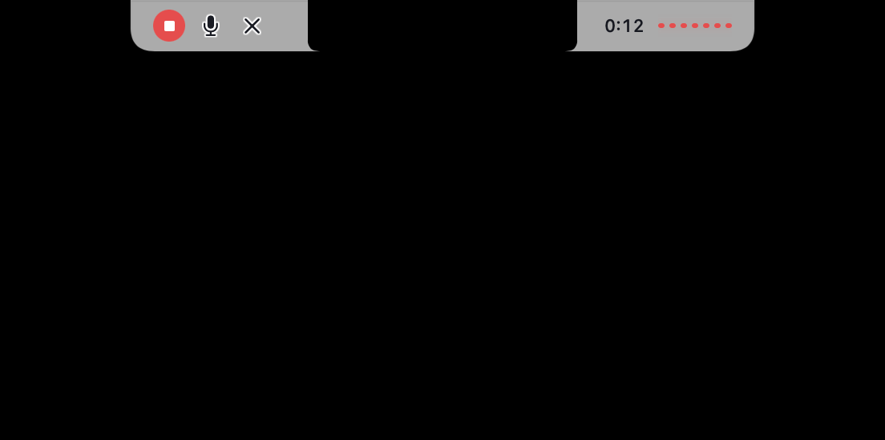

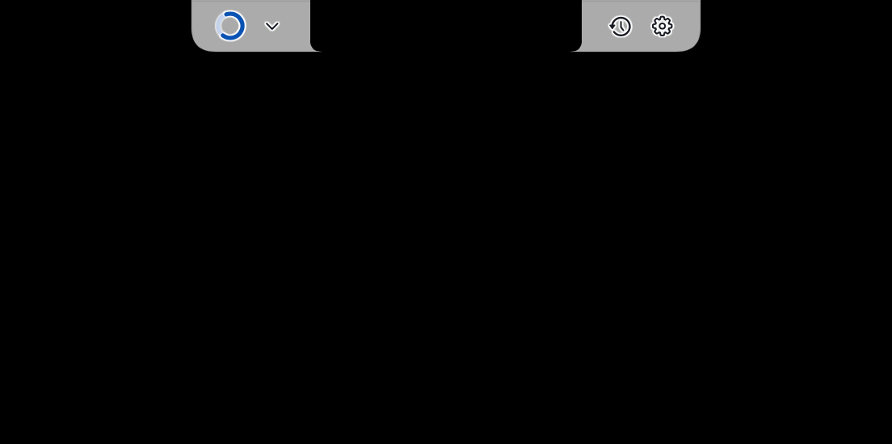

Sparse before/after samples; sub-frame continuity and the armed grip hint are NOT_VERIFIED.

## e. Recording to transcribing sparse samples, dark

Sparse before/after samples; sub-frame continuity and the armed grip hint are NOT_VERIFIED.

## f. Native grip attempt, partial growth only, light

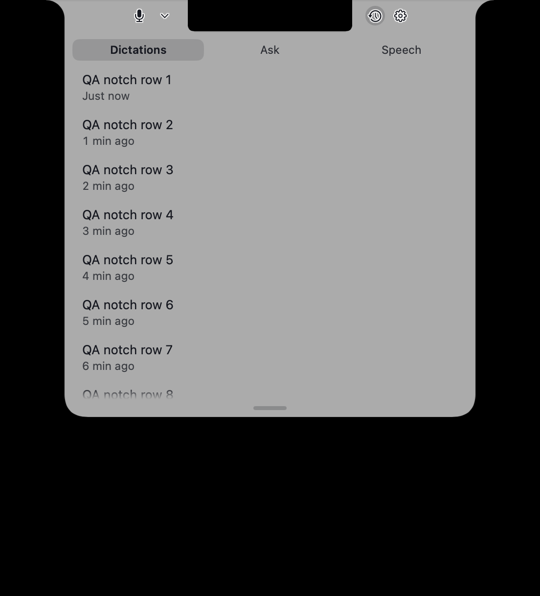

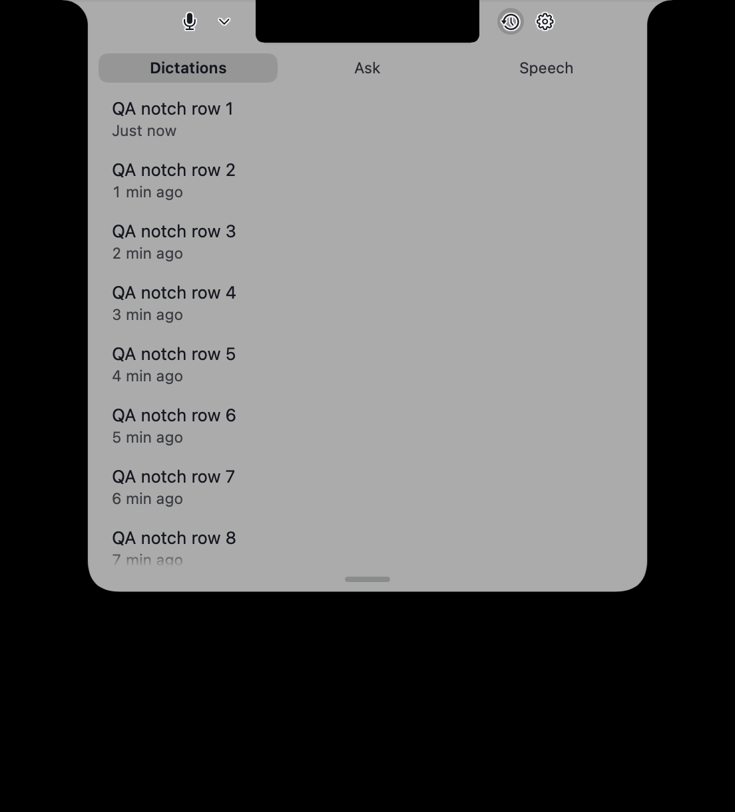

Sparse before/after samples; sub-frame continuity and the armed grip hint are NOT_VERIFIED.

## f. Native grip attempt, partial growth only, dark

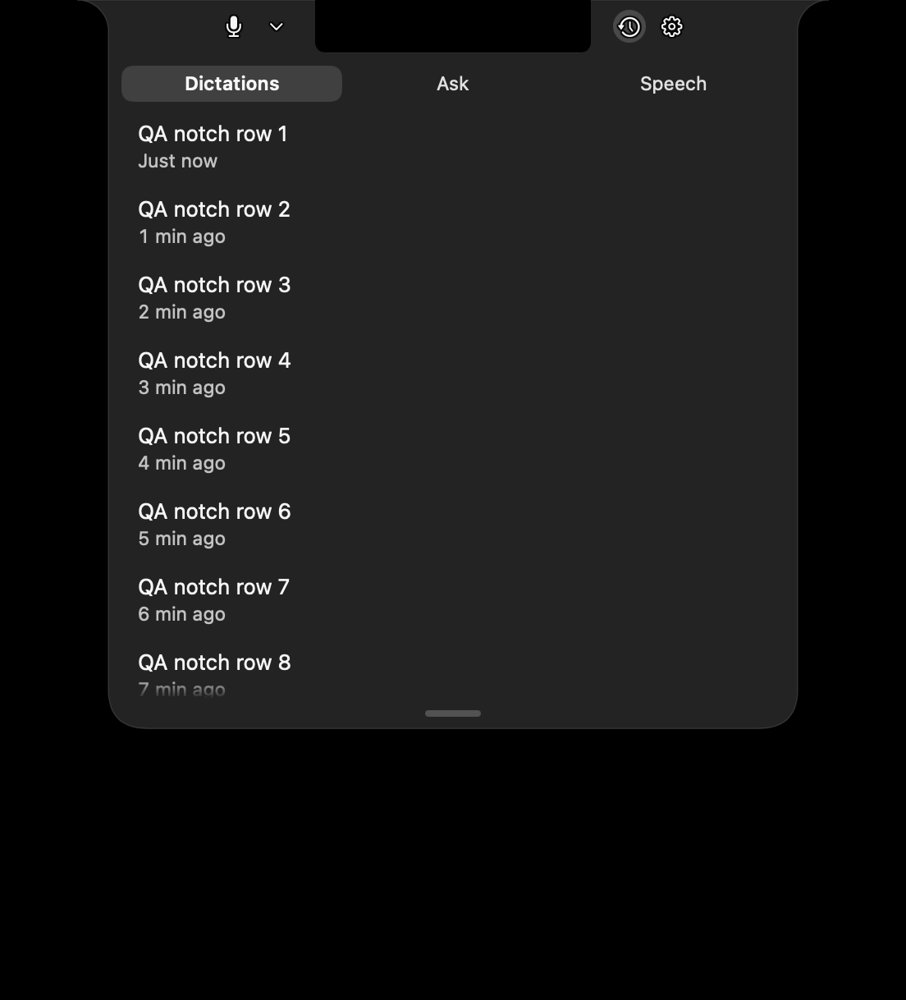

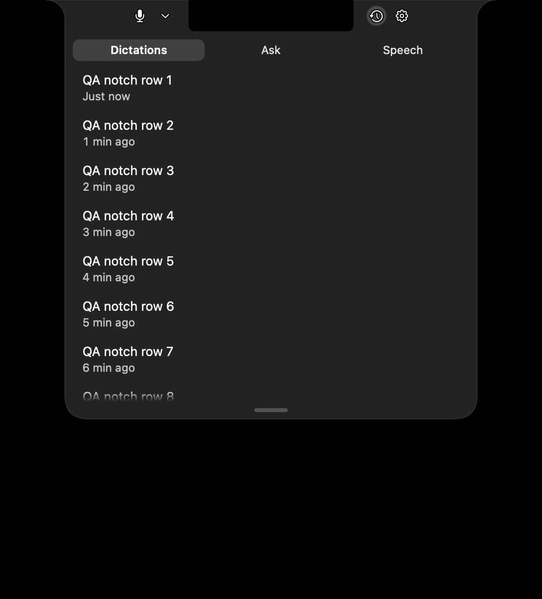

Sparse before/after samples; sub-frame continuity and the armed grip hint are NOT_VERIFIED.

## Motion samples

Native2x still bursts carry capture-request-start timestamps relative to each burst start (capture completes later). The salvaged BEFORE/light hand-over also has31 original1x recorder frames with exact movie presentation timestamps, extracted with -vsync0 and never upscaled. These are sparse samples across the state change, not frame-complete flicker or timing proof. Item e/f is incomplete unless at least eight corresponding samples exist; a missing stage is not inferred from another image.

| Image | State | Time (ms) | Scale/use |
|---|---|---:|---|
| [before-light-e-burst-01.png](images/before-light-e-burst-01.png) | e-burst-01 | 898.398 | 2x still, sparse position/visibility sample |
| [before-light-e-burst-02.png](images/before-light-e-burst-02.png) | e-burst-02 | 1762.698 | 2x still, sparse position/visibility sample |
| [before-light-e-burst-03.png](images/before-light-e-burst-03.png) | e-burst-03 | 3502.553 | 2x still, sparse position/visibility sample |
| [before-light-e-burst-04.png](images/before-light-e-burst-04.png) | e-burst-04 | 4337.931 | 2x still, sparse position/visibility sample |
| [before-light-e-burst-05.png](images/before-light-e-burst-05.png) | e-burst-05 | 5175.009 | 2x still, sparse position/visibility sample |
| [before-light-e-burst-06.png](images/before-light-e-burst-06.png) | e-burst-06 | 6041.304 | 2x still, sparse position/visibility sample |
| [before-light-e-burst-07.png](images/before-light-e-burst-07.png) | e-burst-07 | 6882.673 | 2x still, sparse position/visibility sample |
| [before-light-e-burst-08.png](images/before-light-e-burst-08.png) | e-burst-08 | 7737.023 | 2x still, sparse position/visibility sample |
| [before-dark-e-burst-01.png](images/before-dark-e-burst-01.png) | e-burst-01 | 893.419 | 2x still, sparse position/visibility sample |
| [before-dark-e-burst-02.png](images/before-dark-e-burst-02.png) | e-burst-02 | 1735.573 | 2x still, sparse position/visibility sample |
| [before-dark-e-burst-03.png](images/before-dark-e-burst-03.png) | e-burst-03 | 3505.252 | 2x still, sparse position/visibility sample |
| [before-dark-e-burst-04.png](images/before-dark-e-burst-04.png) | e-burst-04 | 4382.495 | 2x still, sparse position/visibility sample |
| [before-dark-e-burst-05.png](images/before-dark-e-burst-05.png) | e-burst-05 | 5310.178 | 2x still, sparse position/visibility sample |
| [before-dark-e-burst-06.png](images/before-dark-e-burst-06.png) | e-burst-06 | 6182.956 | 2x still, sparse position/visibility sample |
| [before-dark-e-burst-07.png](images/before-dark-e-burst-07.png) | e-burst-07 | 7074.868 | 2x still, sparse position/visibility sample |
| [before-dark-e-burst-08.png](images/before-dark-e-burst-08.png) | e-burst-08 | 7955.675 | 2x still, sparse position/visibility sample |
| [after-light-e-burst-01.png](images/after-light-e-burst-01.png) | e-burst-01 | 983.259 | 2x still, sparse position/visibility sample |
| [after-light-e-burst-02.png](images/after-light-e-burst-02.png) | e-burst-02 | 1907.727 | 2x still, sparse position/visibility sample |
| [after-light-e-burst-03.png](images/after-light-e-burst-03.png) | e-burst-03 | 3802.809 | 2x still, sparse position/visibility sample |
| [after-light-e-burst-04.png](images/after-light-e-burst-04.png) | e-burst-04 | 4740.951 | 2x still, sparse position/visibility sample |
| [after-light-e-burst-05.png](images/after-light-e-burst-05.png) | e-burst-05 | 5663.913 | 2x still, sparse position/visibility sample |
| [after-light-e-burst-06.png](images/after-light-e-burst-06.png) | e-burst-06 | 6561.828 | 2x still, sparse position/visibility sample |
| [after-light-e-burst-07.png](images/after-light-e-burst-07.png) | e-burst-07 | 7445.917 | 2x still, sparse position/visibility sample |
| [after-light-e-burst-08.png](images/after-light-e-burst-08.png) | e-burst-08 | 8349.014 | 2x still, sparse position/visibility sample |
| [after-dark-e-burst-01.png](images/after-dark-e-burst-01.png) | e-burst-01 | 979.193 | 2x still, sparse position/visibility sample |
| [after-dark-e-burst-02.png](images/after-dark-e-burst-02.png) | e-burst-02 | 1901.992 | 2x still, sparse position/visibility sample |
| [after-dark-e-burst-03.png](images/after-dark-e-burst-03.png) | e-burst-03 | 3871.683 | 2x still, sparse position/visibility sample |
| [after-dark-e-burst-04.png](images/after-dark-e-burst-04.png) | e-burst-04 | 4857.799 | 2x still, sparse position/visibility sample |
| [after-dark-e-burst-05.png](images/after-dark-e-burst-05.png) | e-burst-05 | 5841.066 | 2x still, sparse position/visibility sample |
| [after-dark-e-burst-06.png](images/after-dark-e-burst-06.png) | e-burst-06 | 6796.29 | 2x still, sparse position/visibility sample |
| [after-dark-e-burst-07.png](images/after-dark-e-burst-07.png) | e-burst-07 | 7755.04 | 2x still, sparse position/visibility sample |
| [after-dark-e-burst-08.png](images/after-dark-e-burst-08.png) | e-burst-08 | 8719.217 | 2x still, sparse position/visibility sample |
| [before-light-f-burst-01.png](images/before-light-f-burst-01.png) | f-burst-01 | 998.804 | 2x still, sparse position/visibility sample |
| [before-light-f-burst-02.png](images/before-light-f-burst-02.png) | f-burst-02 | 1959.451 | 2x still, sparse position/visibility sample |
| [before-light-f-burst-03.png](images/before-light-f-burst-03.png) | f-burst-03 | 3359.945 | 2x still, sparse position/visibility sample |
| [before-light-f-burst-04.png](images/before-light-f-burst-04.png) | f-burst-04 | 4309.189 | 2x still, sparse position/visibility sample |
| [before-light-f-burst-05.png](images/before-light-f-burst-05.png) | f-burst-05 | 5156.724 | 2x still, sparse position/visibility sample |
| [before-light-f-burst-06.png](images/before-light-f-burst-06.png) | f-burst-06 | 5995.839 | 2x still, sparse position/visibility sample |
| [before-light-f-burst-07.png](images/before-light-f-burst-07.png) | f-burst-07 | 6831.976 | 2x still, sparse position/visibility sample |
| [before-light-f-burst-08.png](images/before-light-f-burst-08.png) | f-burst-08 | 7682.846 | 2x still, sparse position/visibility sample |
| [before-dark-f-burst-01.png](images/before-dark-f-burst-01.png) | f-burst-01 | 995.634 | 2x still, sparse position/visibility sample |
| [before-dark-f-burst-02.png](images/before-dark-f-burst-02.png) | f-burst-02 | 1951.584 | 2x still, sparse position/visibility sample |
| [before-dark-f-burst-03.png](images/before-dark-f-burst-03.png) | f-burst-03 | 3333.42 | 2x still, sparse position/visibility sample |
| [before-dark-f-burst-04.png](images/before-dark-f-burst-04.png) | f-burst-04 | 4266.681 | 2x still, sparse position/visibility sample |
| [before-dark-f-burst-05.png](images/before-dark-f-burst-05.png) | f-burst-05 | 5177.114 | 2x still, sparse position/visibility sample |
| [before-dark-f-burst-06.png](images/before-dark-f-burst-06.png) | f-burst-06 | 6077.806 | 2x still, sparse position/visibility sample |
| [before-dark-f-burst-07.png](images/before-dark-f-burst-07.png) | f-burst-07 | 6966.214 | 2x still, sparse position/visibility sample |
| [before-dark-f-burst-08.png](images/before-dark-f-burst-08.png) | f-burst-08 | 7843.491 | 2x still, sparse position/visibility sample |
| [after-light-f-burst-01.png](images/after-light-f-burst-01.png) | f-burst-01 | 1028.082 | 2x still, sparse position/visibility sample |
| [after-light-f-burst-02.png](images/after-light-f-burst-02.png) | f-burst-02 | 2066.393 | 2x still, sparse position/visibility sample |
| [after-light-f-burst-03.png](images/after-light-f-burst-03.png) | f-burst-03 | 3507.767 | 2x still, sparse position/visibility sample |
| [after-light-f-burst-04.png](images/after-light-f-burst-04.png) | f-burst-04 | 4492.034 | 2x still, sparse position/visibility sample |
| [after-light-f-burst-05.png](images/after-light-f-burst-05.png) | f-burst-05 | 5373.829 | 2x still, sparse position/visibility sample |
| [after-light-f-burst-06.png](images/after-light-f-burst-06.png) | f-burst-06 | 6271.262 | 2x still, sparse position/visibility sample |
| [after-light-f-burst-07.png](images/after-light-f-burst-07.png) | f-burst-07 | 7189.928 | 2x still, sparse position/visibility sample |
| [after-light-f-burst-08.png](images/after-light-f-burst-08.png) | f-burst-08 | 8080.767 | 2x still, sparse position/visibility sample |
| [after-dark-f-burst-01.png](images/after-dark-f-burst-01.png) | f-burst-01 | 1023.503 | 2x still, sparse position/visibility sample |
| [after-dark-f-burst-02.png](images/after-dark-f-burst-02.png) | f-burst-02 | 1999.24 | 2x still, sparse position/visibility sample |
| [after-dark-f-burst-03.png](images/after-dark-f-burst-03.png) | f-burst-03 | 3432.821 | 2x still, sparse position/visibility sample |
| [after-dark-f-burst-04.png](images/after-dark-f-burst-04.png) | f-burst-04 | 4408.953 | 2x still, sparse position/visibility sample |
| [after-dark-f-burst-05.png](images/after-dark-f-burst-05.png) | f-burst-05 | 5339.712 | 2x still, sparse position/visibility sample |
| [after-dark-f-burst-06.png](images/after-dark-f-burst-06.png) | f-burst-06 | 6257.473 | 2x still, sparse position/visibility sample |
| [after-dark-f-burst-07.png](images/after-dark-f-burst-07.png) | f-burst-07 | 7154.685 | 2x still, sparse position/visibility sample |
| [after-dark-f-burst-08.png](images/after-dark-f-burst-08.png) | f-burst-08 | 8076.229 | 2x still, sparse position/visibility sample |
| [before-light-e-recorder-001.png](images/before-light-e-recorder-001.png) | e-recorder-001 | 0.0 | 1x still, sparse position/visibility sample |
| [before-light-e-recorder-002.png](images/before-light-e-recorder-002.png) | e-recorder-002 | 75.0 | 1x still, sparse position/visibility sample |
| [before-light-e-recorder-003.png](images/before-light-e-recorder-003.png) | e-recorder-003 | 141.667 | 1x still, sparse position/visibility sample |
| [before-light-e-recorder-004.png](images/before-light-e-recorder-004.png) | e-recorder-004 | 208.333 | 1x still, sparse position/visibility sample |
| [before-light-e-recorder-005.png](images/before-light-e-recorder-005.png) | e-recorder-005 | 283.333 | 1x still, sparse position/visibility sample |
| [before-light-e-recorder-006.png](images/before-light-e-recorder-006.png) | e-recorder-006 | 350.0 | 1x still, sparse position/visibility sample |
| [before-light-e-recorder-007.png](images/before-light-e-recorder-007.png) | e-recorder-007 | 416.667 | 1x still, sparse position/visibility sample |
| [before-light-e-recorder-008.png](images/before-light-e-recorder-008.png) | e-recorder-008 | 483.333 | 1x still, sparse position/visibility sample |
| [before-light-e-recorder-009.png](images/before-light-e-recorder-009.png) | e-recorder-009 | 558.333 | 1x still, sparse position/visibility sample |
| [before-light-e-recorder-010.png](images/before-light-e-recorder-010.png) | e-recorder-010 | 616.667 | 1x still, sparse position/visibility sample |
| [before-light-e-recorder-011.png](images/before-light-e-recorder-011.png) | e-recorder-011 | 691.667 | 1x still, sparse position/visibility sample |
| [before-light-e-recorder-012.png](images/before-light-e-recorder-012.png) | e-recorder-012 | 766.667 | 1x still, sparse position/visibility sample |
| [before-light-e-recorder-013.png](images/before-light-e-recorder-013.png) | e-recorder-013 | 833.333 | 1x still, sparse position/visibility sample |
| [before-light-e-recorder-014.png](images/before-light-e-recorder-014.png) | e-recorder-014 | 900.0 | 1x still, sparse position/visibility sample |
| [before-light-e-recorder-015.png](images/before-light-e-recorder-015.png) | e-recorder-015 | 975.0 | 1x still, sparse position/visibility sample |
| [before-light-e-recorder-016.png](images/before-light-e-recorder-016.png) | e-recorder-016 | 1041.667 | 1x still, sparse position/visibility sample |
| [before-light-e-recorder-017.png](images/before-light-e-recorder-017.png) | e-recorder-017 | 1108.333 | 1x still, sparse position/visibility sample |
| [before-light-e-recorder-018.png](images/before-light-e-recorder-018.png) | e-recorder-018 | 1158.333 | 1x still, sparse position/visibility sample |
| [before-light-e-recorder-019.png](images/before-light-e-recorder-019.png) | e-recorder-019 | 1250.0 | 1x still, sparse position/visibility sample |
| [before-light-e-recorder-020.png](images/before-light-e-recorder-020.png) | e-recorder-020 | 1316.667 | 1x still, sparse position/visibility sample |
| [before-light-e-recorder-021.png](images/before-light-e-recorder-021.png) | e-recorder-021 | 1383.333 | 1x still, sparse position/visibility sample |
| [before-light-e-recorder-022.png](images/before-light-e-recorder-022.png) | e-recorder-022 | 1450.0 | 1x still, sparse position/visibility sample |
| [before-light-e-recorder-023.png](images/before-light-e-recorder-023.png) | e-recorder-023 | 1516.667 | 1x still, sparse position/visibility sample |
| [before-light-e-recorder-024.png](images/before-light-e-recorder-024.png) | e-recorder-024 | 1583.333 | 1x still, sparse position/visibility sample |
| [before-light-e-recorder-025.png](images/before-light-e-recorder-025.png) | e-recorder-025 | 1658.333 | 1x still, sparse position/visibility sample |
| [before-light-e-recorder-026.png](images/before-light-e-recorder-026.png) | e-recorder-026 | 1725.0 | 1x still, sparse position/visibility sample |
| [before-light-e-recorder-027.png](images/before-light-e-recorder-027.png) | e-recorder-027 | 1791.667 | 1x still, sparse position/visibility sample |
| [before-light-e-recorder-028.png](images/before-light-e-recorder-028.png) | e-recorder-028 | 1858.333 | 1x still, sparse position/visibility sample |
| [before-light-e-recorder-029.png](images/before-light-e-recorder-029.png) | e-recorder-029 | 1925.0 | 1x still, sparse position/visibility sample |
| [before-light-e-recorder-030.png](images/before-light-e-recorder-030.png) | e-recorder-030 | 1991.667 | 1x still, sparse position/visibility sample |
| [before-light-e-recorder-031.png](images/before-light-e-recorder-031.png) | e-recorder-031 | 2058.333 | 1x still, sparse position/visibility sample |

## Screenshot measurements

Innermost left control to physical notch, notch to timer, and wing-width estimates are in [measurements.json](measurements.json). For a VAD take, the innermost control is selected from the real AX regions, including Lock. Values use screenshot ink/glass pixels, not source constants. Hint bands remain UNKNOWN.

| Build | Theme | State | Inner control to notch (pt) | Notch to timer (pt) | Left/right wing (pt) |
|---|---|---|---:|---:|---:|
| before | light | c-recording-live | 22.0 | 8.5 | 102.5 / 101.5 |
| before | light | c2-recording-lock | 22.5 | 8.5 | 102.5 / 101.5 |
| before | dark | c-recording-live | 22.0 | 8.5 | 103.0 / 102.0 |
| before | dark | c2-recording-lock | 22.5 | 8.5 | 103.0 / 102.0 |
| after | light | c-recording-live | 14.0 | 8.5 | 94.5 / 101.5 |
| after | light | c2-recording-lock | 14.5 | 8.5 | 94.5 / 101.5 |
| after | dark | c-recording-live | 14.0 | 8.5 | 95.0 / 102.0 |
| after | dark | c2-recording-lock | 14.5 | 8.5 | 95.0 / 102.0 |

## Item outcomes

- Initial BEFORE/light row-creation attempt failed; later Dictionary captures use the existing QA seed and were inspected.
- Initial BEFORE/light General navigation failed; later captures reached General but not its footer.
- Last targeted window stopped at native modal inventory NOT_PROVEN; resident/audio/appearance restored cleanly. Raw refusal remains in private receipt.

## Not shown / not verified

- Item i, F5 while a read has queued Next: NOT_RUN. The existing QA host disables global hotkeys and has no supported provider.
- Any missing before/after pair or burst stage.
- Frame-complete hand-over/over-pull motion; the recorder initially gave1x frames and the old extraction duplicated variable-rate input, causing a timestamp-count mismatch. A separate offline -vsync0 extraction matched31 frames/PTS for BEFORE/light; the original failure receipt remains unchanged. Other pairs use sparse2x bursts. No upscaled frames are included.
- General footer: NOT_RUN. Native scroll input did not reach it; delivered General images show the top of the pane only.
- Armed grip hint and exact 50%/100% stages: NOT_VERIFIED. Native grip attempts show partial drawer growth, not the armed capsule.
- Hint fade/capsule band measurements: UNKNOWN.
- Real microphone, live STT or transcription paste.
- Installed candidate release and real-agent acceptance.
- Human design approval.

Prior r8 motion samples were excluded after inspection found a lingering QA Add sheet in e and an incorrect drag start in f. They remain in private receipts as adverse evidence. Exact 50%/100% grip checkpoints are NOT_VERIFIED; burst samples are not an animation-completeness claim. All public paths are relative; raw lifecycle, permission, broker and ownership receipts remain private. [inventory.json](inventory.json) lists every delivered PNG, build, theme, scale and available timestamp.
