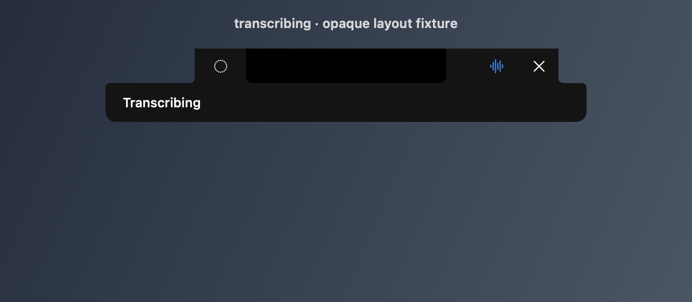
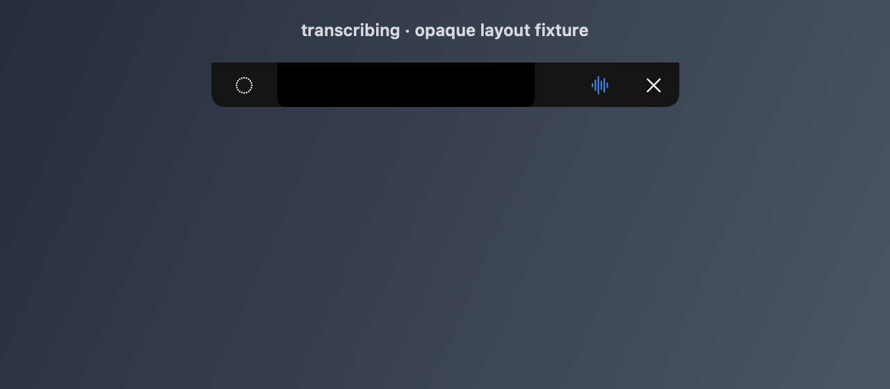
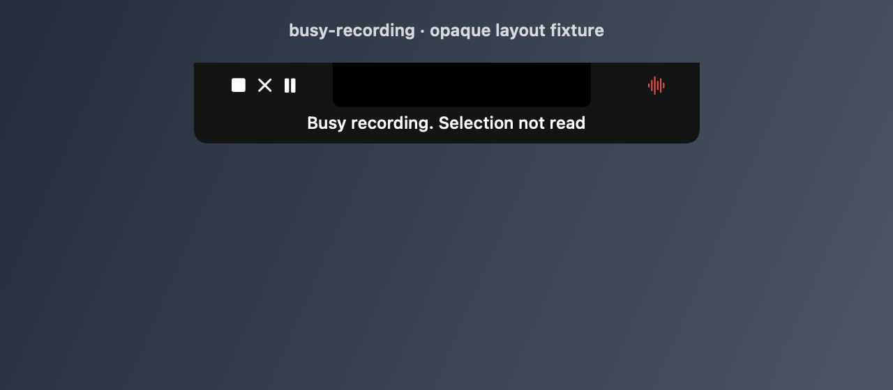
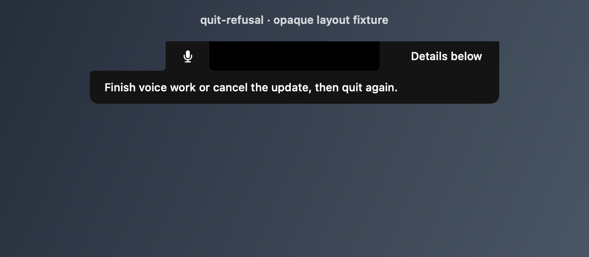
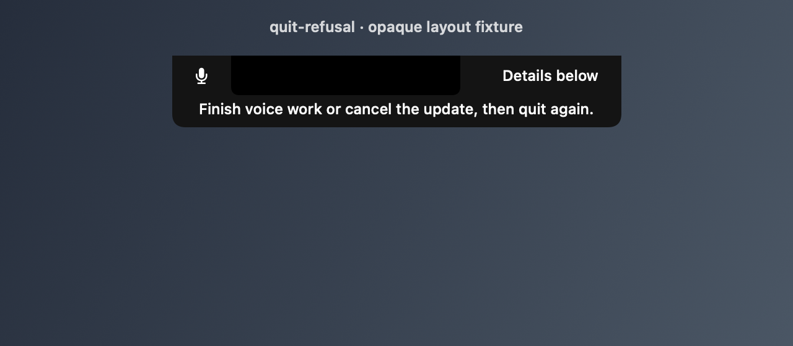
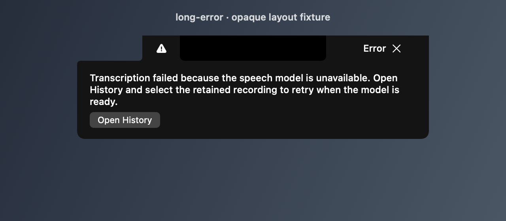
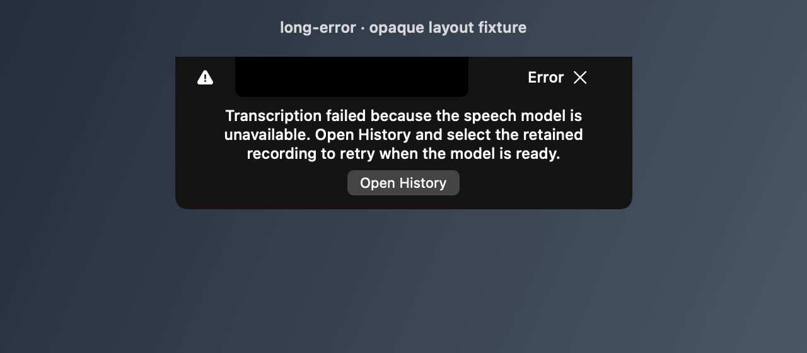

# Compact notch feedback visual QA

Before: main `9e5355bd150cdc65dd838e175c27ccbfd1610946`.
After: this PR's presentation-only change, with normal wing content retained. All images use identical synthetic inputs,
a 185 pt core, a 640 × 280 pt canvas and dark appearance (1280 × 560 PNGs).

Rendered with the existing silent `NotchStatusLab` executable source from
`VoiceLayer-Lab.noindex/2026-10-30/experiments/wave2-ux/ask1-notch/flow-bar/Sources/NotchStatusLab/main.swift`,
with its fixture list narrowed to the four requested cases. Each executable links
only the corresponding revision's VoiceBarUI objects. The same shared feedback
view used by BarView draws the status/error text. The busy-selection fixture uses
the harness's existing compact note renderer before and the shared production
compact note renderer after.

These are offscreen layout fixtures with an opaque material substitute and
synthetic top-row controls; they do not prove installed glass rendering or live
app behavior. No VoiceState, audio, microphone, daemon, sockets or app activation
is involved. The installed VoiceBar and `/Applications` were untouched.

| Case | Before | After |
| --- | --- | --- |
| Transcribing |  |  |
| Busy recording. Selection not read |  |  |
| Quit refusal |  |  |
| Long error |  |  |

GIF: none: no animation or interaction changed.

## Swift verification

| Run | Tests | Skipped | Failures |
| --- | ---: | ---: | ---: |
| Immutable main d500e4ee, all VoiceBarUITests | 1758 | 65 | 0 |
| Branch, all VoiceBarUITests | 1760 | 65 | 0 |
| Branch, focused feedback/layout/hit-gate suites | 69 | 1 | 0 |

No new failure names. The 14 NotchStatusFeedbackTests include a rendered, OCR-independent two-line quit-refusal check.
Full command: `swift test --package-path <revision>/flow-bar --scratch-path <isolated-build> --filter VoiceBarUITests`.
Focused filter: `NotchStatusFeedbackTests|NotchTransientNoteLayoutTests|BarViewClickabilityTests|NotchNoteMorphGeometryTests|VoiceBarPanelHitGateTests`.
The glass-readability probe skips when offscreen text contrast is unavailable.
The first focused run had one new-test failure: the quit refusal fits on one line
at a 185 pt core. Its wrapping fixture now uses a 120 pt core; final runs above
include that correction. The initial receipt remains in the local build area.
